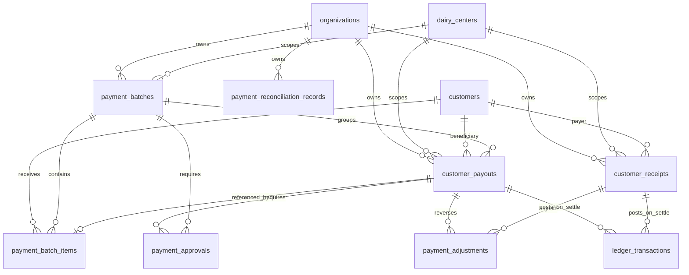

# Payment & Reconciliation Database Data Model

## 1. Overview

The Payment and Reconciliation data model (Migration `014_customer_payouts_batches_and_reconciliation.sql`) adds 7 tables and 8 atomic stored procedures to the DFarm PostgreSQL architecture. It seamlessly integrates with the existing Customer Subledger (`customer_ledger_accounts`, `ledger_transactions`, `ledger_entries`) and preserves all historical collection and billing immutability guarantees.

---

## 2. Entity-Relationship Diagram

---

## 3. Data Dictionary

### 3.1 `customer_payouts`
Stores individual farmer payouts (Dairy Pays Customer).

| Column | Type | Constraints | Description |
| :--- | :--- | :--- | :--- |
| `id` | UUID | PRIMARY KEY, DEFAULT gen_random_uuid() | Payout unique identifier |
| `organization_id` | UUID | NOT NULL, FK -> organizations(id) | Tenant scoping |
| `center_id` | UUID | NOT NULL, FK -> dairy_centers(id) | Center isolation |
| `customer_id` | UUID | NOT NULL, FK -> customers(id) | Beneficiary customer |
| `batch_id` | UUID | NULLABLE, FK -> payment_batches(id) | Parent batch reference |
| `amount` | NUMERIC(12,2)| NOT NULL, CHECK (amount > 0) | Payout monetary value |
| `currency` | VARCHAR(3) | NOT NULL, DEFAULT 'INR' | Currency code |
| `direction` | VARCHAR(30) | NOT NULL, DEFAULT 'DAIRY_PAYS_CUSTOMER' | Direction identifier |
| `payment_method` | VARCHAR(30) | NOT NULL (CASH, BANK_TRANSFER, UPI, etc.) | Disbursement method |
| `status` | VARCHAR(30) | NOT NULL, DEFAULT 'PENDING_APPROVAL' | State machine status |
| `payment_reference` | VARCHAR(120) | NULLABLE | External bank UTR / cheque number |
| `source_bill_id` | UUID | NULLABLE, FK -> billing_statements(id) | Associated bill reference |
| `idempotency_key` | VARCHAR(128) | NOT NULL, UNIQUE | Deduplication key |
| `bank_account_mask` | VARCHAR(30) | NULLABLE | Masked account (`XXXX-XXXX-1234`) |
| `bank_ifsc` | VARCHAR(20) | NULLABLE | Bank IFSC code |
| `beneficiary_name` | VARCHAR(120) | NULLABLE | Account holder name |
| `created_by` | UUID | NOT NULL, FK -> users(id) | Maker user |
| `approved_by` | UUID | NULLABLE, FK -> users(id) | Checker user |
| `settled_at` | TIMESTAMPTZ | NULLABLE | Timestamp of final settlement |

### 3.2 `customer_receipts`
Stores customer debt repayments (Customer Pays Dairy).

| Column | Type | Constraints | Description |
| :--- | :--- | :--- | :--- |
| `id` | UUID | PRIMARY KEY, DEFAULT gen_random_uuid() | Receipt unique identifier |
| `organization_id` | UUID | NOT NULL, FK -> organizations(id) | Tenant scoping |
| `center_id` | UUID | NOT NULL, FK -> dairy_centers(id) | Center isolation |
| `customer_id` | UUID | NOT NULL, FK -> customers(id) | Repaying customer |
| `amount` | NUMERIC(12,2)| NOT NULL, CHECK (amount > 0) | Received monetary value |
| `currency` | VARCHAR(3) | NOT NULL, DEFAULT 'INR' | Currency code |
| `direction` | VARCHAR(30) | NOT NULL, DEFAULT 'CUSTOMER_PAYS_DAIRY' | Direction identifier |
| `payment_method` | VARCHAR(30) | NOT NULL (CASH, UPI, BANK_TRANSFER, etc.) | Tender method |
| `status` | VARCHAR(30) | NOT NULL, DEFAULT 'PENDING_CLEARANCE' | Clearance status |
| `receipt_number` | VARCHAR(60) | NOT NULL, UNIQUE | Human-readable voucher code |
| `transaction_reference` | VARCHAR(120) | NULLABLE | Bank/UPI reference number |
| `idempotency_key` | VARCHAR(128) | NOT NULL, UNIQUE | Deduplication key |
| `settled_at` | TIMESTAMPTZ | NULLABLE | Timestamp of confirmed receipt |

### 3.3 `payment_batches` & `payment_batch_items`
- `payment_batches`: Header table tracking aggregate payouts, billing period range, total beneficiaries, and reconciliation status (`UNRECONCILED`, `PARTIALLY_RECONCILED`, `RECONCILED`).
- `payment_batch_items`: Child records linking each beneficiary payout, masked bank account, item status (`PENDING`, `SUBMITTED`, `SETTLED`, `FAILED`), and per-beneficiary failure reason.

### 3.4 `payment_reconciliation_records`
Maintains statement import lines and webhook audit records with matching status (`MATCHED`, `UNMATCHED`, `AMOUNT_MISMATCH`, `DUPLICATE_REFERENCE`, `PARTIALLY_RECONCILED`, `MANUAL_REVIEW_REQUIRED`).

---

## 4. Stored Procedures & Atomic Triggers

1. `create_customer_payout(...)`: Enforces eligible payable balance verification and inserts pending payout.
2. `approve_customer_payout(...)`: Validates separation of duties (`created_by <> approved_by`) and updates status to `APPROVED`.
3. `submit_customer_payout(...)`: Dispatches payout for banking settlement without modifying ledger.
4. `settle_customer_payout(...)`: Executes double-entry subledger posting (Debit Customer Payable / Credit Cash & Bank) and records sync event.
5. `reverse_customer_payout(...)`: Reverses a settled payout with compensatory balanced journal entries.
6. `create_customer_receipt(...)` & `settle_customer_receipt(...)`: Records customer debt repayment and updates customer ledger liability balance.
