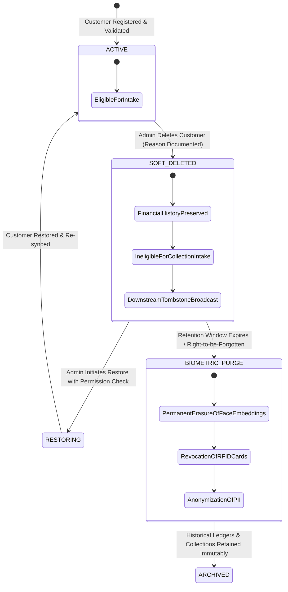

# DFarm: Soft Delete, Restore & Biometric Data Erasure Architecture

This document specifies the lifecycle policies, data integrity rules, audit requirements, and privacy compliance protocols governing customer soft deletion, administrative restoration, and permanent biometric template erasure across the DFarm ecosystem.

---

## 1. Soft Delete & Restoration Lifecycle



---

## 2. Customer Soft-Delete Design

### 2.1 Financial Record Immutability
Under dairy business accounting rules, historical milk collection records, daily slips, customer ledger debits/credits, monthly billing statements, and payment disbursement logs **must never be physically deleted or cascade-deleted** when a customer is removed. Physical deletion would destroy financial reconciliation and tax compliance.

### 2.2 Schema Columns for Soft Deletion
The `customers` table includes:
- `is_deleted`: `BOOLEAN DEFAULT FALSE`
- `deleted_at`: `TIMESTAMPTZ NULL`
- `deleted_by`: `UUID FK -> users.id`
- `deletion_reason`: `TEXT NOT NULL` (Mandatory business justification, e.g. "Farmer left cooperative", "Duplicate entry corrected", "Farmer deceased")
- `version`: `BIGINT NOT NULL DEFAULT 1` (Incremented on every mutation to support optimistic concurrency control)

### 2.3 Deletion Propagation Workflow
1. An administrator with `ADMIN` privileges requests customer deletion via the Admin Web Dashboard, submitting a mandatory reason code.
2. The central database executes an atomic update:
   - Sets `customers.is_deleted = TRUE`, `status = 'SOFT_DELETED'`, and populates `deleted_at`, `deleted_by`, and `deletion_reason`.
   - Sets `rfid_cards.status = 'REVOKED'` and `rfid_cards.revoked_at = NOW()`.
   - Appends a tombstone record to `sync_tombstones`.
3. Edge collection counter terminals receive the tombstone during the next pull synchronization cycle.
4. The local SQLite store updates its local replica, immediately revoking the customer's eligibility for collection intake and removing the facial template from the active matching memory index.

---

## 3. Administrative Restore Workflow

If a customer was marked deleted erroneously or rejoins the collection center:
1. **Authorization Gate:** Only users with verified `SUPER_ADMIN` or `DAIRY_DIRECTOR` credentials can trigger customer restoration. Regular collection supervisors cannot restore deleted accounts.
2. **Reactivation Transaction:**
   - Clears `is_deleted` (`FALSE`), sets `deleted_at = NULL`, `deleted_by = NULL`, and transitions status to `ACTIVE`.
   - Increments `version`.
   - Emits a `CUSTOMER_RESTORED` sync event.
3. **Biometric & RFID Re-validation:**
   - If biometric templates have not been permanently purged, the face template is re-activated in the sync cache.
   - If the biometric template was purged under privacy retention policies, the restored customer is placed in `PENDING_FACE_ENROLLMENT` status, requiring re-enrollment before face identification is permitted.

---

## 4. Biometric Data Retention & Permanent Erasure Protocol

### 4.1 Strict Privacy Boundary: Soft Delete $\ne$ Indefinite Biometric Retention
While financial ledger records must be preserved indefinitely for accounting auditability, biometric data (facial embedding vectors) constitutes sensitive personal information and cannot be legally retained indefinitely following customer offboarding.

### 4.2 Erasure Timeline & Rules
- **Immediate Edge Invalidation:** Upon receiving a customer soft-delete event, edge collection counters immediately delete the associated 512D embedding vector from local RAM indices and local SQLite storage.
- **Grace Period (Configurable 30–90 Days):** The encrypted cloud template in `face_enrollments` is retained in a dormant, non-searchable state for a grace period to permit accidental deletion recovery.
- **Permanent Cryptographic Erasure:** Following expiration of the grace period or upon explicit farmer request (Right-to-be-Forgotten):
  1. The row in `face_enrollments` is hard-deleted from PostgreSQL.
  2. The AES-256 initialization vector and auth tag are purged, making any historical backup unrecoverable.
  3. A permanent, irreversible audit record is logged:
     ```json
     {
       "event": "BIOMETRIC_PERMANENT_ERASURE",
       "customer_uuid": "c3a9d201-...",
       "erased_by": "system_retention_worker",
       "timestamp": "2026-12-15T04:00:00Z"
     }
     ```
  4. The financial ledger and collection tables remain untouched, preserving full accounting integrity.

