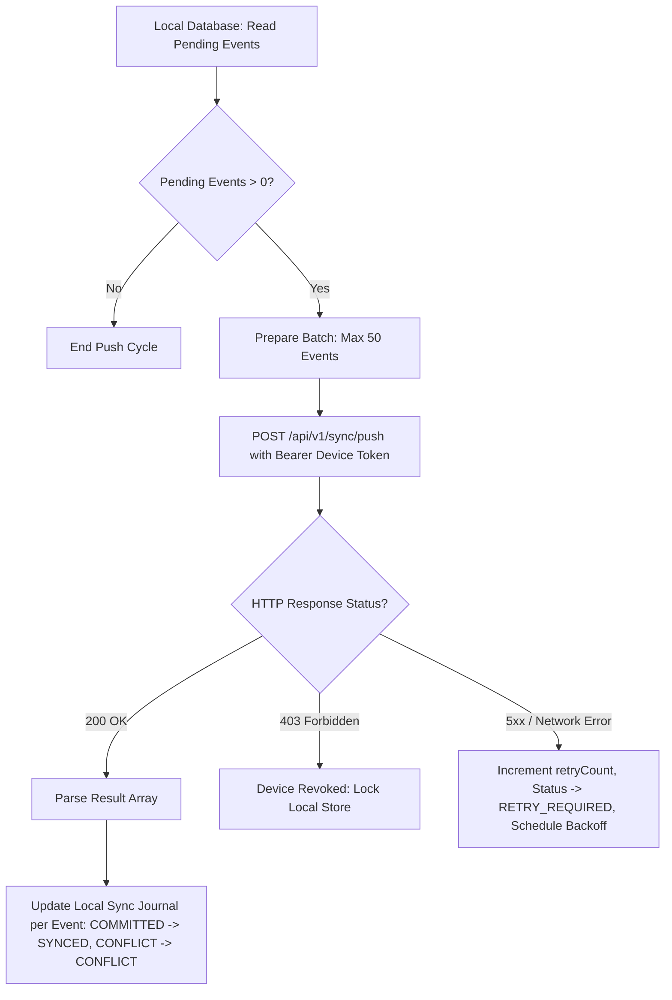
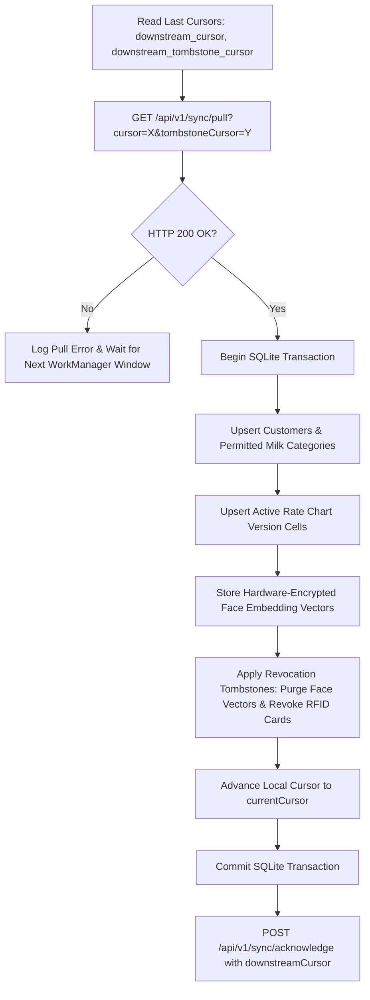

# DFarm: Offline-First Architecture & Synchronization Engine

## 1. Architectural Philosophy

Rural dairy collection operations in Maharashtra operate under harsh physical realities: intermittent 4G/2G mobile connectivity, power fluctuations, and remote village collection centers. 

The DFarm edge applications (`apps/registration-android` and `apps/collection-app`) follow a strict **Offline-First Reactive Architecture**:
1. **Edge Autonomy:** All critical business actions—farmer registration drafts, biometric identity matching, milk measurement intake, and receipts—commit directly to a local, encrypted SQLite database. Zero network dependency is required to accept milk or capture drafts.
2. **Asynchronous Dual-Phase Sync Engine:** Synchronization runs continuously in the background using Android WorkManager, safely pushing pending events upstream and pulling master catalog updates downstream.
3. **Fail-Closed Security Posture:** Devices maintain a cryptographic freshness window (`max_offline_hours = 72`). If a terminal is isolated beyond this policy window, biometric collections fail closed until an administrative sync is completed.

---

## 2. Upstream Push Pipeline

When connectivity is restored, the `DFarmSyncEngine` pushes pending events in sequential, atomic batches:



### Batching & Idempotency Rules
- Maximum batch size: 50 events per HTTP payload.
- Every event carries an immutable client-generated UUID `idempotencyKey`.
- Server uses PostgreSQL `SAVEPOINT` per event, allowing partial successes where valid events are committed while invalid events are recorded in `sync_conflict_records` without rolling back the entire batch.

---

## 3. Downstream Pull Pipeline



---

## 4. Android WorkManager Implementation

Persistent background synchronization is managed by `DFarmSyncWorker` via Android Jetpack `WorkManager`.

### Constraints & Scheduling Strategy
```kotlin
val constraints = Constraints.Builder()
    .setRequiredNetworkType(NetworkType.CONNECTED)
    .setRequiresBatteryNotLow(false)
    .build()

val syncWorkRequest = PeriodicWorkRequestBuilder<DFarmSyncWorker>(
    repeatInterval = 15,
    repeatIntervalTimeUnit = TimeUnit.MINUTES
)
    .setConstraints(constraints)
    .setBackoffCriteria(
        BackoffPolicy.EXPONENTIAL,
        WorkRequest.MIN_BACKOFF_MILLIS, // 10 seconds
        TimeUnit.MILLISECONDS
    )
    .addTag("dfarm_sync_engine")
    .build()

WorkManager.getInstance(context).enqueueUniquePeriodicWork(
    "DFarmPeriodicSyncWork",
    ExistingPeriodicWorkPolicy.KEEP,
    syncWorkRequest
)
```

### Key Operational Policies
1. **Network Constraint:** Sync runs strictly when `NetworkType.CONNECTED` is satisfied (Wi-Fi, 4G, 3G).
2. **Foreground Fallback ("Sync Now"):** Because Android Doze mode may defer periodic background workers by several minutes, a manual foreground "Sync Now" button is exposed in the application toolbar, triggering an immediate one-time `OneTimeWorkRequestBuilder<DFarmSyncWorker>()` execution.
3. **No Duplicate Workers:** Using `ExistingPeriodicWorkPolicy.KEEP` prevents thrashing and guarantees a single singleton worker instance.

---

## 5. Offline Customer Registration Workflow

1. **Local Draft Creation:**
   - Registration officer fills farmer details (name, mobile, address, bank accounts, permitted categories).
   - Generates client UUID (`local_id`).
   - Inserts draft into `registration_drafts` with `sync_status = 'LOCAL_ONLY'`.
   - Enqueues event into `registration_sync_events` with `sync_status = 'PENDING_SYNC'`.
2. **Provisional State:**
   - Locally created customers cannot be used for milk intake on collection terminals until synchronized and validated by the cloud.
3. **Cloud Reconciliation:**
   - Upon connection, the registration event is pushed to `POST /api/v1/sync/push`.
   - Server checks phone number uniqueness in `customers`.
   - If unique, creates canonical row with status `ACTIVE`.
   - If collision detected, server records `sync_conflict_records` with `conflict_reason = 'DUPLICATE_MOBILE_NUMBER'`.
   - Client receives canonical status and updates local draft.

---

## 6. Restart & Crash Recovery Guarantees

- **WAL Mode Durability:** SQLite Write-Ahead Logging (`PRAGMA journal_mode=WAL`) ensures all writes are committed to disk before returning from helper methods.
- **Atomic Transactions:** Multi-row mutations execute inside `db.beginTransaction() ... db.setTransactionSuccessful() ... db.endTransaction()`.
- **Application Kill Safety:** If the Android OS terminates the application process mid-intake or during pending sync, uncommitted memory state is safely discarded while the committed SQLite journal remains 100% intact and recoverable upon next launch.

