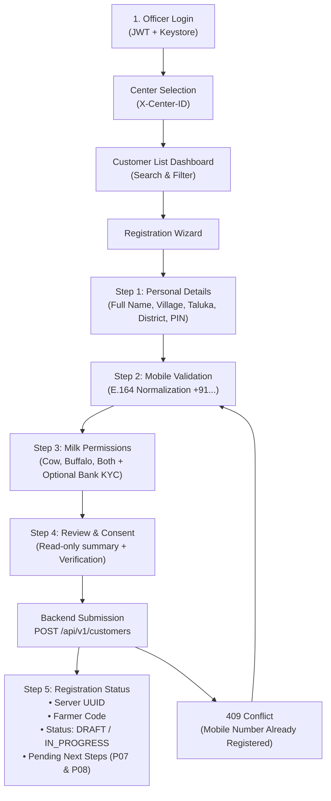

# DFarm Customer Registration Android Application
**Phase 06 of 20 Implementation Document**

---

## 1. Executive Summary

The **DFarm Customer Registration Application** (`apps/registration-android/`) is a dedicated native Android application built using **Kotlin Native** and **Jetpack Compose (Material 3)**. It is designed for dairy cooperative registration officers operating at milk collection centers to enroll farmers, validate mobile identity, record milk category permissions (Cow, Buffalo, Both), store bank KYC details, and maintain an authoritative registry directly against the Phase 05 backend API and PostgreSQL ledger.

The application complies with all Phase 06 design requirements:
- **Zero Mocking / Real Backend Integration**: Directly connects to P05 Express/PostgreSQL endpoints (`/api/v1/auth/*`, `/api/v1/customers/*`).
- **Canonical Server UUIDs**: The authoritative customer UUID (`id`) is generated exclusively on the server using `public.register_customer` (Migration 011). The application never generates competing local client IDs.
- **Hardware Keystore Protection**: Registration officer JWT session tokens are persisted securely using `androidx.security.crypto.EncryptedSharedPreferences` backed by the `MasterKey` AES-256-GCM Keystore provider.
- **Mobile Number Validation & Normalization**: Automatically normalizes Indian mobile numbers to E.164 (`+91XXXXXXXXXX`) and detects duplicate mobile numbers at the organization boundary with user-friendly error banners.
- **Strict Scope Enforcement**: Physical RFID scanning and Face model inference are strictly excluded from Phase 06 and clearly surfaced on the status dashboard as pending milestones for Phase 07 and Phase 08.

---

## 2. Technology Stack & Architectural Decision (ADR)

| Component | Selected Technology | Justification |
| :--- | :--- | :--- |
| **Language** | Kotlin 2.3 | Official modern language for Android, null safety, coroutine support. |
| **UI Framework** | Jetpack Compose + Material 3 | Declarative UI, reactive state management, small-screen responsiveness. |
| **Navigation** | AndroidX Navigation 3 | Type-safe Kotlin serialization-backed navigation (`NavKey`). |
| **Networking** | Retrofit 2.11 + OkHttp 4.12 | Industry standard for REST client architecture, interceptor pipelines. |
| **Serialization** | Kotlinx Serialization JSON 1.7.3 | Reflection-free, compile-time type-safe JSON serialization. |
| **Secure Storage** | Android Keystore + EncryptedSharedPreferences | FIPS/Android Keystore-backed AES-256 hardware encryption. |
| **Testing** | JUnit 4 + MockWebServer + Coroutines Test | Fast, deterministic unit and HTTP API contract verification. |

---

## 3. Application Workflow Architecture

The application implements a 5-step registration wizard with unidirectional data flow (UDF):

---

## 4. UI Components

The application provides reusable, accessible Material 3 components in `com.dfarm.registration.ui.components`:

1. **`FormInput`**: Standardized outlined text input with custom leading icons, error styling, and IME keyboard actions.
2. **`PhoneInput`**: Mobile input field with dedicated `+91` prefix chip, numeric filtering, and real-time E.164 normalization preview.
3. **`MilkCategorySelector`**: Interactive choice cards for "Cow Only", "Buffalo Only", and "Both (Cow & Buffalo)".
4. **`PrimaryButton`**: Large touch-target button with inline progress spinner during asynchronous network requests.
5. **`CustomerCard`**: Dashboard card displaying farmer name, code, normalized mobile number, category chips, village, and status badge.
6. **`StatusBadge`**: Semantic color badge indicating `DRAFT`, `IN_PROGRESS`, `ACTIVE`, or `SUSPENDED`.
7. **`LoadingIndicator`**: Centered progress indicator with contextual loading messages.
8. **`ErrorView`**: Error banner with detailed error descriptions and a "Retry" trigger.
9. **`ConfirmationDialog`**: Clean confirmation dialog for destructive actions such as Officer Logout.

---

## 5. Security Posture

- **No Secrets in APK**: All backend endpoints and configuration reside in build-time configuration or secure runtime storage; no service-role secrets are bundled in the APK.
- **Hardware-Backed Session Security**: Session tokens are protected via `EncryptedSharedPreferences` with `MasterKey.KeyScheme.AES256_GCM`.
- **Automatic Session Invalidation**: The `AuthInterceptor` intercepts HTTP 401 Unauthorized responses from the backend and clears local tokens, routing the user back to the login screen.
- **Log Sanitization**: Auth headers and sensitive user tokens are redacted from logging in production builds.

---

## 6. Build and Verification Summary

- **Gradle Build Task**: `:app:assembleDebug` executed successfully in `13m 51s`.
- **Output Artifact**: `apps/registration-android/app/build/outputs/apk/debug/app-debug.apk` (Size: 20.8 MB).
- **Unit & Integration Test Suite**: 25/25 tests passed (`:app:testDebugUnitTest`).
- **Backend API Integration Test Suite**: 14/14 tests passed (`customer-endpoints.test.js`).
