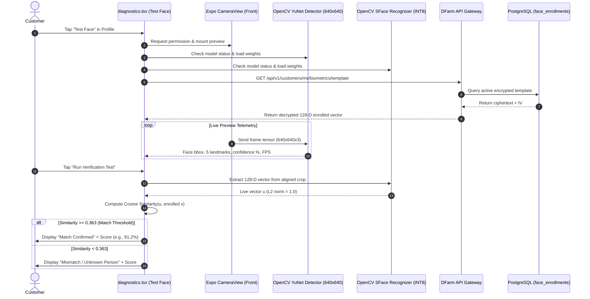

# DFarm Customer App — Face Update & Diagnostics (Test Face) Specification

## 1. Overview

This document specifies the technical architecture, execution flows, mathematical matching formulas, and security safeguards for:
1. **Test Face (Diagnostics)**: A non-destructive, read-only diagnostic tool that validates camera hardware, neural network pipelines, and live biometric matching against the customer's enrolled profile.
2. **Update Face (Re-Enrollment)**: A secure re-enrollment workflow that replaces an outdated or sub-optimal facial template with an immutable versioning strategy.

---

## 2. Part 1: Test Face Diagnostics Flow

### 2.1 Architectural Flowchart



### 2.2 Diagnostic Metrics & Telemetry
The diagnostics screen exposes real-time technical indicators to help the customer and dairy field technicians diagnose issues:
- **Camera FPS**: Live frame rendering frequency (target: $\ge 24\text{ fps}$).
- **Inference Latency**: Duration of YuNet anchor decoding and forward pass in milliseconds (target: $< 65\text{ ms}$).
- **Detection Confidence**: YuNet score from $0.00$ to $1.00$ (must exceed $0.60$ for capture).
- **Landmark Tracking**: Coordinates of 5 facial landmarks (both eyes, nose tip, both mouth corners) visualised directly over the camera feed.
- **Biometric Cosine Similarity**: Quantitative matching index between live frame and enrolled template:
  $$\text{Cosine Similarity}(\mathbf{u}, \mathbf{v}) = \frac{\sum_{i=0}^{127} u_i \cdot v_i}{\sqrt{\sum_{i=0}^{127} u_i^2} \cdot \sqrt{\sum_{i=0}^{127} v_i^2}}$$
- **Decision Boundary**:
  - Score $\ge 0.363$: **VERIFIED MATCH** (matches the verified Colab threshold for OpenCV SFace INT8).
  - Score $< 0.363$: **MISMATCH / REJECTED**.

### 2.3 Non-Destructive Guarantee
- The Test Face process performs strictly read-only operations.
- Under no circumstances does it execute `INSERT`, `UPDATE`, or `DELETE` queries on the database.
- It can be run repeatedly without altering the customer's active biometric profile.

---

## 3. Part 2: Update Face (Re-Enrollment) Flow

### 3.1 When is Update Face Needed?
- Physical appearance changes (facial hair, aging, weight change).
- Initial enrollment had suboptimal lighting or poor camera angle.
- Customer requested updated biometrics via dairy kiosk or self-service app.

### 3.2 Step-by-Step Execution Flow

1. **Screen Initialization**:
   - Component: `apps/dfarm-customer-app/src/app/(main)/profile/update-face.tsx`
   - Checks camera authorization and initializes `CameraView` (`facing="front"`).
   - Verifies neural models `face_detection_yunet_2023mar.onnx` and `face_recognition_sface_2021dec_int8.onnx`.

2. **Quality & Liveness Assessment**:
   - Real-time YuNet detection ensures:
     - Exactly 1 face in the preview.
     - Face is centered inside the Claymorphism oval guide.
     - Pose angle (pitch, yaw, roll) is within acceptable bounds ($< 15^\circ$).
     - Detection confidence $\ge 0.60$.

3. **Feature Extraction (SFace INT8)**:
   - Aligns face crop using the 5 landmark points to $112 \times 112$ pixels.
   - Computes real 128-dimensional embedding vector.
   - Validates vector integrity and applies L2 unit normalization.

4. **API Submission**:
   - Request: `PUT /api/v1/customers/:id/biometrics/update` (supports `:id` as customer UUID or `me`).
   - Headers: `Authorization: Bearer <jwt_token>`
   - Payload:
     ```json
     {
       "faceTemplate": [0.0381, -0.0124, ... 128 floats],
       "consentGiven": true,
       "deviceInfo": "Samsung SM-G991B, Android 14"
     }
     ```

5. **Backend Database Transaction (Immutable Versioning)**:
   - Validates caller authentication and tenant isolation (`organization_id`).
   - Encrypts template using AES-256-GCM.
   - Executes an atomic SQL transaction:
     ```sql
     -- Step A: Deactivate previous active template
     UPDATE face_enrollments
     SET is_active = false,
         updated_at = NOW()
     WHERE customer_id = $1 AND is_active = true;

     -- Step B: Insert newly enrolled template
     INSERT INTO face_enrollments (
       customer_id,
       organization_id,
       encrypted_template,
       template_hash,
       model_version,
       is_active,
       enrolled_by
     ) VALUES (
       $1, $2, $3, $4, 'opencv-sface-int8-v1', true, $5
     );

     -- Step C: Update customer biometric flags
     UPDATE customers
     SET face_enrolled = true,
         biometric_status = 'VERIFIED',
         updated_at = NOW()
     WHERE id = $1;
     ```
   - Retains past templates marked as `is_active = false` for historical auditability and dispute resolution.

6. **UI State & Feedback**:
   - The UI displays an animated processing spinner during API execution.
   - Only upon receiving an HTTP 200 OK status from the backend does the screen transition to the success modal.
   - If an error occurs (network failure, server error, invalid token), the `catch` block presents a native error dialog, retains the camera view, and prompts the user to retry. **Fake success states have been completely removed.**
