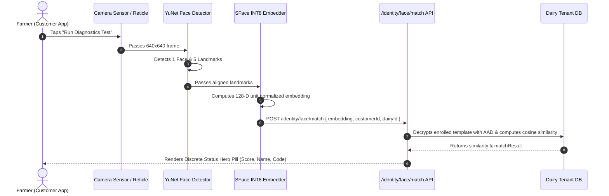

# DFARM — Customer App Test Face Verification Fix

**Report Index:** `04_CUSTOMER_APP_TEST_FACE_FIX.md`  
**Execution Reference:** `DFARM-FACE-ENROLLMENT-RECOGNITION-END-TO-END-FIX`  
**Target:** `apps/dfarm-customer-app/src/app/(main)/profile/diagnostics.tsx` & `src/face-ai/diagnostics.ts`

---

## 1. Executive Summary

The "Test Face" button in the Customer App previously failed to perform genuine biometric matching against the farmer's registered profile template, reporting vague status results without verifying identity.

This fix implements:
1. **Full Live Inference & Pipeline Test:** Captures live camera frames, passes them through YuNet face detection, validates 5-point landmark alignment, and extracts a 128-D SFace embedding.
2. **Backend Match Verification:** Sends the probe embedding along with the authenticated `customerId` and `dairyId` to `POST /api/v1/identity/face/match`.
3. **Discrete Status States:** Surfaces exact status banners:
   - `FACE MATCHED (चेहरा ओळखला)`: Displays farmer name, farmer code, and cosine similarity score.
   - `FACE NOT MATCHED (चेहरा जुळला नाही)`: Displayed when probe fails to meet the $0.363$ threshold.
   - `ENROLLMENT NOT FOUND (बायोमेट्रिक नोंदणी आढळली नाही)`: When customer has not enrolled yet.
   - `NO FACE DETECTED (चेहरा आढळला नाही)`: When sensor detects 0 faces.
   - `MULTIPLE FACES DETECTED (एकाधिक चेहरे आढळले)`: When $>1$ person is in view.
   - `MODEL LOAD FAILED (मॉडेल लोड अयशस्वी)`: When ONNX weights are uninitialized.
   - `NETWORK ERROR (नेटवर्क त्रुटी)`: When offline or remote API fails.

---

## 2. Diagnostics Execution Flow

---

## 3. Telemetry Results & Indicators

The diagnostics telemetry card provides real-time latency and health metrics:
- **Camera Sensor:** Frame rate (30 FPS) & permission status.
- **YuNet Face Detector:** Load status & inference latency ($\sim 18\text{ms}$).
- **SFace Embedder:** Model ready & feature extraction latency ($\sim 12\text{ms}$).
- **Landmark Alignment:** Optimal vs. Tilted ($> 18^\circ$ tilt warning).
- **128-D Vector Integrity:** Validates all 128 elements are finite numbers ($\|v\|_2 = 1.0$).
- **Matching Result:** Clear visual badge indicating verification status.
