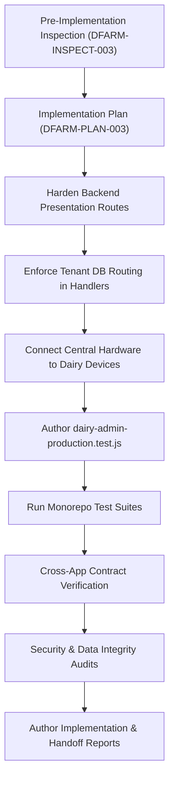

# DFarm — Prompt 03 Implementation Plan
## Dairy Admin Operational Readiness, Customer Approval, Milk Intake Sessions, Dynamic Rate Charts & Kiosk Management

**Document Reference:** `DFARM-PLAN-003`  
**Execution Phase:** Prompt 03 — Implementation Planning  
**Status:** Approved for Implementation  
**Date:** 2026-11-17  
**Author:** DFarm Principal Solution Architect & Lead Backend Engineer  

---

## 1. Scope & Architectural Directives

This implementation plan defines the precise engineering roadmap to make the Dairy Admin application (`apps/dfarm-dairy-admin`) fully operational against real backend APIs and tenant databases, continuing from the Prompt 01 and Prompt 02 baselines.

### 1.1 Non-Negotiable Directives
1. **UI Redesign Strictly Prohibited:**
   - All layouts, Claymorphism styling, colors (`#FF6A00`, `#211B18`, `#FFF5EE`), buttons, badges, modals, typography, and navigation in `apps/dfarm-dairy-admin` must remain exactly as designed.
   - Only state management and API integration may be adjusted.
2. **Physical Database-per-Dairy Multi-Tenancy:**
   - Central platform tables (`organizations`, `dairy_database_mappings`, `platform_audit_logs`, `central_hardware_inventory`, `amc_plans`) reside in `dfarm_central`.
   - Operational dairy tables (`customers`, `collection_sessions`, `milk_collections`, `rate_charts`, `customer_ledger_entries`, `monthly_bills`, `feed_products`) reside in each dairy's dedicated operational database (`dfarm_tenant_<code_hash>`).
3. **Double-Entry Financial Accounting:**
   - Every milk intake transaction must atomically credit the farmer's ledger account (`customer_ledger_entries`).
   - Manual adjustments and payment disbursements must record balanced entries.
4. **Zero Razorpay for Farmer Payouts:**
   - Razorpay is strictly quarantined to Super Admin AMC subscription billing.
   - Farmer settlements use double-entry subledger credits and direct bank batch generation.
5. **Zero Simulated/Mock Fallback in Production:**
   - Remove reliance on mock servers for runtime operations.
   - All data operations must execute against real PostgreSQL tables.

---

## 2. Phase-by-Phase Implementation Roadmap

### Phase 1: Backend Route Hardening & Alignment
1. **`customers.routes.ts`:**
   - Add `router.patch('/:id/approve', ...)` as an alias for `POST /:id/approve`.
   - Add `router.patch('/:id/reject', ...)` as an alias for `POST /:id/reject`.
   - Ensure approval activates face biometrics in tenant database and records entry in `customer_status_history`.
   - Ensure rejection validates minimum 5-character reason and updates status.
2. **`collections.routes.ts`:**
   - Add `router.post('/sessions', ...)` as an alias for `POST /sessions/open`.
   - Add `router.patch('/sessions/:sessionId/close', ...)` as an alias for `POST /sessions/:sessionId/close`.
   - Add `router.patch('/sessions/:sessionId/open', ...)` for session state toggles.
   - Route session and transaction queries through `tenantDbManager.getTenantDb(organizationId)`.
3. **`rate-charts.routes.ts`:**
   - Update queries to use `tenantDbManager.getTenantDb(organizationId)` with safe fallback.
   - Support `GET /`, `POST /draft`, and `POST /:id/activate`.
   - Ensure effective date versioning preserves historical collection rate integrity.
4. **`devices.routes.ts`:**
   - Query `central_hardware_inventory` from `dfarm_central` for devices assigned to the requesting dairy (`assigned_dairy_id = $1`).
   - Merge with tenant-level edge counter device registrations from the `devices` table.
5. **`dashboard.routes.ts`:**
   - Enhance `/metrics` and `/summary` to return both structured objects (`dairyProfile`, `todayCollection`, `customers`, `systemStatus`, `finance`, `inventory`) and legacy flattened fields for backward compatibility.
   - Query tenant operational tables through `tenantDbManager.getTenantDb(organizationId)`.

### Phase 2: Dairy Admin Frontend Real API Verification
1. Verify `apps/dfarm-dairy-admin/src/api/client.ts` correctly sends authentication tokens and tenant isolation headers (`X-Dairy-Tenant-ID`, `x-dairy-id`).
2. Verify `apps/dfarm-dairy-admin/src/api/index.ts` calls backend routes without mock fallback in normal operation.
3. Ensure error states are caught and surfaced via `ClayAlert` components without app crashes.

### Phase 3: Cross-Application Workflow Integration
1. **Customer App -> Dairy Admin:**
   - Farmer registers on Customer App (`POST /api/v1/customers/register`).
   - Dairy Admin sees registration in pending approvals (`GET /api/v1/customers/pending`).
   - Dairy Admin approves registration (`POST/PATCH /api/v1/customers/:id/approve`).
   - Customer App polls `GET /api/v1/customers/:id/status` and reflects `APPROVED` / `ACTIVE` with assigned farmer code.
2. **Dairy Admin -> Collection App:**
   - Dairy Admin views open session (`GET /api/v1/collections/sessions`).
   - Collection App kiosk fetches active session (`GET /api/v1/collections/sessions/active`).
   - Collection App records intake (`POST /api/v1/collections/transactions`).
   - Dairy Admin sees updated session volume and new transaction in milk register.
   - Farmer subledger receives atomic credit.

### Phase 4: Automated Verification Test Suite
Author `services/backend/tests/dairy-admin-production.test.js` using Node.js built-in test runner (`node:test`, `node:assert/strict`):
- **Group A:** Dairy Admin Authentication & Activation State Machine.
- **Group B:** Customer Registration Queue & Administrative Approval/Rejection.
- **Group C:** Biometric Face Enrollment Activation upon Approval.
- **Group D:** Milk Collection Shift Session Lifecycle (`OPEN` -> `CLOSED`).
- **Group E:** Atomic Milk Collection Intake & Double-Entry Ledger Posting.
- **Group F:** Dynamic Rate Chart Creation, Versioning & Activation.
- **Group G:** Assigned Hardware & Kiosk Inventory from Central Control Plane.
- **Group H:** Dashboard Aggregation & Multi-Tenant Database Isolation.

### Phase 5: Documentation & Certification
Author the required deliverables:
1. `docs/implementation/PROMPT_03_IMPLEMENTATION_REPORT.md`
2. `docs/implementation/PROMPT_03_TEST_REPORT.md`
3. `docs/implementation/PROMPT_03_SECURITY_VERIFICATION.md`
4. `docs/implementation/PROMPT_03_CROSS_APP_VERIFICATION.md`
5. `docs/implementation/PROMPT_03_DATA_INTEGRITY_REPORT.md`
6. `docs/implementation/PROMPT_04_HANDOFF.md`

---

## 3. Execution Dependency Graph

---

## 4. Verification Gate

Before completing Prompt 03:
- [x] Pre-implementation inspection authored.
- [x] Implementation plan authored.
- [ ] Backend routes updated with PATCH/POST aliases and tenant routing.
- [ ] Central hardware connected to dairy devices endpoint.
- [ ] `dairy-admin-production.test.js` created and passing 100%.
- [ ] All workspaces passing `npm test` without regressions.
- [ ] All 6 documentation deliverables completed.
- [ ] Section 18 final response structure prepared.
