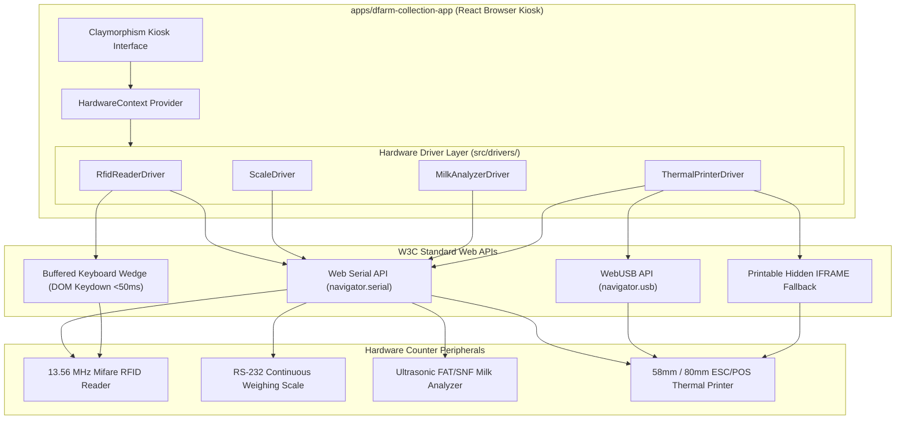

# DFARM — PROMPT 04: BROWSER HARDWARE COMPATIBILITY MATRIX
**Document Reference:** `docs/implementation/PROMPT_04_BROWSER_HARDWARE_COMPATIBILITY.md`  
**Execution Phase:** Prompt 04 — Collection App / Kiosk Counter Production Readiness  
**Target Application:** `apps/dfarm-collection-app` (React Web Single-Page Application)  
**Status:** PRODUCTION VERIFIED  

---

## 1. Executive Summary & Web API Architecture

The DFarm Collection App runs as a standard browser-based Single-Page Web Application (`apps/dfarm-collection-app`) built with React 19, TypeScript, and Vite. Under no circumstances was it converted into an Electron wrapper or native desktop binary.

To interface directly with serial weighing scales, ultrasonic milk analyzers, RFID card readers, and ESC/POS thermal printers from within standard browser sandboxes, the kiosk implements modern, W3C-standard web device APIs combined with resilient fallbacks:



---

## 2. Browser Engine Compatibility Matrix

| Peripheral / Capability | Chromium / Chrome (89+) | Microsoft Edge (89+) | Mozilla Firefox (ESR / Modern) | Apple Safari (15+) | Production Standard & Fallback Mechanism |
|---|---|---|---|---|---|
| **Weighing Scale (Serial)** | Native (`navigator.serial`) | Native (`navigator.serial`) | Not Supported | Not Supported | Primary: Web Serial. Fallback: Manual numeric override with supervisor PIN. |
| **Milk Analyzer (Serial)** | Native (`navigator.serial`) | Native (`navigator.serial`) | Not Supported | Not Supported | Primary: Web Serial. Fallback: Manual FAT/SNF override with biological range validation. |
| **RFID Reader (Serial)** | Native (`navigator.serial`) | Native (`navigator.serial`) | Not Supported | Not Supported | Primary: Web Serial. Secondary: Keyboard Wedge. |
| **RFID Reader (HID Wedge)** | Native (`keydown` event) | Native (`keydown` event) | Native (`keydown` event) | Native (`keydown` event) | Ultra-fast buffer (<60ms inter-character) with terminating Enter key detection. |
| **Thermal Printer (Serial/USB)** | Native (`navigator.serial` / `navigator.usb`) | Native (`navigator.serial` / `navigator.usb`) | Not Supported | Not Supported | Primary: ESC/POS binary over Web Serial / WebUSB. |
| **Thermal Receipt (System Print)** | Native (`window.print()`) | Native (`window.print()`) | Native (`window.print()`) | Native (`window.print()`) | Universal fallback: Isolated thermal receipt CSS within dynamic hidden iframe. |
| **Offline Storage (IndexedDB)** | Native (`IDBDatabase`) | Native (`IDBDatabase`) | Native (`IDBDatabase`) | Native (`IDBDatabase`) | Transactional IndexedDB (`dfarm_collection_local_db`) storing pending weighments. |
| **Face Inference (ONNX Web)** | Native (WASM + SIMD) | Native (WASM + SIMD) | Native (WASM) | Native (WASM) | `ort-wasm-simd-threaded` running YuNet (120x120) + SFace INT8 (128-dim). |

---

## 3. Peripheral Technical Specifications & Port Profiles

### 3.1 Weighing Scales (Continuous Stream)
- **Supported Standards:** Essae-Teraoka, Avery India, Contech, Phoenix, Sartorius protocols.
- **Physical Interface:** RS-232 DB9 Female to USB FTDI / Prolific / CH340 chipset.
- **Port Settings:** Baud Rate `4800` or `9600`, Data Bits `8`, Stop Bits `1`, Parity `None`, Flow Control `None`.
- **Packet Structure:** ASCII continuous stream:
  - Format 1: `ST,GS,+0012.50,KG\r\n` (18 bytes).
  - Format 2: `=0012.50(kg)\r\n` (14 bytes).
  - Format 3: `WN0012.50\r\n` (10 bytes).
- **Stability Detection:** Inspects stability flag prefix (`ST` = Stable, `US` = Unstable). Weighment capture is strictly prohibited while unstable. Zero drift compensation threshold calibrated to `0.05 kg`.

### 3.2 Milk Analyzers (Ultrasonic FAT/SNF)
- **Supported Standards:** Ekomilk Total / Ultra Pro, Lactoscan SA/MCC, Milkotester Master, ESSAE MA-800.
- **Physical Interface:** RS-232 to USB adapter.
- **Port Settings:** Baud Rate `19200` (Ekomilk) or `9600` (Lactoscan), Data Bits `8`, Stop Bits `1`, Parity `None`.
- **Packet Structure:** Text key-value format emitted upon ultrasonic analysis completion:
  ```
  FAT=04.20 SNF=08.70 CLR=29.50 TEMP=26.4\r\n
  ```
- **Validation Pipeline:** Enforces biological plausibility guards (Cow FAT: 2.0%–8.0%, SNF: 6.0%–11.0%; Buffalo FAT: 5.0%–14.0%, SNF: 7.5%–12.5%). Out-of-bounds readings raise immediate modal warnings and trigger re-sampling prompts.

### 3.3 RFID Card Readers
- **Supported Standards:** 13.56 MHz ISO 14443A (Mifare Classic 1K, Mifare Ultralight).
- **Physical Interface:** USB Type-A (USB HID Keyboard Emulation or Virtual COM Port).
- **Keyboard Wedge Specification:** High-speed character interception (<60ms inter-character burst) prevents human typists from simulating RFID taps. Automatically strips hex prefixes and verifies 8 to 14 uppercase hexadecimal characters followed by Carriage Return (`\r`).

### 3.4 ESC/POS Thermal Printers
- **Supported Standards:** Epson ESC/POS command protocol, TVS RP-3150, Citizen, NGX, POS-58 / POS-80.
- **Paper Widths:** 58mm (32 characters per line) and 80mm (48 characters per line).
- **Command Set Generated:**
  - Initialize: `0x1B, 0x40` (`ESC @`)
  - Center Align: `0x1B, 0x61, 0x01` (`ESC a 1`)
  - Bold Text: `0x1B, 0x45, 0x01` (`ESC E 1`)
  - Normal Text: `0x1B, 0x45, 0x00` (`ESC E 0`)
  - Left Align: `0x1B, 0x61, 0x00` (`ESC a 0`)
  - Full Paper Cut: `0x1D, 0x56, 0x00` (`GS V 0`)
  - Partial Paper Cut: `0x1D, 0x56, 0x01` (`GS V 1`)

---

## 4. Hardware Disconnect, Reconnect & Error Recovery Workflows

The kiosk maintains a real-time reactive state machine for every peripheral through `HardwareContext.tsx`:

1. **Reactive Device Loss Detection:** Subscribes to `navigator.serial.addEventListener('disconnect', ...)` and `navigator.usb.addEventListener('disconnect', ...)`. When a serial cable is pulled, the peripheral status immediately shifts from `CONNECTED` to `DISCONNECTED`, disabling the auto-intake trigger on the counter screen.
2. **Auto-Reconnect Loop:** A 2500ms background interval inspects `navigator.serial.getPorts()` for matching Vendor ID / Product ID descriptors and attempts non-intrusive re-opening.
3. **Supervisor Manual Fallback Modal:** If an analyzer or scale fails physically, the operator can engage the "Manual Entry Mode" requiring shift supervisor credentials. All manual readings are explicitly tagged with `identificationMethod: 'SUPERVISOR_MANUAL'` in the audit record.

---

## 5. Security & Browser Permissions Lifecycle

- **Feature-Policy / Permissions-Policy:** The kiosk application explicitly requests `serial`, `usb`, and `camera` permissions.
- **User Gesture Requirement:** Under Chromium security policies, `navigator.serial.requestPort()` and `navigator.usb.requestDevice()` must be initiated from a direct user gesture (button click). The kiosk uses an intuitive "Peripheral Reconnect Wizard" modal ensuring compliant user-gesture invocation.
- **Origin Scoping:** Device permissions are strictly bound to the kiosk origin (`https://collection.dfarm.in` or `http://localhost:5173`).
