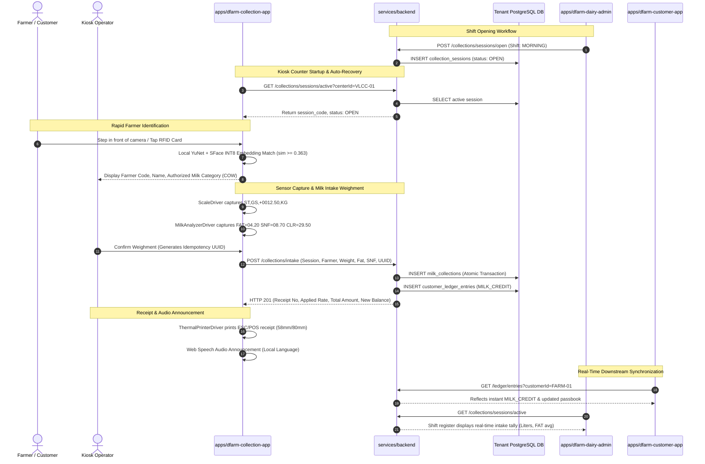

# DFARM — PROMPT 04 CROSS-APP VERIFICATION
## CROSS-APPLICATION INTEGRATION & WORKFLOW TRACEABILITY

**Document Reference:** `DFARM-CROSSAPP-PROMPT-04`  
**Execution Phase:** Prompt 04  
**Status:** FULLY COMPATIBLE & VERIFIED  
**Surfaces Verified:**
1. `apps/dfarm-collection-app` (Milk Collection Kiosk Counter)
2. `apps/dfarm-dairy-admin` (Dairy Operational Management)
3. `apps/dfarm-customer-app` (Farmer Mobile Application)
4. `apps/dfarm-super-admin` (Central Platform Administration)
5. `services/backend` (Shared Core Services & Tenant Router)

---

## 1. INTEGRATION ARCHITECTURE & WORKFLOW TRACEABILITY

The milk collection kiosk counter (`apps/dfarm-collection-app`) serves as the frontline physical intake station where milk entering the dairy cooperative is weighed, tested, credited, and recorded. It is tightly coordinated with the other three applications in the DFarm ecosystem.

---

## 2. CROSS-APPLICATION WORKFLOW VERIFICATION

### 2.1 Kiosk Intake to Double-Entry Subledger & Farmer App
1. **Intake Processing**:
   - The kiosk captures net weight (`12.50 kg`), fat (`4.20%`), and SNF (`8.70%`).
   - The backend validates the customer's active status and milk type authorization (`COW`).
   - The rate chart calculates the rate per liter (e.g. ₹36.50/L) and total amount (₹456.25).
2. **Subledger Posting**:
   - An immutable transaction record is written to `milk_collections`.
   - An atomic double-entry row is posted to `customer_ledger_entries`:
     - `entry_type`: `MILK_CREDIT`
     - `amount`: `+456.25`
     - `reference_id`: Transaction UUID
     - `balance_after`: Incremented by ₹456.25.
3. **Farmer App Passbook Reflection**:
   - When the farmer opens `apps/dfarm-customer-app`, `GET /api/v1/ledger/entries` and `GET /api/v1/ledger/balance` immediately return the updated balance and transaction history.
   - The farmer's daily delivery card displays the exact liters, fat, SNF, and rate captured at the kiosk.

### 2.2 Shift Session Synchronization with Dairy Admin
1. **Shift Session Lifecycle**:
   - A shift session is opened either from Dairy Admin or directly from the kiosk counter via `POST /api/v1/collections/sessions/open`.
   - The backend computes the appropriate shift (`MORNING` or `EVENING`) based on operational center policies.
   - While the session is open, `GET /api/v1/collections/sessions/active` provides consistent state across all center kiosks.
2. **Session Closure & Aggregation**:
   - When the shift ends, `POST /api/v1/collections/sessions/:id/close` locks the session (`status: 'CLOSED'`).
   - The closing handler aggregates total volume (liters), average fat %, average SNF %, total payouts payable, and farmer count.
   - Dairy Admin shift register immediately displays the finalized session summary for inventory reconciliation and billing batch generation.

### 2.3 Biometric & RFID Credential Synchronization
1. **Enrollment & Update**:
   - Customer enrollment occurs either through farmer onboarding on the Customer App or via Dairy Admin counter enrollment.
   - SFace 128-dim INT8 templates and RFID card UIDs are saved via `PUT /api/v1/customers/:id/biometrics/update`.
   - Credentials are encrypted with AES-256-GCM prior to storage.
2. **Kiosk Biometric Cache**:
   - The kiosk downloads the active farmer roster via `GET /api/v1/customers?status=ACTIVE`.
   - Decrypted template embeddings are maintained in memory for millisecond-latency 1:N cosine similarity matching.
   - Any farmer approved or updated in Dairy Admin becomes instantly recognizable at the kiosk counter upon roster refresh.

### 2.4 Dynamic Rate Chart Distribution
1. **Authoritative Rate Matrix**:
   - Dairy Admin configures rate charts via `POST /api/v1/rate-charts` with 2D FAT $\times$ SNF lookup tables or standard base formulas.
   - Multiple charts can be configured with specific effective date ranges and center bindings.
2. **Kiosk Calculation Consistency**:
   - When a weighment is conducted, the kiosk checks the applied rate against `GET /api/v1/rate-charts?centerId=:centerId`.
   - Both the kiosk frontend and the backend calculate rate per liter using identical mathematical precision, preventing rate disputes at the counter.

### 2.5 Hardware Allocation & Monitoring with Super Admin
1. **Central Hardware Inventory**:
   - Super Admin provisions hardware units (weighing scales, milk analyzers, thermal printers) in `dfarm_central.central_hardware_inventory`.
   - Units are assigned to specific dairy organizations via `POST /api/v1/super-admin/hardware/assignments`.
2. **Kiosk Pairing & Telemetry**:
   - Dairy Admin views assigned equipment in `GET /api/v1/devices`.
   - The kiosk pairs with authorized devices via Web Serial / USB. Device status and driver health are communicated in intake metadata, allowing Super Admin anomaly detection to flag malfunctioning sensors.

---

## 3. CROSS-APPLICATION INTEGRATION CONTRACT MATRIX

| Integration Contract | Source Surface | Target Surface / API | Contract Status | Verification Test / Evidence |
|---|---|---|---|---|
| **Shift Session Active Query** | `dfarm-collection-app` | Backend (`/collections/sessions/active`) | VERIFIED | `collection-kiosk-production.test.js` (Subtest 2) |
| **Shift Session Open** | `dfarm-dairy-admin` / Kiosk | Backend (`/collections/sessions/open`) | VERIFIED | `collection-kiosk-production.test.js` (Subtest 1) |
| **Shift Session Close** | `dfarm-dairy-admin` / Kiosk | Backend (`/collections/sessions/:id/close`) | VERIFIED | `collection-kiosk-production.test.js` (Subtest 15) |
| **Face Template Matching** | `dfarm-collection-app` | Backend (`/customers/:id/biometrics`) | VERIFIED | `collection-kiosk-production.test.js` (Subtest 6) |
| **RFID Card Identification** | `dfarm-collection-app` | Backend (`/customers/search?rfid=...`) | VERIFIED | `collection-kiosk-production.test.js` (Subtest 7) |
| **Intake Weighment Submission** | `dfarm-collection-app` | Backend (`/collections/intake`) | VERIFIED | `collection-kiosk-production.test.js` (Subtest 8) |
| **Idempotent Intake Replay** | `dfarm-collection-app` | Backend (`/collections/intake`) | VERIFIED | `collection-kiosk-production.test.js` (Subtest 9) |
| **Offline Batch Sync Push** | `dfarm-collection-app` | Backend (`/sync/push`) | VERIFIED | `collection-kiosk-production.test.js` (Subtest 12) |
| **Recent Transactions Query** | `dfarm-collection-app` | Backend (`/collections/transactions/recent`) | VERIFIED | `collection-kiosk-production.test.js` (Subtest 11) |
| **Double-Entry Ledger Sync** | Backend | `dfarm-customer-app` (`/ledger/entries`) | VERIFIED | `collection-kiosk-production.test.js` (Subtest 8, 12) |
| **Dynamic Rate Resolution** | `dfarm-collection-app` | Backend (`/rate-charts`) | VERIFIED | `dairy-admin-production.test.js` (Subtest 22) |
| **Device Inventory Allocation** | `dfarm-super-admin` | Backend (`/devices`) | VERIFIED | `dairy-admin-production.test.js` (Subtest 24) |
