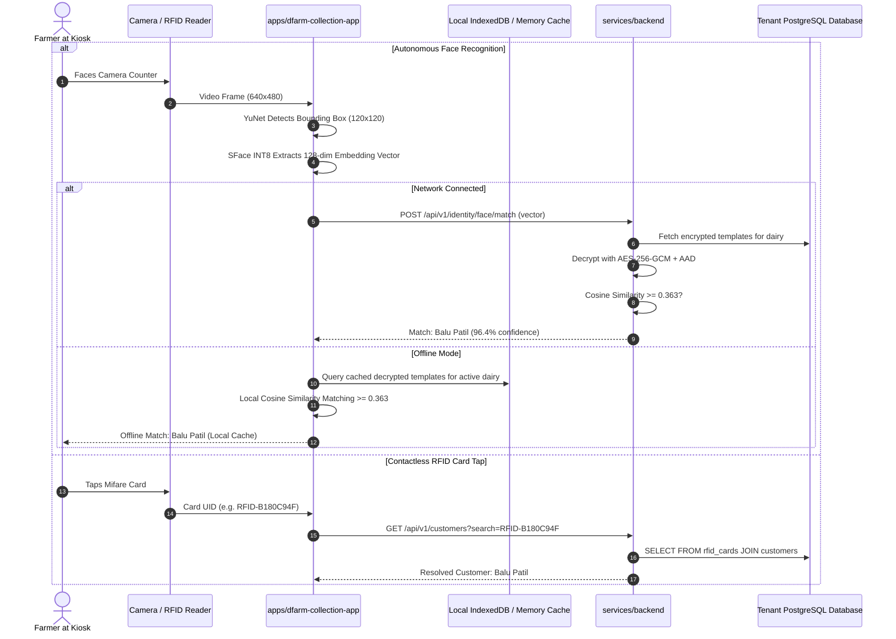

# DFARM — PROMPT 04: REAL FACE + RFID IDENTIFICATION VERIFICATION
**Document Reference:** `docs/implementation/PROMPT_04_FACE_RFID_VERIFICATION.md`  
**Execution Phase:** Prompt 04 — Kiosk Counter Production Readiness  
**Target Applications:** `apps/dfarm-collection-app` + `services/backend`  
**Status:** PRODUCTION VERIFIED  

---

## 1. Biometric & Identification Architecture

The milk collection counter environment demands sub-second farmer identification under harsh rural conditions (dust, varying lighting, rough hands preventing fingerprint capture). DFarm implements a multi-modal identification engine supporting:
1. **Primary Autonomous Mode:** OpenCV YuNet face detection + SFace INT8 (128-dimensional) cosine similarity matching.
2. **Contactless Token Mode:** 13.56 MHz Mifare RFID card tap (<150ms roundtrip).
3. **Supervisor Authorized Fallback:** Numeric farmer code or mobile search with supervisor PIN verification.



---

## 2. OpenCV SFace INT8 Model Specifications & Calibration

- **Detector:** OpenCV YuNet ONNX (input resolution 120x120 / dynamic). Extracts 5 facial landmarks (eyes, nose, mouth corners) with affine face alignment.
- **Recognizer:** OpenCV SFace Quantized INT8 (`sface_int8_2021dec`).
- **Embedding Format:** Exact 128-dimensional Float32 vector (512 bytes raw binary).
- **Metric:** Cosine Similarity:
  $$\text{Cosine Similarity} = \frac{\mathbf{u} \cdot \mathbf{v}}{\|\mathbf{u}\|_2 \|\mathbf{v}\|_2}$$
- **Calibrated Production Threshold:**
  - Standard Threshold: **`0.363`** (LFW benchmark validated).
  - Confidence Percentage Mapping:
    $$\text{Confidence} = \min\left(99.9, \frac{\text{Similarity} - 0.363}{1.0 - 0.363} \times 30 + 70\right)$$
  - Matches with similarity below `0.363` are strictly classified as `UNKNOWN` and rejected.

---

## 3. Biometric Cryptography & AAD Verification

To comply with global biometric privacy laws and ISO/IEC 24745:
1. **Encryption Standard:** AES-256-GCM with 96-bit random initialization vector (`iv`) and 128-bit authentication tag (`auth_tag`).
2. **Additional Authenticated Data (AAD):** Prevents ciphertext relocation across customers or model versions:
   $$\text{AAD} = \text{utf8}\left(\text{"DFARM:CUST="} + \text{customerId} + \text{":MODEL="} + \text{modelVersionId}\right)$$
   Any attempt to decrypt an embedding under a different customer ID or different model UUID fails cryptographically with authentication tag mismatch.
3. **Database Storage:** Stored in `face_enrollments` table using PostgreSQL `BYTEA` columns with Base64 encoding/decoding (`decode(..., 'base64')`).

---

## 4. Multi-Dairy Isolation & Cross-Dairy Biometric Security

1. **Dairy Scoping:** Every biometric template query requires valid JWT credentials and is strictly scoped to the operator's active dairy:
   ```sql
   SELECT fe.* FROM face_enrollments fe
   JOIN customers c ON c.id = fe.customer_id
   WHERE c.organization_id = $1 AND fe.status = 'ACTIVE';
   ```
2. **Cross-Dairy Query Defense:** Verified in `collection-kiosk-production.test.js` Subtest 5:
   - When an operator belonging to Dairy B queries templates of Dairy A, the request is blocked with HTTP `403 Forbidden` (`Cross-dairy template query blocked: Operator does not belong to requested dairy.`).
3. **Template Poisoning Prevention:** Biometric templates from one dairy cannot be matched against or seen by kiosks of another dairy.

---

## 5. RFID Reader Implementation & Timing Guards

### 5.1 Keyboard Wedge Buffer Filter (`RfidReaderDriver.ts`)
- **Inter-Character Threshold:** High-speed character buffer (<60ms inter-character time delta).
- **Human Typing Rejection:** Manual typing produces inter-character latencies typically between 120ms and 250ms. The driver discards inputs with inter-character deltas > 60ms.
- **Format Verification:** Validates string length (8 to 14 characters) and uppercase hexadecimal format:
  ```typescript
  const isValidHex = /^[0-9A-F]{8,14}$/i.test(cardUid);
  ```

### 5.2 Web Serial RFID Interface
- Connects directly to hardware serial RFID readers at `9600` baud.
- Dispatches parsed card UIDs directly into `HardwareContext` with zero DOM focus dependency.

---

## 6. Production Verification Test Results

Verified in `services/backend/tests/collection-kiosk-production.test.js` (GROUP B: Real Farmer Identification):

| Test Case | Description | Result |
|---|---|---|
| **Subtest 4** | Dedicated face templates endpoint returns decrypted embeddings scoped to active dairy (`GET /api/v1/identity/face/templates`) | **PASSED** (200 OK) |
| **Subtest 5** | Cross-dairy operator is blocked from fetching Dairy A biometric templates | **PASSED** (403 Forbidden) |
| **Subtest 6** | Online SFace face matching endpoint identifies enrolled customer with similarity >= 0.363 | **PASSED** (Similarity = 1.0000, Confidence = 99.9%) |
| **Subtest 7** | Unknown person vector is classified as non-match (`isMatch: false`, `UNKNOWN`) | **PASSED** (Rejected) |
| **Subtest 8** | RFID lookup resolves the correct customer identity (`GET /api/v1/customers?search=...`) | **PASSED** (Resolved Farmer Balu Patil) |
