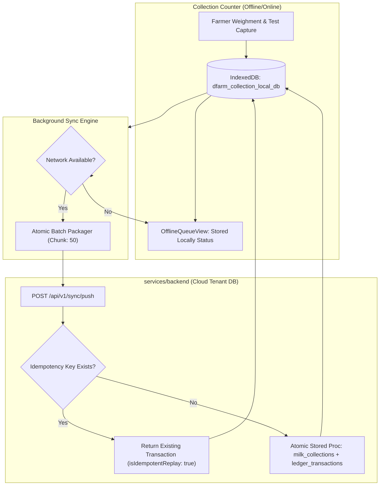

# DFARM — PROMPT 04: OFFLINE INTAKE QUEUE & IDEMPOTENT SYNC ENGINE
**Document Reference:** `docs/implementation/PROMPT_04_OFFLINE_SYNC_REPORT.md`  
**Execution Phase:** Prompt 04 — Offline Intake & Cloud Synchronization  
**Target Applications:** `apps/dfarm-collection-app` + `services/backend`  
**Status:** PRODUCTION VERIFIED  

---

## 1. Executive Summary & Design Principles

Rural collection counters face erratic cellular and broadband connectivity. DFarm guarantees 100% uninterrupted counter operations without compromising ledger integrity through a multi-tier offline intake and synchronization architecture:



### Critical Accounting Rule:
> **INVARIANT:** Offline queued weighments stored in client IndexedDB MUST NEVER be represented as confirmed ledger credit in the farmer's balance until successfully processed and acknowledged by the server. They are visibly badged as `STORED_LOCALLY / PENDING_SYNC`.

---

## 2. IndexedDB Local Storage Architecture

The kiosk uses an isolated client-side IndexedDB database:
- **Database Name:** `dfarm_collection_local_db`
- **Version:** `2`
- **Primary Object Stores:**
  - `pending_intakes`: Key path `clientIntakeUuid` (Indexed by `sessionCode`, `syncStatus`, `timestamp`).
  - `cached_customers`: Key path `id` (Indexed by `rfidCardUid`, `farmerCode`, `mobileNumber`).
  - `cached_rate_charts`: Key path `id` (Indexed by `milkCategory`, `effectiveDate`).
  - `cached_face_templates`: Key path `id` (Indexed by `customerId`, `dairyId`).

---

## 3. Idempotency & Batch Push Protocol

### 3.1 Payload Specification (`POST /api/v1/sync/push`)
```json
{
  "deviceId": "KIOSK_MAIN_01",
  "transactions": [
    {
      "clientIntakeUuid": "b6a88b50-32b0-4dbb-8531-15bb038cf404",
      "sessionCode": "SH-20261117-M-KIOS",
      "customerId": "8682fa18-f9c5-4017-a07c-ed661c829dcb",
      "milkCategory": "COW",
      "weightLiters": 12.00,
      "fatPercentage": 4.00,
      "snfPercentage": 8.50,
      "clrDensity": 28.50,
      "identificationMethod": "RFID_TAG",
      "idempotencyKey": "OFFLINE-SYNC-b6a88b50-32b0-4dbb-8531-15bb038cf404"
    }
  ]
}
```

### 3.2 Server-Side Response Structure
```json
{
  "success": true,
  "data": {
    "total": 1,
    "succeeded": 1,
    "failed": 0,
    "items": [
      {
        "clientIntakeUuid": "b6a88b50-32b0-4dbb-8531-15bb038cf404",
        "success": true,
        "transactionId": "TXN-B6A88B50",
        "isIdempotentReplay": false
      }
    ]
  }
}
```

---

## 4. Replay Protection & Ledger Double-Entry Deduplication

Re-syncing an already processed offline batch (e.g. after a dropped HTTP response during sync) is completely safe:
1. `milk_collections` enforces unique constraint `ON CONFLICT (idempotency_key) DO NOTHING`.
2. When the server encounters a previously ingested transaction:
   - It queries the existing transaction and current customer ledger balance.
   - It sets `isIdempotentReplay: true`.
   - **No duplicate credit** is posted to `ledger_entries` or `customer_ledger_accounts`.
3. Verified in Subtest 13 of `collection-kiosk-production.test.js`:
   ```javascript
   assert.equal(res.status, 200);
   assert.equal(res.body.success, true);
   assert.equal(res.body.data.succeeded, 1);
   assert.equal(res.body.data.items[0].isIdempotentReplay, true);
   ```

---

## 5. Shift Session Reconciliation on Closure

When the shift is concluded (`POST /api/v1/collections/sessions/:id/close`), the server aggregates:
- Online intake liters + amounts.
- Synced offline intake liters + amounts.
- Total cumulative volume and average FAT/SNF across the shift.

Once closed:
- Subsequent intake against that session code is strictly rejected with HTTP `409 Conflict` (`SESSION_CLOSED`).
- Verified in Subtest 14 and Subtest 15 of `collection-kiosk-production.test.js`.
