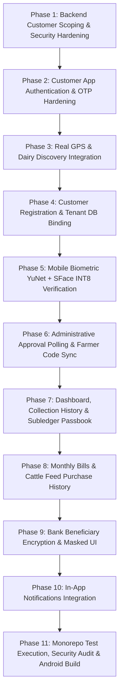

# DFARM — PROMPT 05 IMPLEMENTATION PLAN
## STEP-BY-STEP EXECUTION BLUEPRINT FOR CUSTOMER MOBILE EXPERIENCE & BACKEND INTEGRATIONS

**Document Reference:** `DFARM-PLAN-PROMPT-05`  
**Execution Phase:** Prompt 05  
**Target Application:** `apps/dfarm-customer-app` + `services/backend`  
**Working Directory:** `c:/Users/panka/.gemini/antigravity/worktrees/DFarm/dfarm_customer_app_init`  
**Execution Mode:** Sequential, Modular, Test-Driven  

---

## 1. IMPLEMENTATION OBJECTIVES & BOUNDARIES

1. **Production Readiness**: Connect all farmer mobile screens to live, authoritative backend APIs and isolated PostgreSQL tenant databases (`dfarm_tenant_<code_hash>`).
2. **Zero UI Redesign**: Strictly preserve Claymorphism visual styling, warm dairy palette tokens (`#FF6A00` Saffron, `#211B18` Cocoa Slate, `#FFF5EE` Cream), card geometry, typography, modals, and interaction flows.
3. **No Synthetic Runtime Fallbacks**: Eliminate client-side SMS generation, hardcoded farmer/dairy IDs, synthetic bounding boxes, and fixture embeddings from production execution.
4. **Strict Customer Authorization**: Enforce that a farmer customer can only access their own profile, collection history, passbook entries, bills, feed purchases, bank details, and notifications.
5. **Zero Razorpay for Farmers**: Quarantined strictly to Super Admin AMC subscriptions.

---

## 2. STEP-BY-STEP EXECUTION PHASES

---

### Phase 1: Backend Customer Scoping & Security Hardening
- **Target Files**:
  - `services/backend/src/infrastructure/otp/DoveOtpService.ts`
  - `services/backend/src/presentation/routes/customers.routes.ts`
  - `services/backend/src/presentation/routes/collections.routes.ts`
  - `services/backend/src/presentation/routes/ledger.routes.ts`
  - `services/backend/src/presentation/routes/bills.routes.ts`
  - `services/backend/src/presentation/routes/feed.routes.ts`
  - `services/backend/src/presentation/routes/notifications.routes.ts`
- **Tasks**:
  1. Update `DoveOtpService.sendOtp` to return `cooldownSeconds: 60` and `expiresAt: new Date(expiresAt).toISOString()`.
  2. In `customers.routes.ts`:
     - In `GET /customers/:id`, resolve `id === 'me'` to `req.user.userId`.
     - Enforce that a `FARMER_CUSTOMER` cannot view another customer's profile (return `403 Forbidden`).
     - Mask bank account numbers in customer responses (`XXXX-XXXX-1234`).
     - Implement `PUT /customers/:id/bank-details` with schema validation and masked response.
  3. In `collections.routes.ts`:
     - When `req.user.role === 'FARMER_CUSTOMER'`, enforce `customerId = req.user.userId`. Block cross-customer attempts.
  4. In `ledger.routes.ts`:
     - When `req.user.role === 'FARMER_CUSTOMER'`, enforce `customerId = req.user.userId`.
     - Add `router.get('/balance', ...)` route alias for `/summary`.
  5. In `bills.routes.ts`:
     - Default `customerId` to `req.user.userId` if omitted when caller is `FARMER_CUSTOMER`.
     - Block cross-customer bill queries.
  6. In `feed.routes.ts`:
     - Implement `GET /feed/sales?customerId=:id` querying `feed_sales` and `customer_ledger_entries`.
  7. In `notifications.routes.ts`:
     - Query tenant `customer_notifications` table scoped to `req.user.userId`.

---

### Phase 2: Customer App Authentication & OTP Hardening
- **Target Files**:
  - `apps/dfarm-customer-app/src/app/(auth)/login.tsx`
  - `apps/dfarm-customer-app/src/app/(auth)/verify-otp.tsx`
  - `apps/dfarm-customer-app/src/features/auth/useAuth.ts`
- **Tasks**:
  1. Remove client-side `DirectDoveSmsService` invocation and fallback in `login.tsx` and `verify-otp.tsx`.
  2. Route all OTP requests and verifications exclusively through backend `/auth/request-otp` and `/auth/verify-otp`.
  3. Ensure valid JWT session tokens and user status (`APPROVED`, `PENDING_APPROVAL`, `UNREGISTERED`) are saved securely in `expo-secure-store`.

---

### Phase 3: Real GPS & Dairy Discovery Integration
- **Target Files**:
  - `apps/dfarm-customer-app/src/features/dairy/useDairyDiscovery.ts`
  - `apps/dfarm-customer-app/src/app/(onboarding)/dairy-discovery.tsx`
- **Tasks**:
  1. Ensure `useDairyDiscovery` passes GPS coordinates to backend `/dairies/nearby`.
  2. Handle location permissions cleanly without hardcoded coordinate fallbacks.
  3. Filter out suspended or disabled dairies.

---

### Phase 4: Customer Registration & Tenant DB Binding
- **Target Files**:
  - `apps/dfarm-customer-app/src/features/registration/useRegistration.ts`
  - `apps/dfarm-customer-app/src/app/(onboarding)/register.tsx`
- **Tasks**:
  1. Submit registration payload to `POST /api/v1/customers/register` including `selectedDairyId`, `fullName`, `village`, `milkSupplyType`, and `biometricConsent`.
  2. Persist returned `customerUuid` and set local status to `PENDING_APPROVAL`.

---

### Phase 5: Mobile Biometric YuNet + SFace INT8 Verification
- **Target Files**:
  - `apps/dfarm-customer-app/src/face-ai/yunet-detector.ts`
  - `apps/dfarm-customer-app/src/face-ai/sface-embedder.ts`
  - `apps/dfarm-customer-app/src/app/(onboarding)/face-enroll.tsx`
- **Tasks**:
  1. Remove synthetic rectangular fallback in `yunet-detector.ts` for production; throw `ModelInferenceError` when detection fails.
  2. Remove fixture embedding in `sface-embedder.ts` for production; enforce real ONNX inference or propagate model error.
  3. Ensure 128-dimensional L2-normalized embedding is passed to registration/biometric update endpoint.

---

### Phase 6: Administrative Approval Polling & Farmer Code Sync
- **Target Files**:
  - `apps/dfarm-customer-app/src/features/registration/useRegistration.ts`
  - `apps/dfarm-customer-app/src/app/(onboarding)/pending-approval.tsx`
- **Tasks**:
  1. Poll `GET /api/v1/customers/:id/status` safely on the pending approval screen.
  2. When status becomes `APPROVED`, display the permanent Farmer Code issued by the backend and transition to the main dashboard.
  3. Display rejection reason if status is `REJECTED`.

---

### Phase 7: Home Dashboard, Collection History & Subledger Passbook
- **Target Files**:
  - `apps/dfarm-customer-app/src/features/collection/useCollection.ts`
  - `apps/dfarm-customer-app/src/features/ledger/useLedger.ts`
  - `apps/dfarm-customer-app/src/app/(main)/index.tsx`
  - `apps/dfarm-customer-app/src/app/(main)/collection.tsx`
  - `apps/dfarm-customer-app/src/app/(main)/ledger.tsx`
- **Tasks**:
  1. Connect dashboard cards to real collection transactions and passbook balances.
  2. Show today's shift intake details (volume, fat %, SNF %, rate/L, total amount).
  3. Display double-entry ledger entries (`MILK_CREDIT`, `PAYMENT` debits) in `ledger.tsx`.

---

### Phase 8: Monthly Bills & Cattle Feed Purchase History
- **Target Files**:
  - `apps/dfarm-customer-app/src/features/bills/useBills.ts`
  - `apps/dfarm-customer-app/src/app/(main)/bills.tsx`
  - `services/backend/src/presentation/routes/feed.routes.ts`
- **Tasks**:
  1. Connect `bills.tsx` to `GET /api/v1/bills` showing finalized statements.
  2. Support feed purchase records in ledger/feed endpoints.

---

### Phase 9: Bank Beneficiary Encryption & Masked UI
- **Target Files**:
  - `apps/dfarm-customer-app/src/features/profile/useProfile.ts`
  - `apps/dfarm-customer-app/src/app/(main)/profile/index.tsx`
- **Tasks**:
  1. Display masked bank account number (`XXXX-XXXX-1234`), bank name, and IFSC code.
  2. Support secure update via `PUT /api/v1/customers/:id/bank-details`.

---

### Phase 10: In-App Notifications Integration
- **Target Files**:
  - `services/backend/src/presentation/routes/notifications.routes.ts`
- **Tasks**:
  1. Return actual notifications from tenant `customer_notifications` table.

---

### Phase 11: Testing, Security Audit & Build Verification
- **Tasks**:
  1. Author `services/backend/tests/customer-app-production.test.js` covering all customer journeys.
  2. Run `npm --prefix apps/dfarm-customer-app test` (Jest) & `npm --prefix apps/dfarm-customer-app run typecheck`.
  3. Execute full regression suite across the entire monorepo (232+ tests).
  4. Author all required documentation deliverables.
