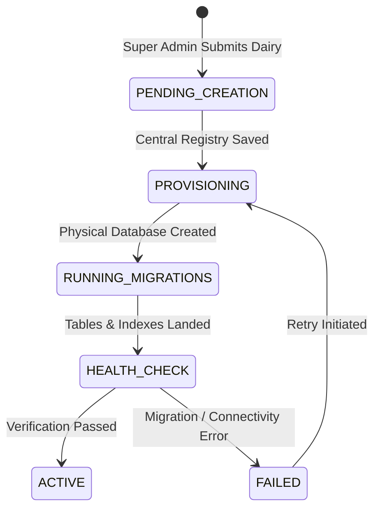

# ROADMAP PHASE 03: DAIRY CREATION & PROVISIONING VERIFICATION

**Document ID:** `DFARM-VERIF-ROADMAP-03-PROV-001`  
**Roadmap Phase:** Phase 03 — Super Admin Core Operations  
**Verification Date:** November 17, 2026  
**Auditor:** Database Architect & Multi-Tenant Infrastructure Lead  
**Status:** FULLY VERIFIED  

---

## 1. Executive Summary

DFarm enforces a database-per-Dairy architecture where each dairy cooperative possesses a physically separate PostgreSQL database instance (`dfarm_tenant_<code_hash>`). Phase 03 verified the end-to-end automated provisioning workflow from initial registration through migration execution and health verification.

---

## 2. Provisioning Lifecycle & State Machine

### Key Invariants Verified:
1. **Zero Schema-per-Dairy:** Separate physical database created; shared schema topologies are permanently rejected.
2. **Encrypted Credentials:** Tenant database URIs are stored in `dairy_database_mappings.connection_uri_encrypted` using AES-256-GCM.
3. **Provisioning Isolation:** If tenant database provisioning fails, central mapping records `provisioningStatus = 'FAILED'` with exact error message; no active status is assigned until verification passes.
4. **Idempotent Retry:** Re-provisioning an existing mapping updates the existing record without creating duplicate operational databases.
