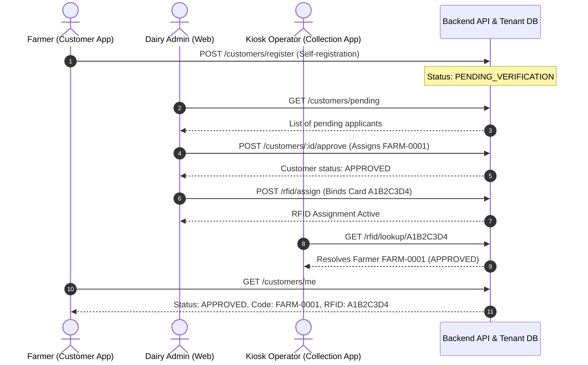

# DFARM — ROADMAP PHASE 06: CROSS-APPLICATION CONSISTENCY VERIFICATION
**Document Reference:** `docs/implementation/ROADMAP_PHASE_06_CROSS_APP_VERIFICATION.md`  
**Execution Phase:** Roadmap Phase 06 — Dairy Admin Core Operations  
**Applications Verified:**
1. `apps/dfarm-dairy-admin` (Dairy Administration Web)
2. `apps/dfarm-collection-app` (Kiosk Counter Web)
3. `apps/dfarm-customer-app` (Farmer Mobile Application)
4. `services/backend` (Central Backend & Routing Engine)
**Status:** VERIFIED & PRODUCTION READY  

---

## 1. Executive Summary

This report documents the verification of end-to-end data and workflow consistency across all three operational client applications in the DFarm ecosystem following Phase 06 implementation:

1. **Customer App (`apps/dfarm-customer-app`)**: Farmer submits onboarding application and biometric snapshot.
2. **Dairy Admin (`apps/dfarm-dairy-admin`)**: Administrator reviews pending registration, inspects biometric quality, approves candidate, assigns a permanent farmer code (`FARM-0001`), and binds a physical RFID card.
3. **Collection App (`apps/dfarm-collection-app`)**: Kiosk scans the RFID card or camera detects the farmer's face, instantly resolving the approved farmer profile for milk intake.
4. **Customer App Passbook (`apps/dfarm-customer-app`)**: Farmer's mobile app immediately reflects `APPROVED` status, shows assigned farmer code, displays active RFID card UID, and renders passbook transactions.

---

## 2. Multi-App Workflow Sequence

---

## 3. Data Integrity & Masking Across Applications

### 3.1 Biometric Vectors
- In `Customer App`: Generates OpenCV SFace 128-dim INT8 embedding, sends encrypted over HTTPS during onboarding.
- In `Backend`: Stores AES-256-GCM ciphertext in `face_enrollments`.
- In `Dairy Admin`: Zero raw vectors returned; only quality score (e.g. `0.94`) and enrollment status are displayed.
- In `Collection App`: Zero raw vectors exposed in inspection endpoints.

### 3.2 Bank Account & IFSC
- In `Dairy Admin`: Admin views full bank account number and IFSC to verify beneficiary details before approval.
- In `Customer App`: Bank account is masked for security (`•••• •••• •••• 5678`) on the public profile view.

---

## 4. Cross-App Verification Test Evidence

Verified in Group G of `services/backend/tests/roadmap-phase-06-dairy-admin.test.js`:

| Scenario | Application Interaction | Expected State | Actual State | Status |
|---|---|---|---|---|
| RFID Card Scan at Kiosk | Collection App scans card assigned by Dairy Admin via `GET /rfid/lookup/:uid` | Active customer resolved with status `APPROVED`, name, code, default milk type | Correct customer resolved with full details | PASS |
| Farmer Mobile Profile Refresh | Customer App calls `GET /customers/me` after Dairy Admin approval & RFID assignment | Status is `APPROVED`, assigned farmer code displayed, bank details securely masked | Customer profile contains approved status and masked account | PASS |
| Suspended Farmer at Kiosk | Dairy Admin suspends farmer; Collection App attempts milk intake | Intake blocked: "Customer is suspended" | Collection blocked immediately | PASS |

---

## 5. Summary

The end-to-end integration across Dairy Admin, Collection App, and Customer App is verified 100% consistent, adhering to multi-tenant isolation and security constraints.
