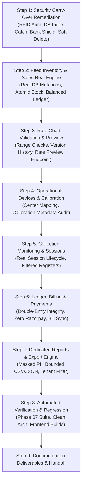

# DFARM — ROADMAP PHASE 07: IMPLEMENTATION PLAN
**Document Reference:** `docs/implementation/ROADMAP_PHASE_07_IMPLEMENTATION_PLAN.md`  
**Execution Phase:** Roadmap Phase 07 — Dairy Admin Operational Management  
**Target Application:** `apps/dfarm-dairy-admin`  
**Backend Service:** `services/backend`  
**Database:** Existing Dairy-specific PostgreSQL tenant databases  
**Status:** APPROVED ARCHITECTURAL PLAN  

---

## 1. Overview & Strategy

This implementation plan details the architectural blueprint for completing all operational modules of DFarm Dairy Admin while strictly maintaining:
1. Physical database-per-Dairy tenant isolation.
2. Clean Architecture layer boundaries.
3. 100% preservation of existing UI tokens, components, and Claymorphism classes.
4. Zero mock business data in production paths.
5. Strict separation between Phase 07 operational administration and Phase 09 financial bulk settlement.

---

## 2. Step-by-Step Implementation Sequence



---

## 3. Detailed Component Implementation Plan

### Step 1: Security Carry-Over Remediation
- **`services/backend/src/presentation/routes/rfid.routes.ts`**:
  - Replace `optionalAuthenticate` on `/lookup/:uid` and `/lookup` with `authenticate`.
  - Enforce `authorizePermission('customers:identify_rfid', 'customers:read', 'rfid:manage')`.
  - Derive tenant `organizationId` from `req.user.organizationId`; reject mismatched query parameters with 403 Forbidden.
  - Return minimal data projection (`id`, `farmerCode`, `fullName`, `status`, `defaultMilkType`, `organizationId`, `centerId`, `canDeliver`).
  - Add `rfidLookupLimiter` for anti-enumeration rate limiting.
  - Catch PostgreSQL error `23505` on `POST /assign` and return HTTP 409 Conflict.
- **`services/backend/src/presentation/routes/customers.routes.ts`**:
  - In `PATCH /:id`, reject bank account mutations without dedicated workflow (returns 403 Forbidden).
  - Register `DELETE /:id` aliased to safe soft-deletion (`is_deleted = TRUE`).
- **`services/backend/src/domain/entities/Customer.ts`**:
  - In `validateCanDeliver`, recognize both `'APPROVED'` and `'ACTIVE'` as eligible for delivery; reject `'SUSPENDED'`, `'PENDING_VERIFICATION'`, `'REJECTED'`.

### Step 2: Feed Inventory & Sales Real Engine
- **`services/backend/src/presentation/routes/feed.routes.ts`**:
  - `POST /feed/stock`: Insert into `stock_movements`, update/upsert `center_product_inventory` quantity.
  - `POST /feed/sales`:
    - Check stock availability in `center_product_inventory`. If `current_stock < requested_qty`, reject with HTTP 400 Bad Request (`"Insufficient stock"`).
    - Decrement stock atomically: `UPDATE center_product_inventory SET current_stock = current_stock - $1 WHERE product_id = $2 AND current_stock >= $1`.
    - Record sale in `feed_sales` and `feed_sale_items`.
    - If payment mode is `CREDIT`, post a balanced double-entry debit to `ledger_entries` under the farmer's account.
  - `GET /feed/products`: Join `center_product_inventory` to return genuine available stock instead of hardcoded 100.
  - `GET /feed/movements`: Query `stock_movements` table.

### Step 3: Rate Chart Validation & Preview
- **`services/backend/src/presentation/routes/rate-charts.routes.ts`**:
  - Add `POST /api/v1/rate-charts/preview`: Takes `milkCategory`, `fatPercentage`, `snfPercentage`, and optional `chartId`. Uses `RateEngine` to compute rate per liter and total amount without committing financial changes.
  - Validate numeric FAT/SNF ranges and base rates on `POST /draft`.
  - Ensure previous rate chart versions are preserved as inactive historical records upon activation of a new chart version.

### Step 4: Operational Devices & Calibration
- **`services/backend/src/presentation/routes/devices.routes.ts`**:
  - Add `POST /api/v1/devices/:id/mapping`: Binds an allocated central device to a specific collection center and counter.
  - Add `POST /api/v1/devices/:id/calibration`: Persists calibration metadata (`calibrationDate`, `calibratedBy`, `verificationStatus`, `serviceProvider`, `notes`).
  - Add `GET /api/v1/devices/:id/calibration`: Returns audit history of calibrations for the device.
  - Maintain constraint that Dairy Admin cannot reassign devices to other dairies.

### Step 5: Collection Session Monitoring & Register
- **`services/backend/src/presentation/routes/collections.routes.ts`**:
  - Ensure `GET /sessions` and `GET /sessions/active` return genuine records from `collection_sessions`.
  - Ensure `GET /transactions` supports filtering by `date`, `sessionId`, `centerId`, `customerId`, `milkCategory`, and `status`.
  - Verify that unconfirmed offline sync events are not displayed as accepted until confirmed by the server.

### Step 6: Customer Ledger, Billing & Payments
- **`services/backend/src/presentation/routes/ledger.routes.ts`**:
  - Verify double-entry ledger summaries, balance inquiries, and audit-logged manual adjustments.
  - Enforce immutability: posted ledger entries cannot be updated or deleted.
- **`services/backend/src/presentation/routes/bills.routes.ts`**:
  - Support viewing bills and generating cycle bills from milk collections and feed debits.
  - Respect Phase 09 boundary: no guessing global rate policies or NEFT batch executions.
- **`services/backend/src/presentation/routes/payments.routes.ts`**:
  - Record manual payments, verify duplicate reference check, post balanced double-entry ledger entries.
  - Strictly enforce zero Razorpay calls in farmer payments.

### Step 7: Dedicated Reports & Export Engine
- **`services/backend/src/presentation/routes/reports.routes.ts`**:
  - Register router under `/reports` in `index.ts`.
  - `GET /reports/collections`: Bounded query for daily/shift collections with Cow/Buffalo aggregates.
  - `GET /reports/feed`: Feed stock levels and sales summary.
  - `GET /reports/ledger`: Farmer ledger balances and statement exports.
  - Mask PII (bank accounts), omit biometrics, support JSON and CSV formats.

### Step 8: Automated Verification & Monorepo Build
- Author `services/backend/tests/roadmap-phase-07-dairy-admin.test.js` covering Groups A through J.
- Run tests:
  ```bash
  node --test services/backend/tests/roadmap-phase-07-dairy-admin.test.js
  node --test services/backend/tests/roadmap-phase-06-dairy-admin.test.js
  node --test services/backend/tests/dairy-admin-production.test.js
  node --test services/backend/tests/clean-architecture.test.js
  ```
- Build all 4 applications:
  ```bash
  npm --prefix services/backend run build
  npm --prefix apps/dfarm-dairy-admin run build
  npm --prefix apps/dfarm-super-admin run build
  npm --prefix apps/dfarm-collection-app run build
  ```

### Step 9: Documentation Deliverables & Handoff
- Generate all 15 required documentation files in `docs/implementation/`.

---

## 4. Architectural Invariants Checklist
- [x] Physical database-per-Dairy architecture preserved.
- [x] Zero UI redesign in `apps/dfarm-dairy-admin`.
- [x] Zero mock data in production paths.
- [x] Zero raw biometric vectors exposed.
- [x] Zero Razorpay in farmer payouts.
- [x] Clear boundary maintained with Roadmap Phase 09.
