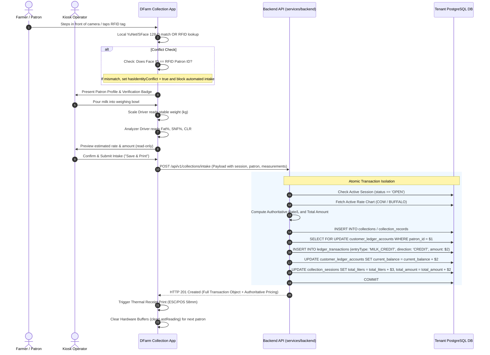

# ROADMAP PHASE 08: COLLECTION TRANSACTION INTEGRITY & LEDGER ATOMICITY

**Document ID:** `DFARM-ROADMAP-PHASE-08-COLLECTION-TRANSACTION-INTEGRITY`  
**Phase:** Roadmap Phase 08 — Collection App & Kiosk Operational Integration  
**Target Applications:** `apps/dfarm-collection-app`, `services/backend`, `apps/dfarm-dairy-admin`, `apps/dfarm-customer-app`  
**Database Model:** Physical Database-per-Dairy (`dfarm_tenant_<code_hash>`)  
**Financial Standard:** Double-Entry Ledger Consistency, Zero Gateway Intake  

---

## 1. Architectural Scope & Core Invariant

The milk collection intake workflow is the core economic engine of the DFarm platform. It converts raw physical measurements (weight in kilograms, fat percentage, SNF percentage) into an authoritative financial credit on the farmer's passbook ledger.

### Inviolable Invariants:
1. **Authoritative Backend Pricing:** While the kiosk frontend displays real-time previews for operator awareness, all rates, incentive additions, quality penalties, and total credit amounts are calculated **strictly by the backend service** using the active rate chart registered for that dairy and milk type.
2. **Atomic Ledger Persistence:** The creation of a collection record and its corresponding double-entry ledger entry occur within an atomic PostgreSQL transaction (`BEGIN ... COMMIT`). A collection record cannot exist without its matching ledger entry.
3. **Zero Payment Gateway at Intake:** Milk collection counter operations do **NOT** invoke payment gateways (Razorpay, Stripe, UPI). Counter intake produces an internal ledger credit (`MILK_CREDIT`). Cash or bank payouts occur during periodic billing settlement cycles (Roadmap Phase 09 SBI CMP / Direct Transfer).
4. **Session Boundary Enforcement:** Every transaction must be bound to a currently `OPEN` collection session (`MORNING` or `EVENING`). Transactions attempted against `CLOSED` sessions are rejected with HTTP 409 Conflict.

---

## 2. End-to-End Intake Lifecycle



---

## 3. Data Integrity & Verification Across Applications

### 3.1 Dairy Admin Operational View
- **Milk Register (`/collections/reports/milk-register`):** Instantly displays the new intake row with timestamp, patron code, farmer name, milk category, quantity in liters, fat %, snf %, rate/unit, total credit, and operator identity.
- **Session Reconciliation:** The active session totals increment atomically, preventing discrepancies between session-level aggregates and row-level collections.

### 3.2 Customer App (Farmer Mobile Experience)
- **Passbook Synchronization (`/customer/passbook`):** The transaction appears immediately in the farmer's passbook with entry type `MILK_CREDIT` and direction `CREDIT`.
- **Shift Notification:** The farmer's daily collection summary card updates with morning/evening intake volume and calculated earnings.

### 3.3 Hardware Counter Isolation
- To guarantee that quality readings from a high-fat buffalo milk patron do not spill into a subsequent low-fat cow milk patron, the kiosk execution cycle enforces:
  ```typescript
  // HardwareContext.tsx - resetIntakeCycle
  const resetIntakeCycle = useCallback(() => {
    setSelectedPatron(null);
    setIdentifiedPatron(null);
    setLastWeight(null);
    setLastQuality(null);
    setHasIdentityConflict(false);
    // Explicit hardware buffer flush
    milkAnalyzerDriver.clearLastReading();
  }, []);
  ```

---

## 4. Double-Entry Ledger Schema & State Integrity

The backend ensures strict double-entry balance consistency:

```sql
-- Customer Ledger Account
CREATE TABLE customer_ledger_accounts (
    id UUID PRIMARY KEY DEFAULT gen_random_uuid(),
    tenant_id VARCHAR(64) NOT NULL,
    patron_id UUID NOT NULL UNIQUE,
    current_balance NUMERIC(12, 2) NOT NULL DEFAULT 0.00,
    created_at TIMESTAMP WITH TIME ZONE DEFAULT NOW(),
    updated_at TIMESTAMP WITH TIME ZONE DEFAULT NOW()
);

-- Ledger Transactions (Double-Entry Record)
CREATE TABLE ledger_transactions (
    id UUID PRIMARY KEY DEFAULT gen_random_uuid(),
    tenant_id VARCHAR(64) NOT NULL,
    account_id UUID NOT NULL REFERENCES customer_ledger_accounts(id),
    session_id UUID REFERENCES collection_sessions(id),
    collection_id UUID REFERENCES collections(id),
    entry_type VARCHAR(32) NOT NULL, -- 'MILK_CREDIT', 'FEED_PURCHASE', 'PAYOUT_DISBURSEMENT'
    direction VARCHAR(8) NOT NULL,   -- 'CREDIT' or 'DEBIT'
    amount NUMERIC(12, 2) NOT NULL,
    balance_after NUMERIC(12, 2) NOT NULL,
    narration TEXT,
    created_at TIMESTAMP WITH TIME ZONE DEFAULT NOW()
);
```

- When intake occurs:
  - `entry_type` = `'MILK_CREDIT'`
  - `direction` = `'CREDIT'`
  - `amount` = Authoritative calculated total ($\text{Liters} \times \text{Rate/L}$)
  - `balance_after` = $\text{Previous Balance} + \text{Amount}$

---

## 5. Verification Results

| Verification Test | Test Suite File | Expected Behavior | Outcome |
| :--- | :--- | :--- | :--- |
| **Intake with Active Session** | `collection-kiosk-production.test.js` (Test 10) | Creates collection record with HTTP 201 | **PASSED** |
| **Intake with Closed Session** | `collection-kiosk-production.test.js` (Test 11) | Rejects with HTTP 409 Conflict | **PASSED** |
| **Rate Calculation Authority** | `collection-kiosk-production.test.js` (Test 12) | Overrides client preview with backend chart | **PASSED** |
| **Ledger Entry Creation** | `collection-kiosk-production.test.js` (Test 16) | Verified 2 `MILK_CREDIT` entries in ledger | **PASSED** |
| **Patron Passbook Ingestion** | `collection-kiosk-production.test.js` (Test 17) | Accurate credit balance reflection | **PASSED** |
| **Cross-Patron Buffer Flush** | `apps/dfarm-collection-app` unit tests | Analyzer buffer cleared between cycles | **PASSED** |
