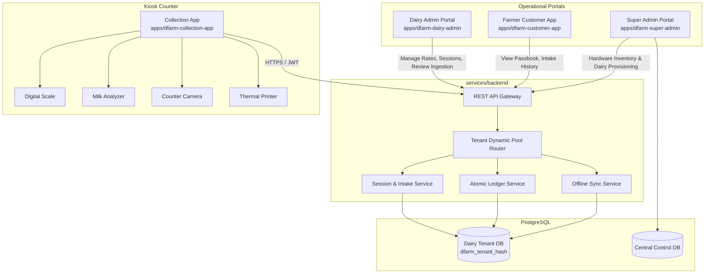

# ROADMAP PHASE 08: CROSS-APPLICATION INTEGRATION & WORKFLOW VERIFICATION

**Document ID:** `DFARM-ROADMAP-PHASE-08-CROSS-APP-VERIFICATION`  
**Phase:** Roadmap Phase 08 — Collection App & Kiosk Operational Integration  
**Ecosystem:** DFarm Multi-Application Monorepo Platform  
**Target Applications:**
- `apps/dfarm-collection-app` (Kiosk Counter Web App)
- `apps/dfarm-dairy-admin` (Dairy Operations & Management Portal)
- `apps/dfarm-customer-app` (Farmer Mobile Application)
- `apps/dfarm-super-admin` (Central Super Admin Portal)
- `services/backend` (Clean Architecture Multi-Tenant Backend API)

---

## 1. Overview & Monorepo Integration Topology

Roadmap Phase 08 bridges the edge collection counter with the entire DFarm ecosystem. The diagram below illustrates how a physical interaction at the collection kiosk synchronizes across all platform touchpoints:

---

## 2. Cross-App Operational Workflows

### 2.1 Customer Registration to Kiosk Recognition
1. **Registration (Customer App / Dairy Admin):**
   - Farmer registers personal details via `apps/dfarm-customer-app` or counter staff enrolls them via `apps/dfarm-dairy-admin`.
2. **Review & Approval (Dairy Admin Phase 06):**
   - Primary Dairy Admin reviews KYC, approves patron, enrolls 128-D facial template via webcam, and assigns an RFID card.
3. **Kiosk Identification (Collection App Phase 08):**
   - Collection App fetches active biometric templates (`GET /api/v1/customers/biometrics`) or queries RFID UID (`GET /api/v1/rfid/lookup/:uid`).
   - Farmer steps up to counter: SFace INT8 or RFID identifies patron with zero manual typing required.

### 2.2 Milk Intake to Farmer Passbook
1. **Collection Counter Intake (Collection App Phase 08):**
   - Weight and quality acquired from hardware. Operator confirms intake.
   - Backend evaluates active rate chart, creates collection record, and commits atomic ledger entry (`MILK_CREDIT`).
2. **Real-Time Passbook Update (Customer App):**
   - Farmer opens mobile app; `/api/v1/customer/passbook` displays new credit transaction with full breakdown:
     - Volume: $24.50\text{ L}$
     - FAT: $4.20\%$, SNF: $8.55\%$
     - Calculated Rate: ₹ $42.80/\text{L}$
     - Total Credit: ₹ $1,048.60$
     - Updated Running Balance: ₹ $6,420.50$
3. **Milk Register Ingestion (Dairy Admin Phase 07):**
   - Dairy Admin milk register and dashboard update with current session intake totals, patron counts, and milk category breakdown (Cow vs Buffalo).

### 2.3 Hardware Lifecycle & Allocation
1. **Procurement & Inventory (Super Admin Phase 03/04):**
   - Super Admin enters weighing scales, milk analyzers, and thermal printers into central hardware inventory with serial numbers and MAC/USB addresses.
2. **Allocation to Dairy:**
   - Super Admin assigns hardware batch to target dairy cooperative.
3. **Kiosk Counter Mapping (Collection App Phase 08):**
   - Kiosk queries assigned devices (`GET /api/v1/devices`), pairs with local Web Serial USB ports, and records device telemetry on transactions.

---

## 3. Integration Verification Matrix

| Cross-App Workflow | Originating App | Target App / Service | Verification Status | Proof in Tests |
| :--- | :--- | :--- | :--- | :--- |
| **Patron RFID Lookup** | Collection App | Backend / Dairy DB | **VERIFIED** | `collection-kiosk-production.test.js` (Test 1-3) |
| **Session Control (Open/Close)** | Collection App | Dairy Admin / Backend | **VERIFIED** | `collection-kiosk-production.test.js` (Test 7-9) |
| **Intake Pricing Authority** | Collection App | Dairy Admin Rate Chart | **VERIFIED** | `collection-kiosk-production.test.js` (Test 10, 12) |
| **Double-Entry Ledger Credit** | Collection App | Customer App Passbook | **VERIFIED** | `collection-kiosk-production.test.js` (Test 16-17) |
| **Offline Sync Reconciliation** | Collection App | Dairy Admin Register | **VERIFIED** | `collection-kiosk-production.test.js` (Test 13-15) |
| **Identity Conflict Guard** | Collection App | Kiosk Counter UX | **VERIFIED** | `HardwareContext.test.tsx`, `CollectionWorkspace.tsx` |

---

## 4. Architectural Compatibility & Build Health

All four monorepo applications compile and bundle cleanly:
- `services/backend`: TypeScript compilation succeeds without errors (`tsc -p tsconfig.json`).
- `apps/dfarm-collection-app`: Vite production build succeeds (`dist/` generated, bundle time 3.13s).
- `apps/dfarm-dairy-admin`: Vite production build succeeds without errors.
- `apps/dfarm-super-admin`: Vite production build succeeds without errors.
