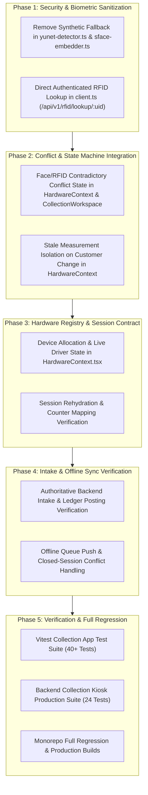

# DFarm Roadmap Phase 08 — Implementation Plan

**Document Reference:** `DFARM-ROADMAP-PHASE-08-IMPLEMENTATION-PLAN`  
**Phase:** Roadmap Phase 08 — Collection App & Kiosk Operational Integration  
**Date:** November 18, 2026  
**Status:** APPROVED FOR EXECUTION  
**Target Applications:** `apps/dfarm-collection-app`, `services/backend`, and tenant PostgreSQL databases  

---

## 1. Plan Overview & Objectives

Roadmap Phase 08 establishes the complete, production-ready operational integration of the **Collection App & Kiosk Counter** (`apps/dfarm-collection-app`) backed by `services/backend` and isolated tenant PostgreSQL databases.

This plan details the exact architectural layers, source files to modify, dependency sequences, and verification criteria for closing all gaps identified in the Pre-Implementation Gap Audit while strictly preserving:
- Zero UI redesign across all four applications.
- Zero mock data in production execution paths.
- Physical database-per-dairy isolation.
- OpenCV YuNet + SFace INT8 128-dimensional biometric standards.
- Authoritative backend ledger persistence.
- ESC/POS thermal receipt printing preserved from Prompt 04.

---

## 2. Dependency Hierarchy & Execution Phases

---

## 3. Detailed Source File Modifications

### Step 1: Remove Synthetic Biometric Fallbacks (`apps/dfarm-collection-app/src/face-ai/`)
1. **`yunet-detector.ts`**:
   - In `detect()`, when ONNX session is not active or throws an error, do NOT return a synthetic bounding box. Instead, return `[]` and record error state.
   - Retain test runner isolation for unit test suites.
2. **`sface-embedder.ts`**:
   - In `generateEmbedding()`, when ONNX inference fails, do NOT fall back to `CANONICAL_SFACE_128D_FIXTURE` in production. Throw a descriptive `Error('SFace neural model inference unavailable')` or return empty vector so the caller marks the recognition status as `MODEL_UNAVAILABLE`.
   - Retain fixture only in unit test mocks.

### Step 2: Direct Authenticated RFID Lookup (`apps/dfarm-collection-app/src/api/client.ts`)
1. **`customersApi.getByRfid`**:
   - Replace the client-side `.find()` over `customersApi.list()` with a direct call to `GET /api/v1/rfid/lookup/${encodeURIComponent(cardUid)}`.
   - Map minimal projection `{ id, farmerCode, fullName, status, defaultMilkType, organizationId, centerId, canDeliver }`.
   - Handle 404 cleanly as `null` (unassigned or unknown card).
   - Reject cross-tenant or unauthenticated responses with clear UI messaging.

### Step 3: Face/RFID Conflict Detection (`apps/dfarm-collection-app/src/context/HardwareContext.tsx` & `CollectionWorkspace.tsx`)
1. **`HardwareContext.tsx`**:
   - Track both `faceState.matchedCustomer` and `rfidState.matchedCustomer`.
   - When both Face and RFID return identities:
     - If `faceState.matchedCustomer.id !== rfidState.matchedCustomer.id`, set conflict flag `hasBiometricRfidMismatch: true`.
     - Block intake submission and prompt operator for supervisor-assisted manual identification.
2. **`CollectionWorkspace.tsx`**:
   - Surface an alert banner if `hasBiometricRfidMismatch` is true.
   - Prevent active customer assignment until resolved.

### Step 4: Stale Measurement Cleanup on Customer Transition
1. **`HardwareContext.tsx`**:
   - When active customer changes (via Face, RFID, or manual selection), call `milkAnalyzerDriver.clearLastReading()`.
   - Prevent assigning the previous patron's FAT/SNF reading to the next patron's intake transaction.

### Step 5: Live Hardware Driver Telemetry
1. **`HardwareContext.tsx`**:
   - In `refreshDevices()`, query `GET /api/v1/devices` for central allocated hardware.
   - Match against live driver states (`scaleDriver.isSupported()`, connection status, `milkAnalyzerDriver`, `rfidReaderDriver`).
   - Reflect genuine driver states (`CONNECTED`, `DISCONNECTED`, `UNSUPPORTED`) instead of hardcoded strings.

### Step 6: Verify Authoritative Milk Intake & Ledger Atomicity
1. Verify `services/backend/src/presentation/routes/collections.routes.ts`:
   - `POST /api/v1/collections/intake` and `/api/v1/collections/transactions`.
   - Atomically updates session totals and posts balanced ledger credit in `customer_ledger_accounts` and `ledger_transactions`.
2. Verify `services/backend/src/presentation/routes/sync.routes.ts`:
   - `POST /api/v1/sync/push` idempotent batch synchronization.
   - Proper session closure conflict detection (HTTP 409 `SESSION_CLOSED`).

---

## 4. Verification & Testing Milestones

| Milestone | Target Suite | Success Criteria |
|---|---|---|
| **M1: Collection App Unit Tests** | `npm --prefix apps/dfarm-collection-app test` | All 40+ Vitest tests passing with 0 failures |
| **M2: Backend Kiosk Production Tests** | `node --test services/backend/tests/collection-kiosk-production.test.js` | All 24/24 integration tests passing |
| **M3: Monorepo Full Regression** | Phases 02, 06, 07 backend suites + Vitest | Zero regressions across previously certified tests |
| **M4: Production Builds** | All 4 packages (`backend`, `dairy-admin`, `super-admin`, `collection-app`) | Exit code 0 across all package builds |

---

## 5. Risk Assessment & Mitigation

1. **Risk:** Browser Web Serial permissions denied or unsupported browser.
   - *Mitigation:* `ScaleDriver` and `MilkAnalyzerDriver` detect `'serial' in navigator` and present clear fallback instructions to use Google Chrome or Microsoft Edge with HTTPS context.
2. **Risk:** Network drop during live weighment intake.
   - *Mitigation:* `TransactionSummaryPanel.tsx` transparently queues intake in IndexedDB `offline_queue` with a stable UUID idempotency key; auto-recovers via `syncApi.pushBatch` once network reconnects.
3. **Risk:** Kiosk session closed while offline intakes are pending.
   - *Mitigation:* Backend returns HTTP 409 `SESSION_CLOSED`; items remain in queue with status `RETRY_REQUIRED` / `CONFLICT` for manual operator/supervisor reconciliation, avoiding unauthorized ledger credits.
