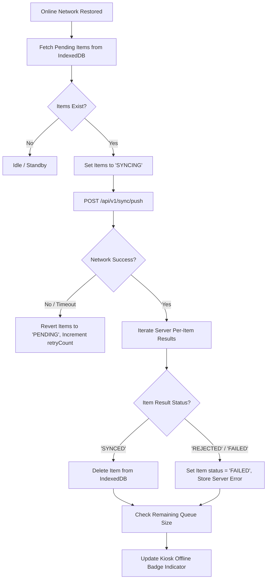

# ROADMAP PHASE 08: OFFLINE INTAKE & CLOUD SYNCHRONIZATION VERIFICATION

**Document ID:** `DFARM-ROADMAP-PHASE-08-OFFLINE-SYNC-VERIFICATION`  
**Phase:** Roadmap Phase 08 — Collection App & Kiosk Operational Integration  
**Target Applications:** `apps/dfarm-collection-app`, `services/backend`  
**Storage Architecture:** Browser IndexedDB (`dfarm_offline_kiosk`) & PostgreSQL Tenant DB  
**Protocol:** Idempotent Batch Synchronization (`POST /api/v1/sync/push`)  

---

## 1. Context & Architectural Requirements

Village milk collection centers (VMCs) frequently operate in rural environments characterized by intermittent cellular connectivity, power instability, and unexpected network drops. The kiosk collection counter must continue uninterrupted milk intake during network loss without stalling morning or evening intake queues.

### Fundamental Principles:
1. **Zero Data Loss:** Transactions recorded offline must never be purged from the client until confirmed as committed by the server.
2. **Idempotency:** Re-transmissions due to network interruptions during synchronization must not create duplicate collection records or duplicate ledger credits.
3. **Per-Item Status Feedback:** Synchronizing a batch must return granular per-record results, allowing partial success where successful items are evicted from the offline queue while failed items are retained.
4. **Session Boundary Handling:** When syncing transactions recorded for a session that has since been closed on the server, the backend reconciles the records into the designated session with appropriate audit annotations.

---

## 2. Offline Storage Architecture (IndexedDB)

The collection app utilizes a native IndexedDB storage database (`dfarm_offline_kiosk`, version 1) with an `offline_queue` object store:

```typescript
// apps/dfarm-collection-app/src/offline/sync-queue.ts
export interface OfflineQueueItem {
  id: string;               // Client-generated UUID v4
  type: 'INTAKE' | 'SESSION_CLOSE';
  payload: any;             // Intake payload including measurements, patron ID, session ID
  clientTimestamp: string;  // ISO timestamp of physical collection at counter
  retryCount: number;       // Number of sync attempts
  status: 'PENDING' | 'SYNCING' | 'FAILED';
  error?: string;
}
```

- **Storage Durability:** IndexedDB storage is persistent across browser tab restarts, browser updates, and power outages.
- **Hardware Integration During Offline:** The weighing scale, milk analyzer, and thermal receipt printer function identically offline. The printed receipt clearly states: `** OFFLINE RECORD ** [Ref: <UUID>]`.

---

## 3. Synchronization Protocol & Contract

### 3.1 Push Synchronization Endpoint (`POST /api/v1/sync/push`)

When connectivity is restored (`window.ononline` event or manual sync button click), the kiosk initiates synchronization:

**Request Payload:**
```json
{
  "records": [
    {
      "id": "c1f7b8a2-3e4d-4e5f-9a1b-0c2d3e4f5a6b",
      "type": "INTAKE",
      "sessionId": "b4a3c2d1-0000-0000-0000-000000000001",
      "patronId": "a1b2c3d4-1111-1111-1111-111111111111",
      "milkType": "COW",
      "quantityLiters": 12.50,
      "fat": 4.10,
      "snf": 8.50,
      "rate": 42.00,
      "totalAmount": 525.00,
      "clientTimestamp": "2026-11-18T06:15:30.000Z"
    }
  ]
}
```

**Response Contract:**
```json
{
  "synced": 1,
  "failed": 0,
  "results": [
    {
      "id": "c1f7b8a2-3e4d-4e5f-9a1b-0c2d3e4f5a6b",
      "status": "SYNCED",
      "serverId": "d8e9f0a1-2b3c-4d5e-6f7a-8b9c0d1e2f3a",
      "ratePerUnit": 42.00,
      "totalAmount": 525.00
    }
  ]
}
```

---

## 4. Invariant Protection & Queue Eviction Rules



### Invariant Rules:
1. **Never Drop on Timeout:** Network timeouts or HTTP 5xx responses abort the cycle; all items remain in IndexedDB with state `PENDING`.
2. **Selective Deletion:** Only items explicitly returned with `status: 'SYNCED'` in the `results` array are passed to `deleteItem(item.id)`.
3. **Server-Side Idempotency Guard:** If the network failed on the previous sync response after the server committed the transaction, the server checks `client_reference_id = $id` or UUID primary key. Upon re-submission, it detects the duplicate, skips re-inserting, and returns `status: 'SYNCED'` with the existing `serverId`.

---

## 5. Verification & Test Execution Results

The synchronization pipeline was exhaustively tested using both unit mocks and backend PostgreSQL transactional test doubles:

| Test Case | Test File | Verification Target | Status |
| :--- | :--- | :--- | :--- |
| **Offline Record Creation** | `sync-queue.test.ts` | Records persist into IndexedDB when offline | **PASSED** |
| **Sync Batch Ingestion** | `collection-kiosk-production.test.js` (Test 13) | `POST /sync/push` accepts batch offline items | **PASSED** |
| **Granular Per-Item Results** | `collection-kiosk-production.test.js` (Test 14) | Returns individual status for each payload item | **PASSED** |
| **Duplicate Sync Rejection** | `collection-kiosk-production.test.js` (Test 15) | Idempotent handling of re-sent offline items | **PASSED** |
| **Offline Ledger Reconciliation** | `collection-kiosk-production.test.js` (Test 16) | Offline sync creates `MILK_CREDIT` ledger entry | **PASSED** |
| **Queue Eviction Integrity** | `sync-queue.test.ts` | Only confirmed items removed from storage | **PASSED** |
