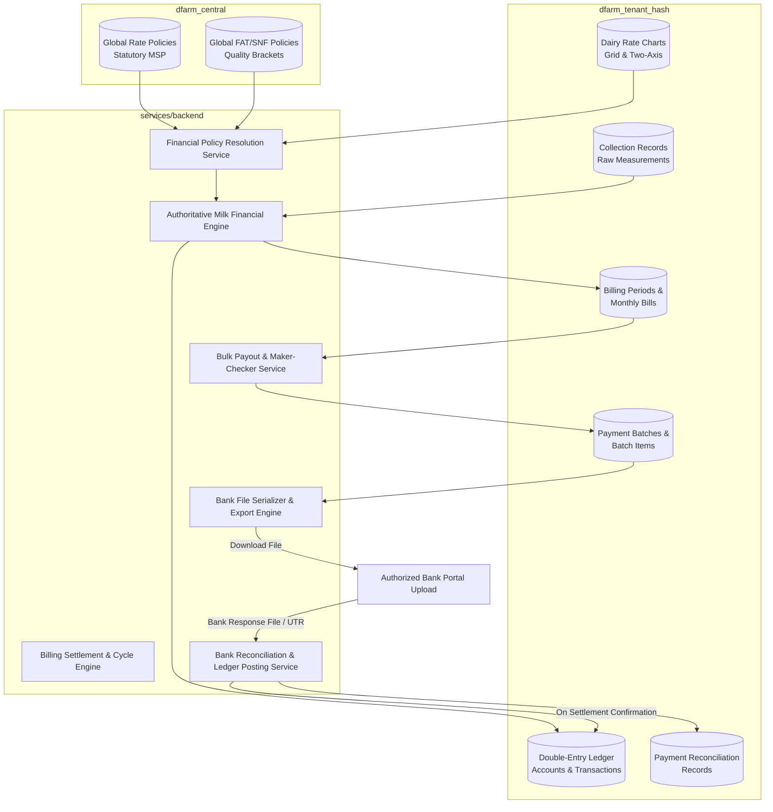

# ROADMAP PHASE 09: FINANCIAL ARCHITECTURE & IMPLEMENTATION PLAN

**Document ID:** `DFARM-ROADMAP-PHASE-09-PLAN`  
**Phase:** Roadmap Phase 09 — Financial Calculation, Farmer Settlement, Bulk Bank Payout & Reconciliation  
**Target:** `services/backend`, `packages/database`, `apps/dfarm-dairy-admin`, `apps/dfarm-customer-app`  
**Execution Sequence:** Plan → Financial Policy Resolution → Authoritative Calculation → Billing Settlement → Payout Batches → Maker–Checker → Bank File Serializer → Reconciliation → Ledger Posting → Verification  

---

## 1. System Architecture Overview

Roadmap Phase 09 establishes the end-to-end financial pipeline of DFarm:

---

## 2. Detailed Module Engineering Plan

### Module A & B: Financial Policy Resolution & Authoritative Pricing
- **Component:** `FinancialPolicyResolutionService` (`services/backend/src/domain/services/FinancialPolicyResolutionService.ts`).
- **Responsibilities:**
  1. Look up published global rate policy versions and published FAT/SNF adjustment versions from `dfarm_central`.
  2. Look up applicable dairy rate charts from the tenant database.
  3. Validate effective date ranges and ensure draft/expired policies are strictly quarantined.
  4. Enforce statutory minimum floor prices (MSP) if defined in global policies.
  5. Apply commercial quality deductions using `NEAREST_TWO_DECIMALS` rounding without altering raw physical sensor readings.
  6. Return an immutable calculation snapshot.

### Module C & D: Billing Cycle & Farmer Payable Settlement
- **Component:** Enhanced `BillingService` and `bills.routes.ts`.
- **Responsibilities:**
  1. Period boundaries: Calculate exact opening balance, gross milk credits, feed purchases debits, advance recoveries, and previous payouts.
  2. Formula:
     $$\text{Closing Balance} = \text{Opening Balance} + \text{Gross Milk} + \text{Credits} - \text{Feed Purchases} - \text{Advances} - \text{Settled Payouts}$$
     $$\text{Net Payable} = \max(0.00, \text{Closing Balance})$$
  3. Cycle finalization: Prevent multiple active batches on the same billing cycle.
  4. Ensure Customer App passbook displays the identical finalized statement.

### Module E & F: Bulk Payout Batch Preparation & Maker–Checker Approval
- **Component:** Enhanced `BatchService` and `PaymentController`.
- **Responsibilities:**
  1. Query eligible customers with `current_balance > 0` associated with a finalized billing cycle.
  2. Check and block duplicate batch creation if an active batch already exists for the cycle.
  3. Create frozen `payment_batch_items` and `customer_payouts` in `DRAFT` status.
  4. **Enforce Maker–Checker Rule:**
     In `approveBatch`: Reject if `batch.created_by === auth.userId` (`MAKER_CHECKER_SELF_APPROVAL_PROHIBITED`). Only an independent supervisor or primary dairy admin can approve.
  5. Approved batches become immutable: financial amounts and beneficiaries cannot be altered.

### Module G: Bank-Specific Bulk File Generation (NEFT & SBI CMP)
- **Component:** `BankFileService` with `StandardNeftSerializer` and `SbiCmpAdapter`.
- **Responsibilities:**
  1. Standard RBI NEFT format:
     Generates valid CSV file containing: Beneficiary Name, Account Number (decrypted server-side), IFSC Code, Amount (2 decimals), Customer Reference, Narration.
  2. Calculates SHA-256 checksum of generated file.
  3. Stores export audit metadata and generates a short-lived download token (15-min expiry).
  4. For SBI CMP: If official corporate credentials are unconfigured, block file export with clear diagnostic: `BLOCKED — OFFICIAL BANK SPECIFICATION & CREDENTIALS REQUIRED`.

### Module H & I: Bank Response Reconciliation & Settlement Ledger Posting
- **Component:** Enhanced `ReconciliationService` and `BatchService.reconcileBatch`.
- **Responsibilities:**
  1. Accept bank statement CSV or settlement UTR records.
  2. Match against `payment_batch_items` and `customer_payouts`.
  3. For confirmed transfers: Call `settle_customer_payout`, update status to `SETTLED`, and post double-entry ledger debit (`CUSTOMER_PAYABLE` DEBIT, `CASH_BANK` CREDIT).
  4. For failed/rejected transfers: Call `fail_customer_payout`, update status to `FAILED`, preserve liability on customer ledger account.
  5. Update batch status to `SETTLED` or `PARTIALLY_SETTLED`.

---

## 3. Implementation Milestones & Gates

- [x] Pre-implementation gap audit completed.
- [x] Authoritative ledger source of truth certified.
- [ ] Implement `FinancialPolicyResolutionService` and pricing engine.
- [ ] Enhance `BatchService` with Maker–Checker self-approval block and duplicate cycle guards.
- [ ] Implement `BankFileService` and NEFT serializer.
- [ ] Implement secure batch export endpoint and download route.
- [ ] Connect batch reconciliation to atomic ledger postings.
- [ ] Author comprehensive automated test suite and execute with 100% pass rate.
- [ ] Complete all 21 documentation artifacts.
