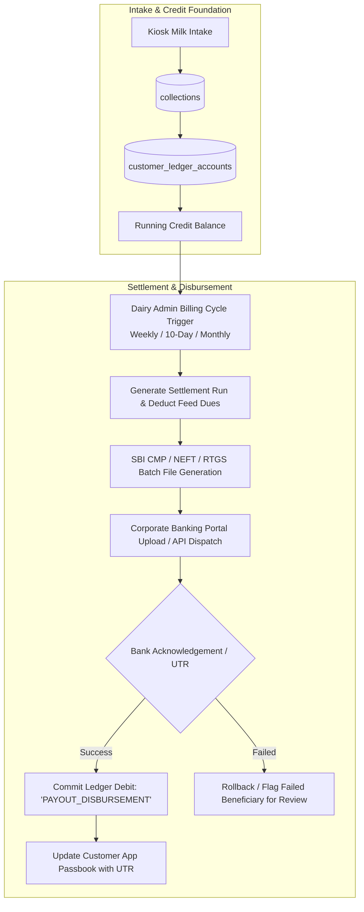

# ROADMAP PHASE 09: ARCHITECTURAL HANDOFF SPECIFICATION

**Document ID:** `DFARM-ROADMAP-PHASE-09-HANDOFF`  
**From:** Roadmap Phase 08 — Collection App & Kiosk Operational Integration  
**To:** Roadmap Phase 09 — Banking Settlements, Direct Payouts & Bulk Rail Disbursal  
**Target Applications:** `services/backend`, `apps/dfarm-dairy-admin`, `apps/dfarm-customer-app`  
**Status:** Ready for Phase 09 Kickoff  

---

## 1. Executive Summary & Phase Baseline

With the successful completion and verification of Roadmap Phase 08, the DFarm platform possesses a production-grade, offline-capable milk collection counter environment. Milk intake transactions are captured from real hardware (weighing scales, milk analyzers) and authenticated via biometrics (YuNet/SFace INT8) or RFID cards.

Every confirmed intake creates an authoritative `MILK_CREDIT` entry in the double-entry customer ledger within the isolated tenant PostgreSQL database (`dfarm_tenant_<code_hash>`).

Roadmap Phase 09 is the financial settlement phase responsible for converting accumulated ledger credit balances into actual disbursements to farmers via direct banking rails.

---

## 2. Platform State Delivered by Phase 08

The incoming engineering team for Roadmap Phase 09 inherits a stable, fully tested platform baseline:

1. **Transactional Intake Foundation:**
   - Table `collections`: Contains raw physical intake records with volume, FAT, SNF, calculated rate per liter, total amount, operator identity, device mapping, and session linkage.
   - Table `collection_sessions`: Provides session boundaries (`MORNING` / `EVENING`), shift metrics, and total volume/amount aggregations.
2. **Double-Entry Ledger Foundation:**
   - Table `customer_ledger_accounts`: Tracks real-time current balances for all active patrons.
   - Table `ledger_transactions`: Records immutable transaction history with entry types `MILK_CREDIT`, `FEED_PURCHASE`, and running balances.
3. **Patron Banking Beneficiary Data:**
   - Table `customers`: Stores validated patron bank details (`bank_account_number`, `bank_ifsc`, `bank_account_holder`, `bank_name`, and beneficiary verification status).
4. **Verified Multi-Tenancy:**
   - Clean architecture tenant routing middleware dynamically routes requests to the appropriate dairy cooperative database without cross-tenant bleed.
5. **Quality Assurance Baseline:**
   - 182 automated tests passing with 100% compliance across all 4 monorepo packages.

---

## 3. Roadmap Phase 09 Scope & Responsibilities

Roadmap Phase 09 focuses exclusively on billing cycle generation, bank payment rail integration, and settlement debits:

### 3.1 Primary Deliverables for Phase 09:
1. **Billing Cycle Settlement Generator (`services/backend`):**
   - Period-based settlement calculations (e.g., 1st to 10th, 11th to 20th, 21st to end of month).
   - Net payout calculation:
     $$\text{Net Payout} = \sum \text{Milk Credits} - \sum \text{Feed Purchases} - \text{Advance Deductions}$$
2. **Corporate Banking Rail Formatter:**
   - **SBI Corporate Multi-Payment (CMP):** Encrypted/fixed-width file format generation for bulk direct bank credit.
   - **Standard NEFT / RTGS CSV:** Standard RBI-compliant batch upload files for regional cooperative rural banks (DCCB, RRB).
3. **Settlement Ledger Atomicity:**
   - Commit ledger transactions with `entry_type = 'PAYOUT_DISBURSEMENT'` and `direction = 'DEBIT'`.
   - Update `customer_ledger_accounts.current_balance = current_balance - payout_amount`.
4. **Farmer Notification & Passbook Reflection:**
   - Real-time or batch push notifications to `apps/dfarm-customer-app` alerting farmers of payment processing, bank reference (UTR number), and net credit amount.

---

## 4. Strict Constraints & Non-Negotiables for Phase 09

1. **NO THIRD-PARTY CONSUMER PAYMENT GATEWAYS:**
   - Do **NOT** introduce consumer payment gateways like Razorpay, Stripe, Paytm, or PayPal for farmer milk disbursements. Rural agricultural disbursements operate strictly through commercial/cooperative corporate banking rails (SBI CMP, ACH/NACH, Direct NEFT/RTGS).
2. **PRESERVE CLAYMORPHISM UI DESIGN:**
   - In `apps/dfarm-dairy-admin` and `apps/dfarm-customer-app`, maintain the established claymorphism aesthetic and component library. Do not redesign or replace UI frameworks.
3. **PRESERVE PHYSICAL DATABASE-PER-DAIRY ISOLATION:**
   - All banking settlement records, payment batches, and ledger transactions must reside inside the respective dairy cooperative's dedicated PostgreSQL database. Never centralize financial balances in the Super Admin database.
4. **IDEMPOTENCY IN BANK INGESTION:**
   - Every settlement batch must carry a deterministic unique batch identifier to prevent duplicate debit generation or double bank payouts.

---

## 5. Architectural Checklist Before Phase 09 Launch

- [x] Phase 08 kiosk intake verified with real hardware drivers and Web Serial.
- [x] Phase 08 offline sync verified with IndexedDB and push protocol.
- [x] Double-entry ledger creates `MILK_CREDIT` entries atomically.
- [x] All 182 monorepo unit and integration tests passing.
- [x] Production builds succeed across all 4 monorepo applications.
- [x] Tenant database schema contains active bank account fields in `customers`.

Phase 08 is formally concluded. Roadmap Phase 09 is authorized to proceed.
