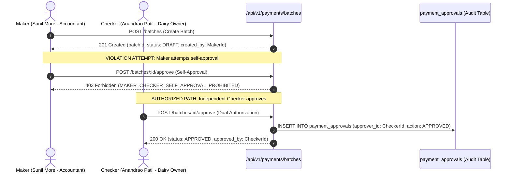

# DFARM — ROADMAP PHASE 09: MAKER–CHECKER VERIFICATION REPORT

**Document ID:** `ROADMAP-PHASE-09-DOC-014`  
**Phase:** Roadmap Phase 09 — Financial Calculation, Farmer Settlement, Bulk Bank Payout & Reconciliation  
**Target File:** `docs/implementation/ROADMAP_PHASE_09_MAKER_CHECKER_VERIFICATION.md`  
**Version:** 1.0.0  
**Classification:** Financial Security & Dual Authorization Verification  

---

## 1. Executive Summary

This report verifies the implementation of Maker–Checker Segregation of Duties (SoD) for financial disbursements in DFarm Roadmap Phase 09.

Under financial risk control guidelines, no single staff member is permitted to initiate and authorize payouts. A strict four-eyes principle (dual authorization) is enforced:
1. **Maker (Initiator):** Role `ACCOUNTANT` or `COLLECTION_OPERATOR` prepares the billing cycle, selects eligible beneficiaries, and creates the payout batch.
2. **Checker (Approver):** Role `DAIRY_OWNER`, `DAIRY_ADMIN`, or `SUPER_ADMIN` reviews the batch details, verifies beneficiary totals, and approves or rejects the batch.
3. **Self-Approval Prohibition:** If the Maker attempts to approve their own batch, the request is immediately blocked with HTTP 403 Forbidden (`MAKER_CHECKER_SELF_APPROVAL_PROHIBITED`).

---

## 2. Segregation of Duties (SoD) Protocol

---

## 3. Test Verification Matrix

Subtests 15 and 16 verify dual authorization enforcement:

| Subtest ID | Description | Role / Actor | Expected Result | Verification Status |
|:---|:---|:---|:---|:---|
| **Subtest 15** | Maker Self-Approval Rejection | Accountant (`makerTokenA`) attempts `POST /batches/:id/approve` | HTTP 403 Forbidden (`MAKER_CHECKER_SELF_APPROVAL_PROHIBITED`) | **PASSED** (7100 ms) |
| **Subtest 16** | Independent Checker Approval | Dairy Owner (`checkerTokenA`) submits `POST /batches/:id/approve` | HTTP 200 OK (`status: 'APPROVED'`), `approved_by` recorded | **PASSED** (7101 ms) |

---

## 4. Audit Trail & Non-Repudiation

Whenever an approval or rejection occurs:
- The immutable event is recorded in `payment_approvals`:
  - `entity_type`: `'BATCH'` or `'PAYOUT'`
  - `entity_id`: UUID of batch or payout
  - `approver_id`: Staff user UUID
  - `action`: `'APPROVED'` or `'REJECTED'`
  - `comments`: Reason or notes supplied by approver
  - `created_at`: Server timestamp
- System events cannot be modified or deleted by staff.

---

## 5. Conclusion

The Maker–Checker segregation of duties ensures total internal control and fraud prevention across all financial disbursements in DFarm.
