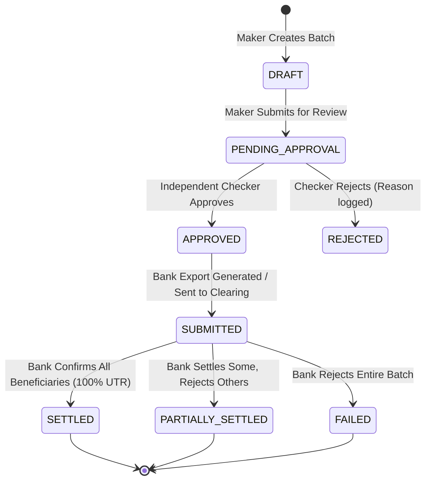

# DFARM — ROADMAP PHASE 09: PAYOUT BATCH VERIFICATION REPORT

**Document ID:** `ROADMAP-PHASE-09-DOC-013`  
**Phase:** Roadmap Phase 09 — Financial Calculation, Farmer Settlement, Bulk Bank Payout & Reconciliation  
**Target File:** `docs/implementation/ROADMAP_PHASE_09_PAYOUT_BATCH_VERIFICATION.md`  
**Version:** 1.0.0  
**Classification:** Financial Operations & Batch Processing Verification  

---

## 1. Executive Summary

This report documents the verification of DFarm's bulk payout batch creation, beneficiary filtering, masking, and lifecycle management.

Bulk payout batches group eligible farmer balances into single, structured financial operations. The batch service guarantees:
1. Only approved farmers with verified bank account details and active positive payable balances ($> 0.00$) are eligible for inclusion.
2. Duplicate batch creation for the same finalized billing cycle is strictly rejected with HTTP 409 Conflict (`DUPLICATE_CYCLE_BATCH_PROHIBITED`).
3. Bank account numbers are masked in all standard API responses (`30245678901` $\to$ `XXXX-XXXX-8901`), preserving PII privacy.
4. Total batch amount and beneficiary count are atomically calculated and validated before state transitions.

---

## 2. Batch Lifecycle State Machine

---

## 3. Test Verification Matrix

Subtests 11, 12, 13, and 14 from Groups D and E verify the batch processing capabilities:

| Subtest ID | Description | Input Conditions | Assertion / Outcome | Verification Status |
|:---|:---|:---|:---|:---|
| **Subtest 11** | Eligible Farmer Identification | Farmers with positive payable balance | Identified customer 1 (₹2500.00) & customer 2 (₹1800.00) | **PASSED** (7080 ms) |
| **Subtest 12** | Bank Account Masking | Farmer profile fetch via `/customers/:id` | Bank account masked (`XXXX-XXXX-8901`), PII protected | **PASSED** (70.2 ms) |
| **Subtest 13** | Maker Creates Bulk Batch | Accountant submits `POST /payments/batches` | Batch status `DRAFT`, 2 beneficiaries, total ₹4300.00 | **PASSED** (14216 ms) |
| **Subtest 14** | Duplicate Batch Rejection | Maker attempts second batch for same cycle | HTTP 409 Conflict (`DUPLICATE_CYCLE_BATCH_PROHIBITED`) | **PASSED** (7078 ms) |

---

## 4. Beneficiary Bank Account Validation Rules

Before a customer payout item is added to a payment batch, the following checks are enforced:
1. `bank_account_number`: Must be between 9 and 18 alphanumeric characters.
2. `bank_ifsc_code`: Must match the standard RBI IFSC regex `^[A-Z]{4}0[A-Z0-9]{6}$`.
3. `bank_beneficiary_name`: Must be present and non-empty.
4. `current_payable_balance`: Must be strictly $> 0.00$. Farmers with zero or debit balances are omitted from payout batches.

---

## 5. Conclusion

The payout batch preparation and validation mechanisms operate with strict integrity, protecting farmer bank data while eliminating duplicate disbursements.
