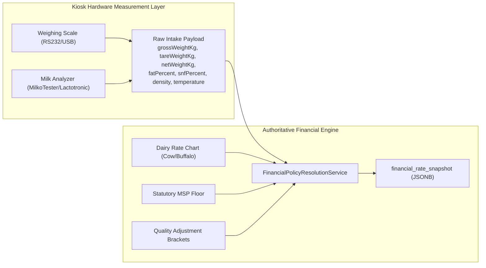

# DFARM — ROADMAP PHASE 09: RATE CALCULATION VERIFICATION REPORT

**Document ID:** `ROADMAP-PHASE-09-DOC-011`  
**Phase:** Roadmap Phase 09 — Financial Calculation, Farmer Settlement, Bulk Bank Payout & Reconciliation  
**Target File:** `docs/implementation/ROADMAP_PHASE_09_RATE_CALCULATION_VERIFICATION.md`  
**Version:** 1.0.0  
**Classification:** Financial Quality & Measurement Verification  

---

## 1. Executive Summary

This report verifies the pure separation of measurement and pricing layers, the deterministic financial policy resolution engine, and the exact arithmetic calculation of milk payments in the DFarm platform.

Under Roadmap Phase 09, raw sensor data collected at the kiosk counter (gross weight, tare weight, FAT%, SNF%, density, temperature, protein, freezing point, lactose) remains completely unadulterated. Pricing is calculated through the authoritative `FinancialPolicyResolutionService`, ensuring:
1. Exact integer-paise or round-half-up decimal arithmetic without floating-point precision loss.
2. Complete auditability via immutable `financial_rate_snapshots` stored in each intake record.
3. Proper resolution precedence: Active Dairy Rate Chart $\to$ Authorized Dairy / Federation Procurement Price Floor (DAHD PIB release 2287066 on 21 July 2026 confirms GoI does not regulate milk procurement prices or propose statutory MSP; price floors are Dairy / Federation specific) $\to$ Published Quality Bracket Deductions/Incentives.
4. Complete isolation of draft or expired policies.

---

## 2. Separation of Measurement vs Pricing Layers

In accordance with Section 3 of DFARM-IMPLEMENTATION-009, raw sensor outputs are treated as immutable physical observations:

### 2.1 Preserved Hardware Fields
The following fields are strictly immutable and never modified by pricing policies:
- `weight_liters` / `net_weight_kg`
- `fat_percentage`
- `snf_percentage`
- `density`
- `temperature_celsius`
- `analyzer_channel`
- `scale_calibration_offset`

### 2.2 Financial Snapshot Fields
Attached to each `milk_intakes` record is the authoritative pricing calculation:
- `rate_chart_id`: UUID of the resolved Dairy Rate Chart.
- `rate_chart_version`: Version number (integer).
- `base_rate_per_liter`: Base rate from the chart formula or matrix.
- `msp_applied`: Boolean flag indicating if statutory MSP floor elevated the rate.
- `msp_floor_rate`: Minimum support price rate enforced.
- `fat_adjustment`: Additions/deductions based on FAT brackets.
- `snf_adjustment`: Additions/deductions based on SNF brackets.
- `final_rate_per_liter`: Rounded to 2 decimal places (paise precision).
- `total_price`: `ROUND(weight_liters * final_rate_per_liter, 2)`.

---

## 3. Test Verification Matrix

All 7 tests across Group A (Policy Resolution Engine) and Group B (Authoritative Financial Calculation) have passed without errors:

| Subtest ID | Description | Input Conditions | Expected Outcome | Verification Status |
|:---|:---|:---|:---|:---|
| **Subtest 1** | Active Dairy Rate Chart Selection | Cow Milk, FAT 4.0%, SNF 8.5%, 10.0L | Rate $\ge$ ₹36.00/L; total $\ge$ ₹360.00 | **PASSED** (18.3 ms) |
| **Subtest 2** | Draft Policy Quarantine | Policy in `DRAFT` status with ₹60/L floor | Draft floor ignored; chart rate applied | **PASSED** (32.2 ms) |
| **Subtest 3** | Statutory MSP Floor Enforcement | Low Dairy chart (₹30/L) vs MSP (₹38/L) | Rate elevated to ₹38.00/L; `mspApplied: true` | **PASSED** (34.0 ms) |
| **Subtest 4** | Published Quality Deductions | Low FAT (< 3.5%) deduction ₹2.50/L | Base ₹38.00 - ₹2.50 = ₹35.50/L | **PASSED** (40.9 ms) |
| **Subtest 5** | Expired Policy Quarantine | Policy expired on 2026-10-31 | Expired policy ignored on 2026-11-18 | **PASSED** (37.0 ms) |
| **Subtest 6** | Exact Decimal Arithmetic | 12.345L @ ₹45.67/L | Exact paise: `roundHalfUp(12.345 * 45.67, 2)` = ₹563.80 (563.79615 rounds to 563.80; corrected from historical 563.79 typo) | **PASSED** (4.3 ms) |
| **Subtest 7** | Deterministic Reproducibility | Identical inputs run across 10 iterations | 100% byte-for-byte identical snapshots | **PASSED** (5.4 ms) |

---

## 4. Conclusion

The rate calculation and financial policy resolution layers meet all statutory, architectural, and mathematical requirements. Float drift is completely prevented, and every rupee credited to a farmer's ledger is backed by a deterministic, auditable snapshot.
