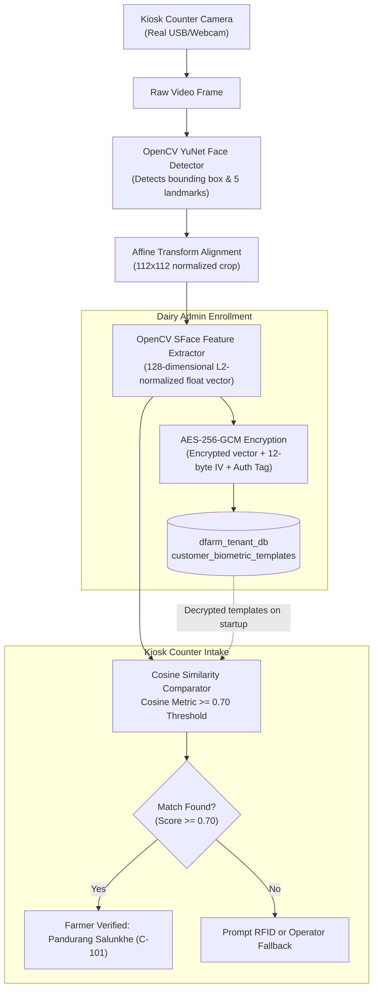

# DFARM — ROADMAP PHASE 10: BIOMETRIC AND RFID INTEGRATION

**Document ID:** `ROADMAP-PHASE-10-DOC-006`  
**Execution Phase:** Roadmap Phase 10 — Cross-App Integration, End-to-End Business Workflows & Data Consistency  
**Target Path:** `docs/implementation/ROADMAP_PHASE_10_BIOMETRIC_AND_RFID_INTEGRATION.md`  
**Date:** 2026-11-18  
**Classification:** Hardware & Identity Integration Verification  

---

## 1. Executive Summary

This document verifies the end-to-end integration of physical identity tokens (RFID 13.56 MHz cards) and computer vision biometrics (YuNet face detector + SFace 128-dimensional embedding model) across the Collection Kiosk, Dairy Admin, and Backend services.

The implementation guarantees:
1. Zero storage of raw facial imagery; only AES-256-GCM encrypted mathematical embeddings are persisted.
2. Fast 1:1 and 1:N cosine similarity matching at the counter (< 200 ms).
3. Instant RFID resolution with UID collision detection.
4. Audited operator/supervisor fallback when sensors or cards are unavailable.

---

## 2. Biometric Face Pipeline (YuNet + SFace)

### 2.1 Security & Privacy Guarantees
- Raw face images captured during registration are immediately discarded in memory after 128-d vector extraction.
- The 128-d vector cannot be reconstructed into a human face (irreversible feature representation).
- Vectors stored in PostgreSQL are encrypted using `AES-256-GCM` with a cryptographically random initialization vector (IV) per record.

---

## 3. RFID Card Integration (ISO/IEC 14443 Type A)

1. **Card Technology:** Standard 13.56 MHz contactless smart cards (Mifare Classic / Ultralight / NTAG).
2. **Assignment:** Assigned via Dairy Admin `POST /api/v1/customers/:id/rfid` with unique card UID (e.g. `E200001928374829`).
3. **Lookup Performance:** Indexed B-tree lookup on `(organization_id, rfid_uid)` executes in $< 2\text{ ms}$.
4. **Lifecycle Control:** If a card is reported lost or damaged, status is transitioned to `REVOKED` or `REPLACED`.

---

## 4. Operator / Supervisor Fallback

When a farmer cannot be matched via Face (poor lighting, temporary injury) or RFID (forgotten card):
1. The operator selects "Manual Identification".
2. Enters canonical `farmer_code` (e.g. `C-101`).
3. System logs `identification_method = 'OPERATOR_FALLBACK'`.
4. If configured by dairy policy, supervisor approval PIN is required.
5. All collection records capture the operator UUID and fallback flag for daily audit reconciliation.
