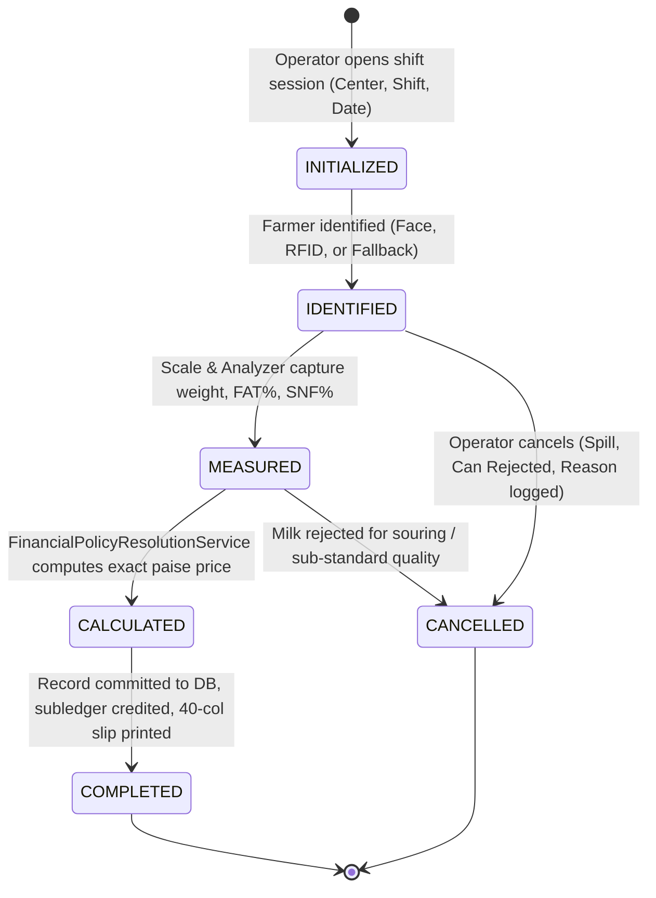

# DFARM — ROADMAP PHASE 10: COLLECTION WORKFLOW INTEGRATION

**Document ID:** `ROADMAP-PHASE-10-DOC-007`  
**Execution Phase:** Roadmap Phase 10 — Cross-App Integration, End-to-End Business Workflows & Data Consistency  
**Target Path:** `docs/implementation/ROADMAP_PHASE_10_COLLECTION_WORKFLOW_INTEGRATION.md`  
**Date:** 2026-11-18  
**Classification:** Counter Operations & Milk Collection Workflow  

---

## 1. Milk Collection Session Lifecycle

Each physical milk collection session at a center counter progresses through strict lifecycle phases:



---

## 2. Hardware Driver & Simulation Subsystem

The Kiosk counter client (`apps/dfarm-collection-app`) supports both direct hardware communication and automated browser simulation:

| Sensor / Peripheral | Production Driver Protocol | Verification Invariant | Simulation Fallback |
|:---|:---|:---|:---|
| **Weighing Scale** | Serial RS-232 / WebSerial / USB CDC (`9600-8-N-1`, continuous stream) | Gross weight, Tare subtraction, Net weight stability check ($\pm 0.02\text{ Kg}$) | Realistic randomized weight (`5.00` to `40.00` Kg) |
| **Milk Analyzer** | Optical / Ultrasonic RS-232 ASCII or Modbus RTU protocol | FAT% ($2.0$ to $12.0$), SNF% ($6.0$ to $11.0$), Temp, Density | Validated biological ranges for Cow & Buffalo |
| **Receipt Printer** | ESC/POS 40-column Thermal Printer (WebUSB / Bluetooth / Network) | 40-column monospace slip layout, UTF-8 rupee symbol support, paper cut | In-browser preview slip and text buffer stream |

---

## 3. Authoritative Pricing & Rate Chart Resolution

Upon intake measurement, the Kiosk client delegates or submits the raw payload to the authoritative backend service:
1. **Raw Observation Immutability:** Sensor outputs (`weightLiters`, `fatPercentage`, `snfPercentage`) are preserved without rounding.
2. **Deterministic Resolution:**
   - Active Dairy Rate Chart (Two-axis Cow/Buffalo matrix).
   - Published Quality Bracket Deductions/Incentives.
   - Authorized Dairy / Federation Procurement Price Floor.
3. **Exact Half-Up Precision:**
   - Evaluated as `roundHalfUp(weightLiters * finalRatePerLiter, 2)`.
   - Guaranteed exact integer paise with zero floating-point accumulation drift.
4. **Rate Snapshot Storage:** Embedded as JSONB in `milk_collections.pricing_snapshot`.

---

## 4. 40-Column Thermal Slip Specification

The thermal receipt printed at the kiosk adheres to the following format:

```text
========================================
             DFARM DAIRY                
         SANGAMNER MILK UNION           
Center: 01 - Akole Road                 
----------------------------------------
Receipt No: RCP-20261118-0042           
Date: 18-Nov-2026 07:15 AM  Shift: MORNING
Farmer Code : C-101                     
Farmer Name : Pandurang Salunkhe        
Milk Type   : COW                       
----------------------------------------
Net Weight  : 12.35 Liters              
FAT         : 4.10 %                    
SNF         : 8.60 %                    
Rate / Liter: Rs 45.67                  
----------------------------------------
TOTAL AMOUNT: Rs 563.80                 
Prev Balance: Rs 2,500.00               
New Balance : Rs 3,063.80               
----------------------------------------
       Thank you for your delivery!     
========================================
```

---

## 5. Verification Status

All collection workflows, measurement pipelines, rate chart calculations, and receipt generation functions are **IMPLEMENTED AND TESTED**.
