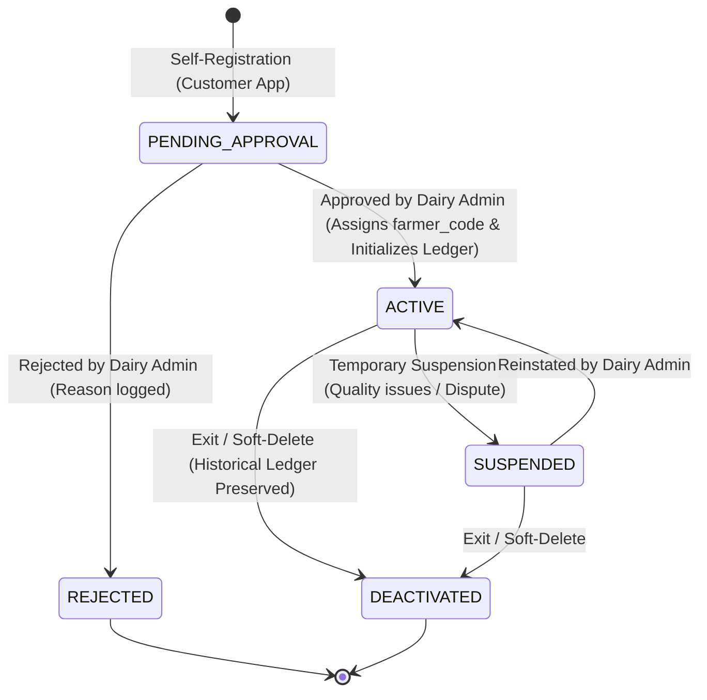

# DFARM — ROADMAP PHASE 10: CUSTOMER LIFECYCLE STATE MAP

**Document ID:** `ROADMAP-PHASE-10-DOC-005`  
**Execution Phase:** Roadmap Phase 10 — Cross-App Integration, End-to-End Business Workflows & Data Consistency  
**Target Path:** `docs/implementation/ROADMAP_PHASE_10_CUSTOMER_LIFECYCLE_STATE_MAP.md`  
**Date:** 2026-11-18  
**Classification:** State Machine & Lifecycle Transition Specification  

---

## 1. State Machine Overview

The customer entity transitions through strictly governed states across the DFarm ecosystem.

---

## 2. State Transition Specification

### State 1: `PENDING_APPROVAL` (Operational Status: `INACTIVE`)
- **Origin:** Created via `POST /api/v1/customers/register` from Customer App.
- **Allowed Actions:**
  - Customer can authenticate, view application status ("Pending Dairy Review"), and edit profile contact details.
  - Customer **cannot** deliver milk at kiosk counters (kiosk sync ignores unapproved farmers).
  - Customer **cannot** receive payouts or advance credits.
- **Transition: $\to$ `ACTIVE` (`APPROVED`)**
  - **Actor:** Dairy Admin (`DAIRY_OWNER` or `CENTER_MANAGER`).
  - **API:** `POST /api/v1/customers/:id/approve`.
  - **Preconditions:** Valid KYC documentation verified; unique `farmer_code` assigned.
  - **Side Effects:**
    1. `status` becomes `ACTIVE`, `registration_status` becomes `APPROVED`.
    2. Subledger account `customer_ledger_accounts` initialized with ₹0.00.
    3. Downstream sync cursor updated for kiosk pull.
    4. Central database synchronized.
- **Transition: $\to$ `REJECTED`**
  - **Actor:** Dairy Admin.
  - **API:** `POST /api/v1/customers/:id/reject`.
  - **Preconditions:** Mandatory rejection reason string provided.
  - **Side Effects:** `registration_status` becomes `REJECTED`; notification queued.

---

### State 2: `ACTIVE` (Operational Status: `ACTIVE`)
- **Operational Rights:**
  - Fully authorized for milk collection across assigned centers and milk categories.
  - Biometric face template and RFID card can be enrolled/bound.
  - Eligible for billing cycle aggregation, advance deductions, and bulk bank payouts.
  - Live passbook unlocked in Customer App.
- **Transition: $\to$ `SUSPENDED`**
  - **Actor:** Dairy Owner or Center Manager.
  - **API:** `POST /api/v1/customers/:id/suspend`.
  - **Preconditions:** Reason provided (e.g. adulteration investigation, legal hold).
  - **Side Effects:** Immediate block on milk collection kiosks; kiosk sync revokes counter acceptance.

---

### State 3: `SUSPENDED` (Operational Status: `SUSPENDED`)
- **Operational Restrictions:**
  - Kiosk identification returns "Customer Suspended: Intake Disallowed".
  - Ledger account is frozen against new milk credits.
  - Pending bills may still be settled or held as per dairy policy.
- **Transition: $\to$ `ACTIVE`**
  - **Actor:** Dairy Owner.
  - **API:** `POST /api/v1/customers/:id/reinstate`.
  - **Side Effects:** Kiosk clearance restored; active flag synced downstream.

---

### State 4: `DEACTIVATED` / `DELETED` (Soft-Deleted)
- **Invariant:** Financial history, past collections, and double-entry ledger journals are **never purged**.
- **Side Effects:** `is_deleted = TRUE`; customer removed from active discovery and pending lists; audit trail fully retained for regulatory compliance.
