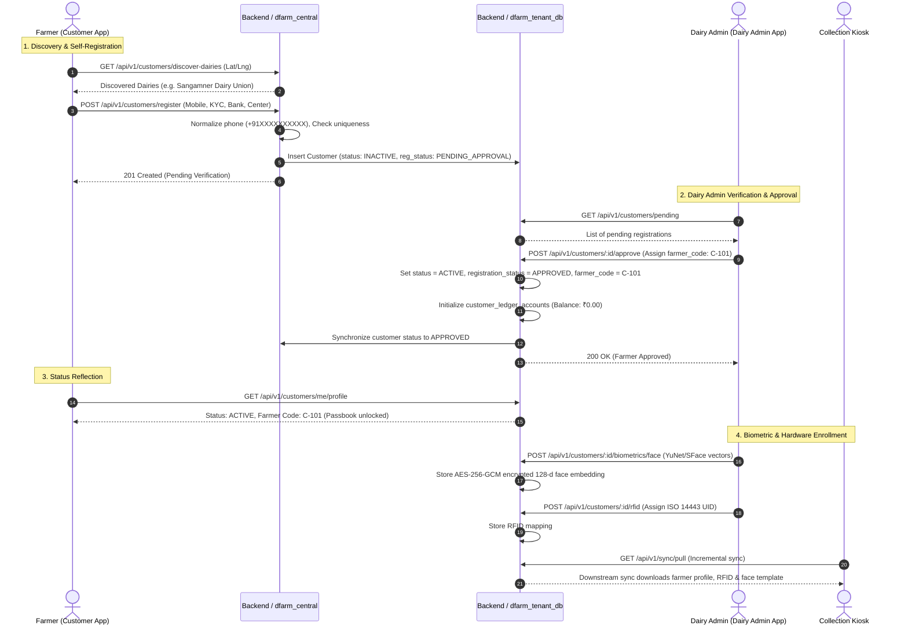

# DFARM — ROADMAP PHASE 10: CUSTOMER REGISTRATION & APPROVAL FLOW

**Document ID:** `ROADMAP-PHASE-10-DOC-004`  
**Execution Phase:** Roadmap Phase 10 — Cross-App Integration, End-to-End Business Workflows & Data Consistency  
**Target Path:** `docs/implementation/ROADMAP_PHASE_10_CUSTOMER_REGISTRATION_FLOW.md`  
**Date:** 2026-11-18  
**Classification:** Cross-Application Business Workflow Specification  

---

## 1. Flow Overview

The farmer onboarding journey spans the Customer App (`apps/dfarm-customer-app`), Dairy Admin App (`apps/dfarm-dairy-admin`), backend API gateway, central registry (`dfarm_central`), and the tenant-isolated operational database (`dfarm_tenant_<code_hash>`).

---

## 2. Technical Invariants & Data Integrity

1. **Normalized Mobile Uniqueness:**
   - E.164 phone normalization enforced at gateway.
   - Central database enforces unique index `(normalized_mobile_number)` for active farmers.
   - Submitting an existing mobile returns HTTP 409 Conflict with clear diagnostic message.
2. **Canonical Farmer Code Assignment:**
   - At self-registration, the farmer has no operational code.
   - Upon Dairy Admin approval, an authoritative, unique `farmer_code` (e.g. `C-101`, `C-102`) is assigned within the Dairy tenant.
3. **Automatic Ledger Initialization:**
   - Approval automatically initializes the double-entry subledger account `customer_ledger_accounts` with currency `INR` and `current_balance = 0.00`.
4. **Immediate Kiosk Synchronization:**
   - Approved customers and their biometric/RFID tokens are marked with downstream sync cursors, making them immediately pullable by offline kiosks during `GET /api/v1/sync/pull`.
