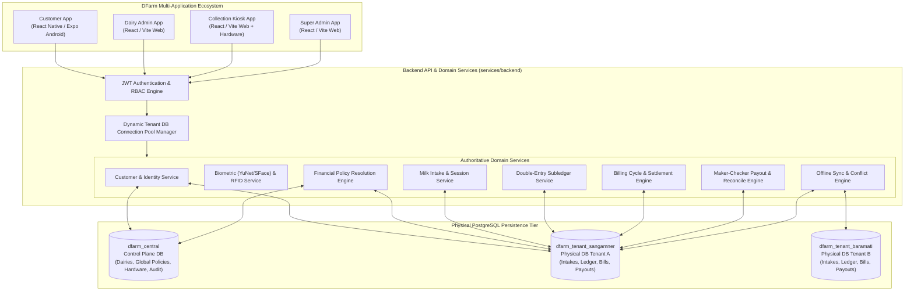
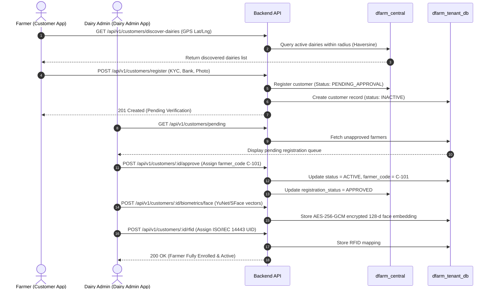
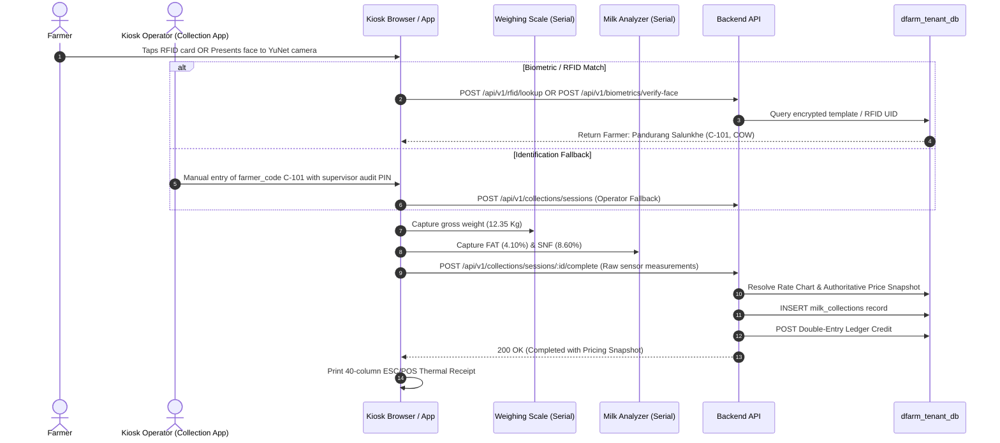
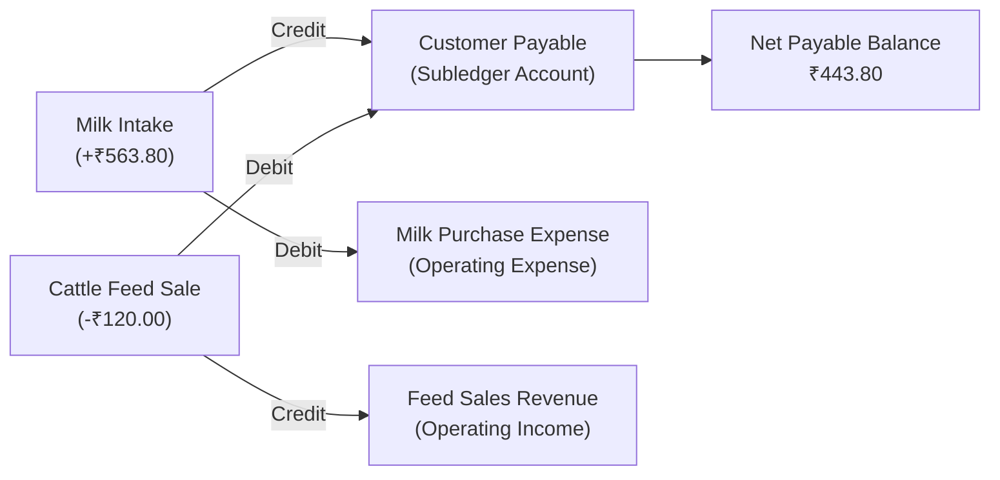
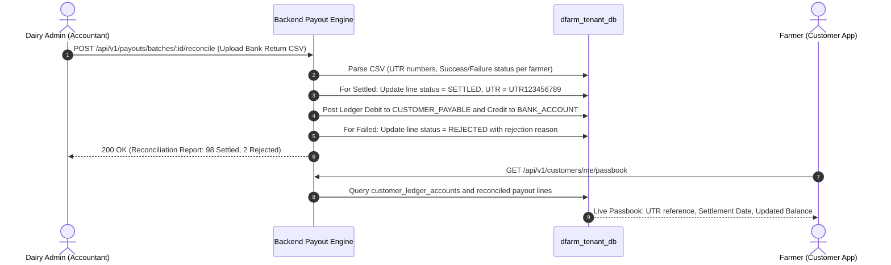

# DFARM — ROADMAP PHASE 10: INTEGRATION ARCHITECTURE PLAN

**Document ID:** `ROADMAP-PHASE-10-DOC-002`  
**Execution Phase:** Roadmap Phase 10 — Cross-App Integration, End-to-End Business Workflows & Data Consistency  
**Target Path:** `docs/implementation/ROADMAP_PHASE_10_INTEGRATION_ARCHITECTURE_PLAN.md`  
**Date:** 2026-11-18  
**Classification:** System Architecture & Cross-Application Integration Plan  

---

## 1. Architectural Foundation & Multi-Tenant Topology

The DFarm platform is built upon strict physical separation of tenant data, centralized control-plane governance, and event-driven end-to-end business workflows.



---

## 2. End-to-End Business Workflows (1 through 9)

### Workflow 1: Farmer Discovery, Registration, Biometrics & Approval


---

### Workflow 2: Face / RFID Identification, Operator Fallback & Milk Collection


---

### Workflow 3: Offline Milk Intake, Sync Reconciliation & Session Closure Policy
```mermaid
sequenceDiagram
    autonumber
    actor Operator as Kiosk Operator
    participant Kiosk as Kiosk Client (IndexedDB)
    participant Backend as Sync Engine (services/backend)
    participant TenantDB as dfarm_tenant_db

    Note over Kiosk: Internet Disconnected
    Operator->>Kiosk: Weighs & accepts milk delivery from Farmer C-102
    Kiosk->>Kiosk: Store in IndexedDB offline_queue (UUID idempotency key)
    Kiosk->>Kiosk: Print offline thermal receipt with timestamp & offline tag

    Note over Kiosk: Shift Session Closes on Server at 10:00 AM
    Note over Kiosk: Internet Reconnected at 11:30 AM
    Kiosk->>Backend: POST /api/v1/sync/push (Batch offline events)
    Backend->>TenantDB: Check target shift session status
    alt Target Session Open
        Backend->>TenantDB: INSERT milk_collections (COMPLETED)
        Backend->>TenantDB: INSERT ledger credit
    else Target Session Already Closed (Decision Gate Policy)
        Backend->>TenantDB: INSERT milk_collections (RECONCILIATION_REQUIRED)
        Backend->>TenantDB: INSERT sync_conflict_records (CLOSED_SESSION_LATE_ARRIVAL)
        Backend->>TenantDB: INSERT ledger credit with supervisor audit flag
        Note over Backend,TenantDB: Milk preserved; Farmer earnings protected; Audit trail created
    end
    Backend-->>Kiosk: 200 OK (Sync Acknowledged with status flags)
```

---

### Workflow 4: Quality Analysis, Rate Chart Resolution & Pricing Snapshot
1. **Raw Measurement Layer:** Net Weight, FAT%, SNF%, Density, and Temperature are captured raw and unadjusted.
2. **Authoritative Resolution Layer:**
   - Active Dairy Rate Chart (Two-axis Cow/Buffalo matrix or formula base).
   - Global Quality Brackets (Published FAT/SNF deduction or incentive rules).
   - Authorized Dairy / Federation Procurement Floor Rate (Enforces floor price).
3. **Exact Half-Up Decimal Arithmetic:**
   - Evaluated as `roundHalfUp(weightLiters * finalRatePerLiter, 2)`.
   - Result: `12.345 L * ₹45.67/L` = `563.79615` $\to$ **₹563.80**.
4. **Immutable JSONB Snapshot:** Stored inside the collection transaction record for 100% historical auditability.

---

### Workflow 5: Double-Entry Subledger, Feed Purchase & Net Payable Accumulation


Every financial movement writes balanced debits and credits:
$$\sum \text{Debits} = \sum \text{Credits}$$
Farmer current balance is maintained transactionally with optimistic concurrency control and zero drift.

---

### Workflow 6: Billing Cycle Generation, Bill Finalization & Payout Batch
1. **Billing Cycle Generation:**
   - Triggered for standard 10-day cycle (e.g. 1st to 10th of month).
   - Aggregates all completed milk intakes for the period.
   - Computes gross earnings, total liters, average FAT/SNF.
   - Deduces cattle feed charges, cash advances, and veterinary fees.
   - Generates `DRAFT` bills per farmer.
2. **Bill Finalization:**
   - Dairy Owner / Accountant reviews cycle summary.
   - Transitions bills from `DRAFT` to `FINALIZED`.
   - Locks underlying milk intakes against retro-adjustments.
3. **Maker-Checker Payout Batch:**
   - **Maker (Accountant):** Generates payout batch for all finalized bills with non-zero payable balances. Status: `DRAFT`.
   - **Checker (Dairy Owner):** Reviews batch, verifies total disbursement and beneficiary details, executes cryptographic approval. Status: `APPROVED`.
   - **Export:** Generates standardized NEFT bank payment CSV with mandatory IFSC, Account Number, Farmer Code, and Net Amount. Status: `PROCESSING`.

---

### Workflow 7: Bank Payout Reconciliation & Farmer Passbook Update


---

### Workflow 8: Super Admin Platform Oversight & Global AMC
1. **Multi-Tenant Health:** Super Admin monitors tenant database connection pools, storage size, and active migration status across all provisioned dairies.
2. **Global Policy Distribution:** Draft policies are quarantined; published policies are cryptographically signed and versioned.
3. **Cross-Tenant Isolation Invariant:** Super Admin queries central metadata only. No Super Admin query ever executes cross-dairy joins or bypasses tenant isolation boundaries.
4. **Hardware & AMC Tracking:** Global inventory of serial numbers, calibration records, and AMC expiry dates monitored with predictive warranty alerts.

---

### Workflow 9: Push / SMS Notification Event Lifecycle
1. **Event Trigger:** Milk intake recorded, bill finalized, or bank payout reconciled.
2. **Payload Construction:** Real event data (liters, fat, amount, UTR, balance). No synthetic templates.
3. **Provider Gateway:** Real SMS/Push dispatcher. If external gateway is unconfigured or offline in development, event is queued with status `QUEUED_EXTERNAL_GATEWAY` without crashing the financial transaction.

---

## 3. Data Integrity & Invariants

1. **Physical Isolation:** Each Dairy operates on an independent PostgreSQL database. Connection credentials and database names are isolated.
2. **Atomic Financial Transactions:** Intake recording, ledger updates, billing finalization, and payout reconciliation are wrapped in ACID PostgreSQL transactions.
3. **Strict Audit Trail:** Every override, supervisor fallback, offline reconciliation, and maker-checker approval records the operator UUID, timestamp, and immutable reason.
