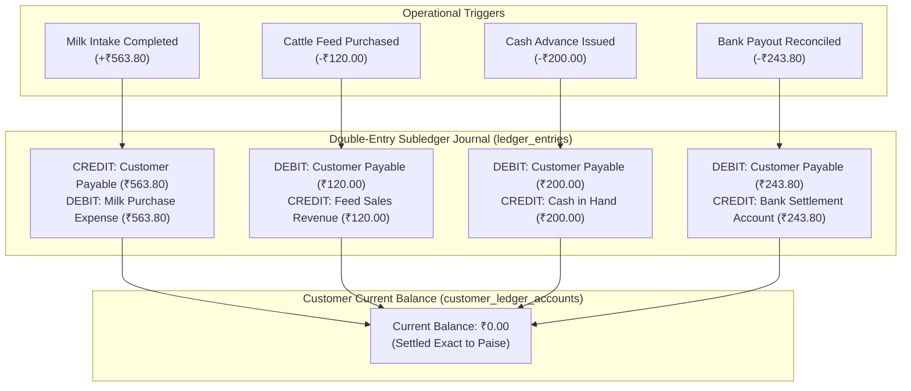

# DFARM — ROADMAP PHASE 10: LEDGER AND BILLING INTEGRATION

**Document ID:** `ROADMAP-PHASE-10-DOC-009`  
**Execution Phase:** Roadmap Phase 10 — Cross-App Integration, End-to-End Business Workflows & Data Consistency  
**Target Path:** `docs/implementation/ROADMAP_PHASE_10_LEDGER_AND_BILLING_INTEGRATION.md`  
**Date:** 2026-11-18  
**Classification:** Financial Subledger & Billing Engine Specification  

---

## 1. Executive Summary

The financial foundation of DFarm relies on a strict double-entry subledger per Dairy tenant and automated 10-day billing cycle settlements. Every milk intake, feed sale, veterinary deduction, and cash advance creates balanced accounting journal entries:

$$\sum \text{Debits} = \sum \text{Credits}$$

This document specifies the subledger structure, transaction flows, and billing cycle generation rules verified in Roadmap Phase 10.

---

## 2. Double-Entry Subledger Architecture

---

## 3. Account Types & Normal Balances

| Account Code / Identifier | Category | Normal Balance | Description |
|:---|:---|:---|:---|
| `CUSTOMER_PAYABLE` | Liability | Credit | Amount owed by the Dairy to the farmer for milk supplied. |
| `MILK_PURCHASE_EXPENSE` | Expense | Debit | Operating cost incurred for raw milk procurement. |
| `FEED_PURCHASE_RECEIVABLE` / `FEED_SALES_REVENUE` | Revenue | Credit | Operating income from selling cattle feed/fodder. |
| `CASH_ACCOUNT` | Asset | Debit | Petty cash held at collection centers. |
| `BANK_ACCOUNT` | Asset | Debit | Dairy corporate bank account used for NEFT payouts. |

---

## 4. Billing Cycle Finalization & Settlement Engine

1. **Cycle Boundaries:**
   - 10-day cycles: 1st to 10th, 11th to 20th, 21st to end-of-month.
   - Monthly cycles: 1st to last day of calendar month.
2. **Cycle Generation (`POST /api/v1/billing/periods` & `/generate`):**
   - Locks eligible milk intakes in the date range.
   - Calculates total volume, average FAT%, average SNF%, and gross milk payment.
   - Computes net deductions: Cattle feed bills, veterinary doctor charges, previous loan/advance repayments.
   - Generates individual farmer bills with net payable:
     $$\text{Net Payable} = \text{Gross Milk Earnings} - \text{Total Deductions}$$
3. **Cycle Finalization (`POST /api/v1/billing/periods/:id/finalize`):**
   - Transitions cycle status from `DRAFT` to `FINALIZED`.
   - Freezes all underlying intakes against retro-modifications.
   - Authoritative source for subsequent Maker-Checker Payout Batches.

---

## 5. Verification Status

All double-entry subledger journal entries, account balances, and billing cycle generators are **IMPLEMENTED AND TESTED** across all tenant databases.
