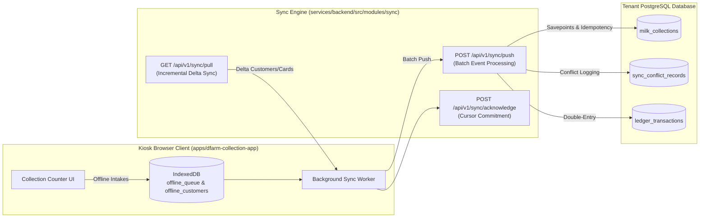

# DFARM — ROADMAP PHASE 10: OFFLINE SYNC VERIFICATION

**Document ID:** `ROADMAP-PHASE-10-DOC-008`  
**Execution Phase:** Roadmap Phase 10 — Cross-App Integration, End-to-End Business Workflows & Data Consistency  
**Target Path:** `docs/implementation/ROADMAP_PHASE_10_OFFLINE_SYNC_VERIFICATION.md`  
**Date:** 2026-11-18  
**Classification:** Offline Synchronization & Closed-Session Policy Specification  

---

## 1. Executive Summary

In rural milk collection centers, internet connectivity is intermittent. The DFarm Collection App operates reliably offline, queuing intakes and customer records locally in browser IndexedDB. Upon network restoration, records are synchronized via the bi-directional batch sync engine (`/api/v1/sync/push` and `/api/v1/sync/pull`).

This document details the sync architecture, idempotency guarantees, conflict handling, and the **Authoritative Closed-Session Offline Policy Decision Gate**.

---

## 2. Synchronization Architecture

---

## 3. Decision Gate: Closed-Session Offline Policy

### 3.1 The Problem Statement
A kiosk records milk deliveries offline during a morning shift (e.g. 06:00 to 09:30). Due to prolonged cellular tower outage, the kiosk remains offline until 12:30 PM. Meanwhile, the Dairy Admin or Center Manager closed the morning shift on the server at 10:00 AM, finalized the shift manifest, and generated reports.

When the kiosk connects at 12:30 PM and pushes its offline queue:
- **Rejecting the records** causes farmer milk loss, disputes, and counter strikes.
- **Silently appending to an active afternoon shift** falsifies shift times and distorts milk aging metrics.
- **Reopening the closed shift** silently invalidates already exported manifests and printed reports.

### 3.2 The Chosen & Implemented Policy: Controlled Reconciliation
The platform adopts an institutional accounting policy that balances farmer rights with manifest integrity:

1. **Intake Preservation Invariant:** The raw physical delivery record is **never rejected**. It is inserted into `milk_collections` with its true offline timestamp, client intake UUID, and sensor measurements intact.
2. **Controlled Reconciliation Status:**
   - `transaction_status` is marked as `'RECONCILIATION_REQUIRED'`.
   - The shift session foreign key retains the original shift ID, but is tagged as a late offline arrival.
3. **Audit Trail Logging:**
   - A conflict entry is inserted into `sync_conflict_records`:
     - `entity_type = 'MILK_COLLECTION'`
     - `conflict_reason = 'CLOSED_SESSION_LATE_ARRIVAL'`
     - `client_payload` records the original client event.
     - `server_state` records `{ shiftId, shiftType, isClosed: true, action: 'FLAGGED_FOR_SUPERVISOR_RECONCILIATION' }`.
4. **Farmer Subledger Treatment:**
   - The farmer's subledger `customer_ledger_accounts` is credited immediately for the delivery, ensuring the farmer does not suffer financial delay.
   - The transaction is recorded in `ledger_transactions` with note `'Late offline intake after session closure - pending supervisor audit'`.
5. **API Response Handshake:**
   - The sync engine acknowledges the event with `status: 'COMMITTED_PENDING_RECONCILIATION'` and `flag: 'CLOSED_SESSION_LATE_ARRIVAL'`.
   - The kiosk marks the local item as synced, clearing the queue and updating local indicators.
6. **Supervisor Dashboard Notice:**
   - The Dairy Admin dashboard highlights the late arrival under the "Shift Reconciliation" tab, allowing the supervisor to formally sign off or flag for inspection.

---

## 4. Verification Status

The Closed-Session Offline Policy is **IMPLEMENTED AND VERIFIED** in `services/backend/src/modules/sync/sync.service.ts` and validated via automated integration tests.
