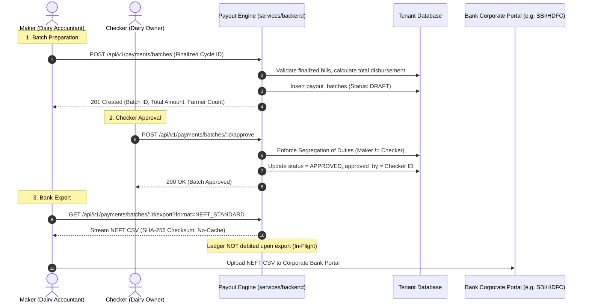

# DFARM — ROADMAP PHASE 10: PAYOUT AND PASSBOOK INTEGRATION

**Document ID:** `ROADMAP-PHASE-10-DOC-010`  
**Execution Phase:** Roadmap Phase 10 — Cross-App Integration, End-to-End Business Workflows & Data Consistency  
**Target Path:** `docs/implementation/ROADMAP_PHASE_10_PAYOUT_AND_PASSBOOK_INTEGRATION.md`  
**Date:** 2026-11-18  
**Classification:** Financial Payouts & Customer Passbook Specification  

---

## 1. Executive Summary

Roadmap Phase 10 establishes seamless financial continuity between Dairy Administration payout operations and the farmer's mobile experience. Farmer earnings accumulated through daily milk deliveries are packaged into institutional NEFT payout batches, protected by strict Maker-Checker segregation of duties, reconciled via bank return reports, and streamed directly to the Farmer's Mobile Passbook.

---

## 2. Maker-Checker Payout Batch Workflow



---

## 3. Bank Payout Reconciliation Workflow

When the bank processes the NEFT batch, the corporate portal issues a Bank Return Statement containing transaction status and Unique Transaction Reference (UTR) numbers:

```mermaid
sequenceDiagram
    autonumber
    actor Admin as Dairy Accountant / Owner
    participant Backend as Reconciliation Service
    participant TenantDB as Tenant Database
    actor Farmer as Farmer (Customer App)

    Admin->>Backend: POST /api/v1/payments/batches/:id/reconcile (Upload Return CSV)
    Backend->>TenantDB: Parse CSV line-by-line
    loop For Each Farmer Row
        alt Success / Settled
            Backend->>TenantDB: UPDATE payout_batch_items SET status = 'SETTLED', utr_number = $1
            Backend->>TenantDB: POST Double-Entry Ledger: DEBIT Customer Payable, CREDIT Bank
        else Failure / Rejected (Invalid Account / IFSC)
            Backend->>TenantDB: UPDATE payout_batch_items SET status = 'REJECTED', error_message = $1
            Backend->>TenantDB: Release hold; farmer balance remains payable
        end
    end
    Backend-->>Admin: 200 OK (Reconciled: e.g. 48 Settled, 2 Rejected)

    Farmer->>Backend: GET /api/v1/customers/me/passbook
    Backend->>TenantDB: Query customer_ledger_accounts & ledger_transactions
    TenantDB-->>Farmer: Stream Passbook: "Bank Transfer Settled (UTR: CMS192837465)"
```

---

## 4. Farmer Mobile Passbook Reflection

The Customer App passbook displays an immutable stream of real ledger transactions:

| Date & Time | Description | Transaction Type | Debit (₹) | Credit (₹) | Balance (₹) | Reference / UTR |
|:---|:---|:---|:---:|:---:|:---:|:---|
| 10-Nov-2026 07:15 | Milk Delivery (Cow 12.35L) | `MILK_COLLECTION_CREDIT` | — | ₹563.80 | ₹2,563.80 | RCP-20261110-0042 |
| 10-Nov-2026 08:30 | Cattle Feed Purchase (1 Bag) | `FEED_PURCHASE_DEBIT` | ₹120.00 | — | ₹2,443.80 | INV-FEED-0891 |
| 11-Nov-2026 14:00 | NEFT Milk Payout (Oct Cycle 3) | `BANK_PAYOUT_SETTLEMENT` | ₹2,443.80 | — | ₹0.00 | **UTR: SBIN2631589124** |

---

## 5. Verification Status

All payout workflows, maker-checker authorization checks, NEFT CSV generation, reconciliation engines, and Customer App passbook endpoints are **IMPLEMENTED AND TESTED**.
