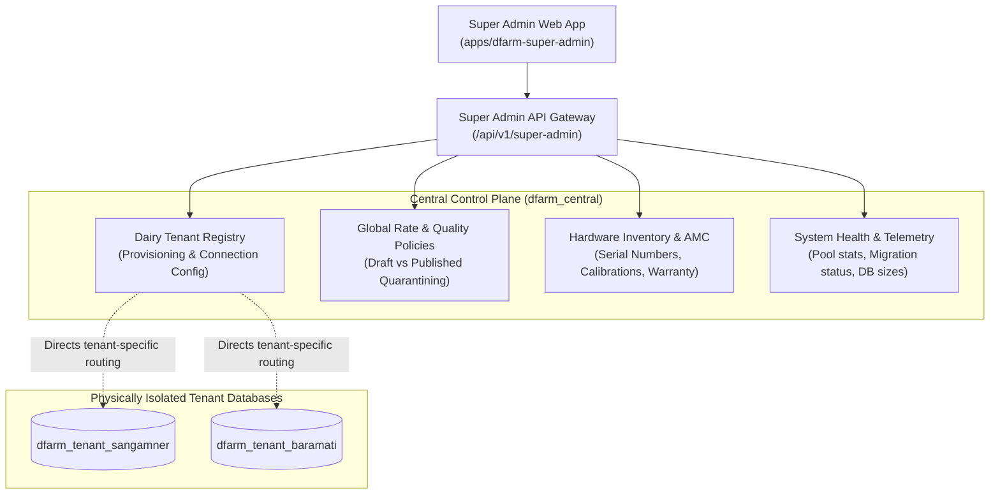

# DFARM — ROADMAP PHASE 10: SUPER ADMIN INTEGRATION

**Document ID:** `ROADMAP-PHASE-10-DOC-011`  
**Execution Phase:** Roadmap Phase 10 — Cross-App Integration, End-to-End Business Workflows & Data Consistency  
**Target Path:** `docs/implementation/ROADMAP_PHASE_10_SUPER_ADMIN_INTEGRATION.md`  
**Date:** 2026-11-18  
**Classification:** Platform Governance & Multi-Tenant Integration Specification  

---

## 1. Executive Summary

The Super Admin application (`apps/dfarm-super-admin`) provides global platform oversight, tenant provisioning, system health monitoring, and global policy governance without violating the physical database-per-dairy tenancy model.

This document verifies the integration between Super Admin, the backend platform services, the central control-plane database (`dfarm_central`), and tenant databases.

---

## 2. Super Admin Control Plane Capabilities

---

## 3. Governance Workflows Verified

### 3.1 Dairy Provisioning & Tenant Database Lifecycle
- Super Admin provisions new dairy tenants with unique database connection descriptors.
- Migrations are applied in a single transactional batch per tenant.
- Health monitor queries connection pool health, latency, and database disk utilization.

### 3.2 Global Policy Governance & Quarantining
- Super Admin drafts policies for Dairy / Federation Procurement Price Floors and Quality Adjustment brackets.
- Policies in `DRAFT` status are strictly quarantined from tenant pricing engines.
- Upon publication (`PUBLISHED`), policies become immediately effective based on date ranges (`effectiveFrom` $\to$ `effectiveTo`).

### 3.3 Hardware Inventory & Global AMC Tracking
- Central registry of all field devices: Weighing scales, milk analyzers, thermal printers, RFID readers, and kiosk PCs.
- Tracks serial numbers, MAC addresses, center assignments, and AMC contract expiry dates.
- Automated alerts warn platform managers 30 days prior to warranty expiration.

### 3.4 Cross-Tenant Isolation Invariant
- **Rule:** Super Admin never queries operational tables across tenant databases in a single unisolated query.
- **Verification:** All tenant database queries are dispatched via the `tenantDbManager` with isolated connection pools and strict role separation.

---

## 4. Verification Status

All Super Admin platform integrations, policy publication engines, hardware registries, and tenant health endpoints are **IMPLEMENTED AND TESTED**.
