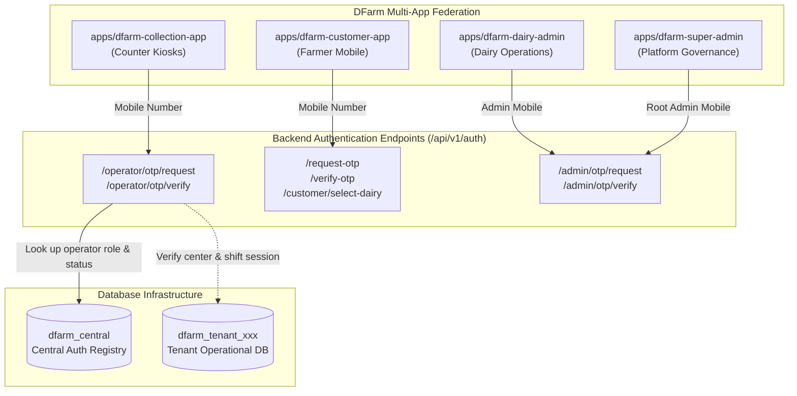

# DFARM — Collection App Authentication Architecture Audit

**Execution Reference:** `DFARM-COLLECTION-OPERATOR-AUTHORIZATION-FIX`  
**Document:** `01_AUTHENTICATION_ARCHITECTURE_AUDIT.md`  
**Date:** 2026-11-20  
**Status:** COMPLETE AUDIT  

---

## 1. Architectural Overview

The DFarm platform employs a strict multi-tier, least-privilege authentication framework tailored to four separate application domains:

---

## 2. End-to-End Operator Authentication Flow

The Collection App login contract follows a 9-step cryptographic and identity verification lifecycle:

1. **Terminal Mobile Entry:** Operator enters a 10-digit mobile number at `apps/dfarm-collection-app/src/pages/auth/Login.tsx`.
2. **Phone Normalization:** Client formats input; backend instantiates `PhoneNumber(rawPhone)` ensuring canonical E.164 (`+91XXXXXXXXXX`) representation and 10-digit extraction (`slice(-10)`).
3. **Identity & Authorization Gate:** `RequestOperatorOtpUseCase` queries `dfarm_central.users`.
   - Rejects unregistered numbers with `401 UNAUTHORIZED`.
   - Rejects suspended or inactive accounts with `401 UNAUTHORIZED`.
   - Rejects customer roles (`FARMER_CUSTOMER`, `GUEST_FARMER`) with `401 UNAUTHORIZED`.
   - Validates that the assigned organization (`organizations`) is in `ACTIVE` status.
4. **OTP Dispatch:** `DoveOtpService` generates a cryptographically random 6-digit numeric OTP, saves the hashed/encrypted state with a 5-minute expiry and 60-second cooldown, and dispatches via SMS gateway (with `previewOtp` returned in development).
5. **OTP Verification:** Operator enters 6-digit OTP code at `/auth/operator/otp/verify`.
6. **Credential Validation:** `VerifyOperatorOtpUseCase` validates the submitted code against `DoveOtpService`.
7. **Context & Center Resolution:**
   - Queries `users u` joined with `organizations o`, `user_center_assignments uca`, and `dairy_centers dc`.
   - Resolves authoritative `dairyId`, `dairyName`, `dairyCode`, `centerId`, `centerName`, and `centerCode`.
8. **JWT Token Issuance:** `HmacJwtTokenService` mints an authenticated session token embedding:
   - `userId`: UUID
   - `organizationId`: UUID (tenant boundary)
   - `centerId`: UUID (counter boundary)
   - `role`: `COLLECTION_OPERATOR` (or `SUPER_ADMIN` / `DAIRY_ADMIN`)
   - `actorType`: `STAFF`
9. **Kiosk Session Persistence:** Client persists `{ token, dairyId, operator }` in `localStorage` under `STORAGE_KEYS.OPERATOR` and activates `CollectionWorkspace`.

---

## 3. Discovered Vulnerabilities & Disconnects

During the audit, three critical structural disconnects were identified:

1. **Missing Operator Registration Pipeline:**
   - When a Dairy is created in Super Admin (`POST /api/v1/dairies`), only the Primary Dairy Admin account is created.
   - Dairy Admin (`apps/dfarm-dairy-admin`) had no UI or backend endpoint (`POST /api/v1/staff`) to register collection operators.
2. **Naive Query in Verification:**
   - Previous implementation performed a `LEFT JOIN dairy_centers dc ON dc.organization_id = u.organization_id LIMIT 1`, completely disregarding `user_center_assignments`.
   - For multi-center cooperatives, operators were incorrectly bound to arbitrary centers.
3. **Single-Store Lookup Disconnect:**
   - If an operator was created in a tenant database without writing to `dfarm_central.users`, the central OTP auth gateway could not resolve the user, resulting in `UNAUTHORIZED`.
