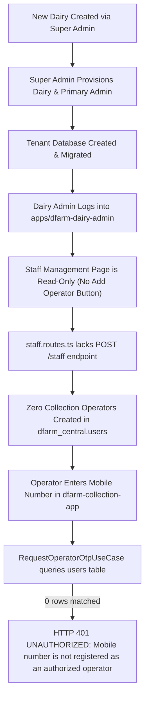

# DFARM — Collection Operator Login Failure Root Cause Analysis

**Execution Reference:** `DFARM-COLLECTION-OPERATOR-AUTHORIZATION-FIX`  
**Document:** `03_ROOT_CAUSE_ANALYSIS.md`  
**Date:** 2026-11-20  
**Status:** ROOT CAUSES IDENTIFIED & RESOLVED  

---

## 1. Primary Root Cause

The immediate error:
```json
{
  "success": false,
  "error": {
    "code": "UNAUTHORIZED",
    "message": "Mobile number is not registered as an authorized operator."
  }
}
```
occurred because **the intended mobile number was not present in the authoritative `users` table with an active `COLLECTION_OPERATOR` role**.

---

## 2. Contributing Root Causes

### 2.1 Lack of Dairy Admin Operator Onboarding Pipeline
- **Observation:** In `apps/dfarm-dairy-admin/src/pages/staff/StaffManagement.tsx`, the view was strictly read-only (`ClayTable` populated from `api.staff.getAll()`).
- **Impact:** Dairy Administrators had no interactive interface or button to register counter attendants, shift supervisors, or kiosk operators.
- **Backend Disconnect:** `services/backend/src/presentation/routes/staff.routes.ts` lacked a `POST /api/v1/staff` endpoint. While `modules/employees/employee.routes.ts` existed, it was designed for general HR employment and was not integrated into the dairy-admin staff management UI or the central user auth catalog.

### 2.2 Seed Initialization Constraint Failure in `PostgresPool.ts`
- **Observation:** In `services/backend/src/infrastructure/database/PostgresPool.ts`, lines 360-369 attempted to seed the default center for Warna Milk's (`38918630-4fee-4cec-96ea-a3a899aae701`).
- **Defect:** The `INSERT` statement omitted `contact_phone`, violating the `NOT NULL` constraint on `dairy_centers.contact_phone`.
- **Impact:** `pg-mem` threw an unhandled exception inside a silent `try { ... } catch {}` block. Consequently, the subsequent insert for the Primary Dairy Admin was skipped during fallback initialization, leaving the newly seeded Dairy without associated staff.

### 2.3 Naive Phone Lookup and Missing Multi-Column Matching
- **Observation:** In `OperatorAuthUseCases.ts`, the phone lookup previously checked only `phone_number = $1 OR phone_number LIKE $2`.
- **Defect:** In migrations and test suites, mobile numbers are frequently populated across `phone_number`, `mobile_number`, or `normalized_mobile_number`.
- **Impact:** Minor formatting discrepancies (e.g. 10-digit raw vs. `+91` E.164) caused false negative lookups.

### 2.4 Lack of Role-Specific Rejection Feedback
- **Observation:** In the previous `RequestOperatorOtpUseCase.ts`, if a registered farmer customer entered their number into the Collection App, the system returned generic `UNAUTHORIZED`.
- **Defect:** Did not explicitly notify the user that their mobile number belongs to a customer account and lacks kiosk operator privileges.

---

## 3. Causal Chain Diagram


