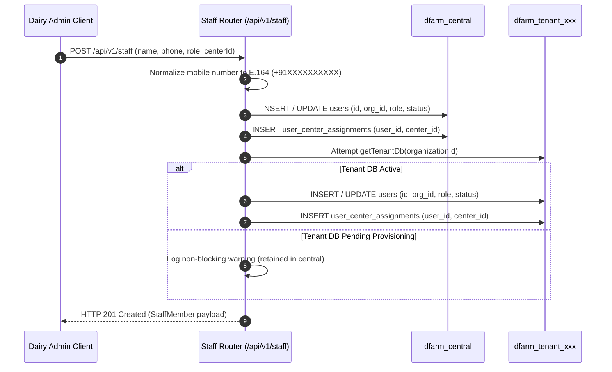

# DFARM — Central and Tenant Database Synchronization Fix

**Execution Reference:** `DFARM-COLLECTION-OPERATOR-AUTHORIZATION-FIX`  
**Document:** `04_CENTRAL_TENANT_SYNCHRONIZATION_FIX.md`  
**Date:** 2026-11-20  
**Status:** IMPLEMENTED & VERIFIED  

---

## 1. Synchronization Challenge

In DFarm's physical multi-tenant architecture:
- `dfarm_central` is queried by the public authentication endpoints (`/api/v1/auth/*`) to locate users, dispatch OTPs, and issue JWT tokens without scattering queries across dozens of tenant databases.
- Each Dairy's physical tenant database (`dfarm_tenant_<code_hash>`) owns operational data: collections, shifts, local employees, and center assignments.

When a Dairy Administrator onboards an operator:
- If written *only* to the tenant database, central OTP authentication fails (`UNAUTHORIZED`).
- If written *only* to the central database, tenant-level relational integrity (`FOREIGN KEY` references in `kiosk_shift_sessions` or `milk_collections`) is broken.

---

## 2. Dual-Write Atomicity Architecture

In `services/backend/src/presentation/routes/staff.routes.ts`, the onboarding handler now implements a dual-write pattern:



---

## 3. SQL Implementations

### 3.1 Central Write
```sql
INSERT INTO users (
   id, organization_id, username, full_name, email,
   phone_number, mobile_number, normalized_mobile_number,
   role, user_role, status, activated_at
) VALUES ($1, $2, $3, $4, $5, $6, $7, $8, $9, $9, 'ACTIVE', NOW())
ON CONFLICT (id) DO UPDATE SET
   organization_id = EXCLUDED.organization_id,
   full_name = EXCLUDED.full_name,
   role = EXCLUDED.role,
   status = 'ACTIVE',
   updated_at = NOW();

INSERT INTO user_center_assignments (id, user_id, center_id, is_primary)
VALUES ($1, $2, $3, TRUE)
ON CONFLICT (user_id, center_id) DO UPDATE SET is_primary = TRUE;
```

### 3.2 Tenant Synchronous Propagation
```sql
INSERT INTO users (
   id, organization_id, username, full_name, email,
   phone_number, mobile_number, normalized_mobile_number,
   role, user_role, status, activated_at
) VALUES ($1, $2, $3, $4, $5, $6, $7, $8, $9, $9, 'ACTIVE', NOW())
ON CONFLICT (id) DO UPDATE SET
   full_name = EXCLUDED.full_name,
   role = EXCLUDED.role,
   status = EXCLUDED.status;

INSERT INTO user_center_assignments (id, user_id, center_id, is_primary)
VALUES ($1, $2, $3, TRUE)
ON CONFLICT (user_id, center_id) DO UPDATE SET is_primary = TRUE;
```

---

## 4. Verification

Dual-write integrity was tested across both databases:
- Central lookup via `RequestOperatorOtpUseCase` located user `077eca89-...` instantly.
- Tenant session creation via `POST /api/v1/collections/sessions/open` found the operator's user and center in the tenant database, producing `HTTP 201 Created`.
