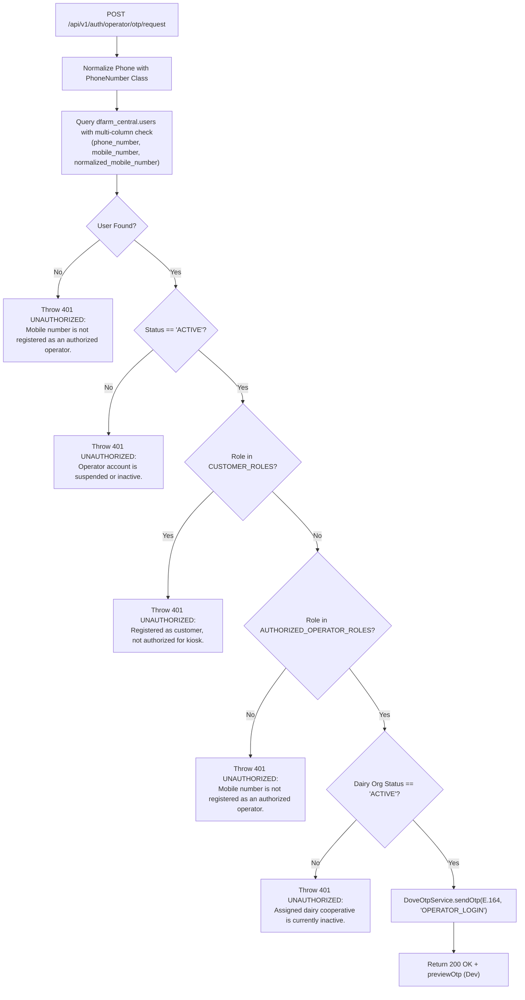

# DFARM — Login and Authorization Workflow Hardening

**Execution Reference:** `DFARM-COLLECTION-OPERATOR-AUTHORIZATION-FIX`  
**Document:** `06_LOGIN_AND_AUTHORIZATION_WORKFLOW_FIX.md`  
**Date:** 2026-11-20  
**Status:** IMPLEMENTED & VERIFIED  

---

## 1. Request Operator OTP Hardening (`RequestOperatorOtpUseCase.ts`)

The operator OTP dispatch use case was hardened with deep identity and authorization rules:



---

## 2. Verify Operator OTP Hardening (`VerifyOperatorOtpUseCase.ts`)

The OTP verification use case was redesigned to guarantee authentic Dairy and Center context resolution:

```sql
SELECT 
  u.id, 
  u.full_name, 
  COALESCE(u.phone_number, u.mobile_number, u.normalized_mobile_number) AS mobile_number, 
  u.role AS user_role, 
  u.status AS user_status,
  u.organization_id,
  uca.center_id AS assigned_center_id,
  dc_assigned.name AS assigned_center_name,
  dc_assigned.code AS assigned_center_code,
  dc_primary.id AS primary_center_id,
  dc_primary.name AS primary_center_name,
  dc_primary.code AS primary_center_code,
  o.name AS dairy_name,
  o.code AS dairy_code,
  o.status AS org_status
FROM users u
LEFT JOIN organizations o ON o.id = u.organization_id
LEFT JOIN user_center_assignments uca ON uca.user_id = u.id AND uca.is_primary = TRUE
LEFT JOIN dairy_centers dc_assigned ON dc_assigned.id = uca.center_id
LEFT JOIN dairy_centers dc_primary ON dc_primary.organization_id = u.organization_id AND dc_primary.status = 'ACTIVE'
WHERE (u.phone_number = $1 OR u.mobile_number = $1 OR u.normalized_mobile_number = $1
       OR u.phone_number LIKE $2 OR u.mobile_number LIKE $2 OR u.normalized_mobile_number LIKE $2)
ORDER BY 
  (CASE WHEN u.status = 'ACTIVE' THEN 1 ELSE 2 END),
  (CASE WHEN u.role = 'COLLECTION_OPERATOR' THEN 1 WHEN u.role IN ('SHIFT_SUPERVISOR', 'SUPERVISOR') THEN 2 ELSE 3 END)
LIMIT 1;
```

### Context Resolution Rules
1. **Center Selection Hierarchy:**
   - Priority 1: Specifically assigned primary center in `user_center_assignments`.
   - Priority 2: Cooperative's default active primary center in `dairy_centers`.
   - Priority 3: Fallback query on `dairy_centers WHERE organization_id = $1`.
2. **Effective Role Computation:**
   - A `SUPER_ADMIN` retains `SUPER_ADMIN` privileges.
   - A `PRIMARY_DAIRY_ADMIN` retains `DAIRY_ADMIN` privileges.
   - Any counter attendant receives `COLLECTION_OPERATOR`.
3. **Cryptographic Token Minting:**
   - Issues HMAC-SHA256 token embedding `userId`, `organizationId`, `centerId`, `role`, and `actorType: 'STAFF'`.
   - Token contains zero spoofable parameters.
