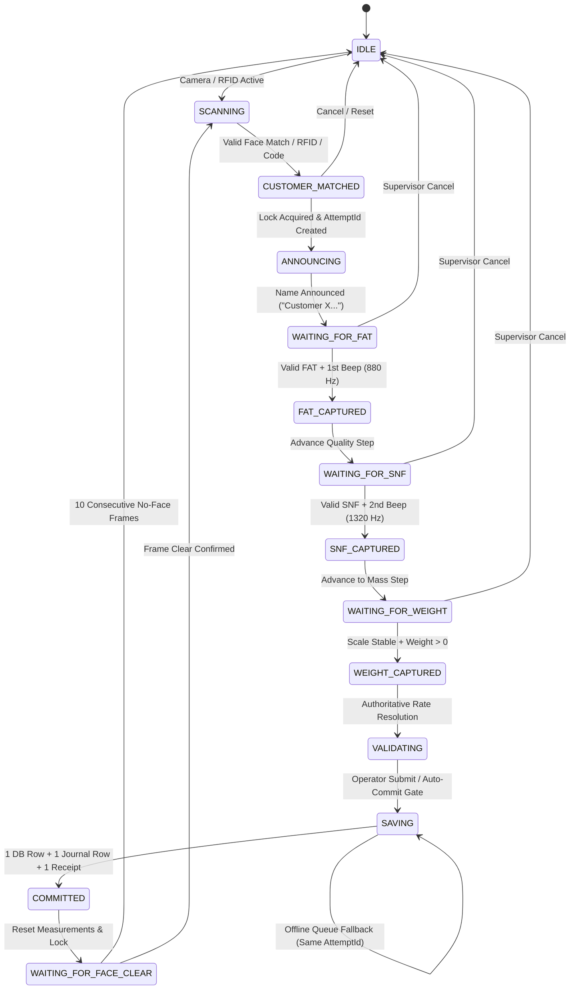

# DFarm Collection App — Root Cause & Single Active Collection State Machine Architecture

**Document ID:** `docs/implementation/collection-single-transaction/02-root-cause-and-state-machine.md`  
**Priority:** P0 Critical  
**Status:** Approved Architecture Specification  

---

## 1. Root Cause Summary

| Root Cause ID | Component | Defect Description | Impact |
|---|---|---|---|
| **RC-01** | `useCamera.ts` | The camera inference loop continues SFace embedding and customer matching every 600 ms while a collection is active. | Constant re-identification of the same patron during intake. |
| **RC-02** | `useCamera.ts` | No requirement for consecutive no-face frames before re-enabling face matching. | Immediate re-match within 600 ms of transaction completion. |
| **RC-03** | `CustomerIdentityPanel.tsx` | Camera `onCustomerMatched` omitted `voiceAnnouncer.speakCustomerIdentified`. | Patron name announcement was silent for face recognition. |
| **RC-04** | `HardwareContext.tsx` | `resetIntakeCycle` did not reset `fat`, `snf`, and `clrDensity`. | Stale quality readings carried over to new collections, instantly satisfying validation. |
| **RC-05** | `client.ts` | `transactionsApi.submit` created a new random UUID for every request. | Bypassed backend transaction deduplication on retry. |
| **RC-06** | System-wide | No authoritative collection state machine or sequence gating (FAT → SNF → Weight). | Race conditions between hardware events, UI inputs, and submission triggers. |

---

## 2. Single Active Collection State Machine

### A. State Diagram

---

## 3. Explicit State Definitions & Invariants

### State 1: `IDLE`
- **Invariant:** No customer locked. No active collection attempt ID.
- **Hardware Context:** FAT = 0.0, SNF = 0.0, CLR = 0.0, Weight = 0.0. Scale tare enabled.
- **Face Inference:** Suspended until scanner is turned on or operator opens session.

### State 2: `SCANNING`
- **Invariant:** Active session is OPEN. Camera stream active. Face detection running.
- **Face Inference:** YuNet running at 30 fps. SFace runs on detected face every 600 ms against authorized tenant face gallery.
- **Transition:** Upon confident match (`isMatch === true`), atomicity lock is engaged and state transitions to `CUSTOMER_MATCHED`.

### State 3: `CUSTOMER_MATCHED`
- **Actions:**
  1. Generate unique `attemptId = "ATT-" + Date.now() + "-" + crypto.randomUUID().slice(0, 8)`.
  2. Engage **Camera Recognition Lock** (`isRecognitionLocked = true`). Face embeddings and matching are halted immediately.
  3. Set active patron context (`customer`, `farmerCode`, `milkCategory`).
- **Transition:** Automatically moves to `ANNOUNCING`.

### State 4: `ANNOUNCING`
- **Actions:**
  1. Trigger single speech utterance via Web Speech API:  
     `"Customer " + customer.fullName + ". Milk collection starting."`
  2. Mark announcement completed for this `attemptId`.
- **Transition:** Automatically moves to `WAITING_FOR_FAT`.

### State 5: `WAITING_FOR_FAT`
- **Actions:**
  1. Visual indicator on UI indicates awaiting FAT reading.
  2. Reject any early weight readings from advancing state.
  3. On receipt of valid FAT (2.0% - 15.0%):
     - Emit **First Audible Beep (880 Hz / 150 ms)**.
     - Associate FAT reading with active `attemptId`.
     - Move to `FAT_CAPTURED`.

### State 6: `FAT_CAPTURED`
- **Actions:**
  - Display validated FAT value on telemetry card.
- **Transition:** If analyzer frame also contains SNF (combined frame protocol), queue SNF with an acoustic delay (150 ms) to ensure distinct beeps; otherwise transition immediately to `WAITING_FOR_SNF`.

### State 7: `WAITING_FOR_SNF`
- **Actions:**
  1. Visual indicator indicates awaiting SNF reading.
  2. On receipt of valid SNF (6.0% - 12.0%):
     - Emit **Second Audible Beep (1320 Hz / 150 ms)**.
     - Associate SNF reading with active `attemptId`.
     - Move to `SNF_CAPTURED`.

### State 8: `SNF_CAPTURED`
- **Actions:**
  - Display validated SNF value on telemetry card.
- **Transition:** Automatically moves to `WAITING_FOR_WEIGHT`.

### State 9: `WAITING_FOR_WEIGHT`
- **Actions:**
  1. Telemetry card indicates awaiting scale stabilization.
  2. On receipt of stable scale reading (`weightLiters > 0`, `isStable === true`):
     - Associate weight with active `attemptId`.
     - Move to `WEIGHT_CAPTURED`.

### State 10: `WEIGHT_CAPTURED`
- **Actions:**
  - Display locked weight volume on UI.
- **Transition:** Automatically moves to `VALIDATING`.

### State 11: `VALIDATING`
- **Actions:**
  1. Query active rate chart for current date, shift, category, FAT, and SNF.
  2. Calculate `ratePerLiter` and `totalAmount`.
  3. Validate all biological constraints and session status.
  4. Enable `RECORD INTAKE` button (and `Ctrl+Enter` shortcut).
- **Transition:** On submit trigger, move to `SAVING`.

### State 12: `SAVING`
- **Actions:**
  1. Submit transaction payload with `idempotencyKey: attemptId`.
  2. If online: await API response.
  3. If offline: write to IndexedDB queue with `idempotencyKey: attemptId`.
  4. Deduplication guarantee: repeated submit calls with identical `attemptId` return the same transaction.
- **Transition:** On success, move to `COMMITTED`.

### State 13: `COMMITTED`
- **Actions:**
  1. Insert exactly 1 row into local Shift Intake Journal (`localDB.saveTransaction`).
  2. Print receipt via ESC/POS thermal printer.
  3. Clear measurements: `fat = 0`, `snf = 0`, `clrDensity = 0`, `weight = 0`.
  4. Release customer session lock.
- **Transition:** Move to `WAITING_FOR_FACE_CLEAR`.

### State 14: `WAITING_FOR_FACE_CLEAR` (Face-Presence Release Gate)
- **Actions:**
  1. Camera continues running YuNet detector only (lightweight, no SFace embedding).
  2. System counts consecutive frames with **zero faces detected** (`faces.length === 0`).
  3. Required threshold: 10 consecutive frames (approx. 330 ms) or patron face leaves boundary.
  4. While any face remains visible, face matching stays disabled.
- **Transition:** Once threshold met, state returns to `IDLE` (or `SCANNING`), ready for the next patron.

---

## 4. Audio Feedback Specifications

Using Web Audio API (`window.AudioContext`), synthesized audio tones ensure zero external audio file dependencies and instant low-latency playback:
- **FAT Beep:** `880 Hz` (A5 standard musical note), Duration: `140 ms`, Gain Envelope: attack 10 ms, decay 130 ms.
- **SNF Beep:** `1320 Hz` (E6 high tone, 1.5x frequency), Duration: `140 ms`, Gain Envelope: attack 10 ms, decay 130 ms.
- When an analyzer transmits both readings in one packet, a `180 ms` gap separates Beep 1 and Beep 2 so the operator clearly hears two distinct chimes.

---

## 5. Architectural Implementation Plan

1. **New Service:** `apps/dfarm-collection-app/src/services/CollectionStateMachine.ts`  
   - Implements the state machine, event listeners, audio tones, and attempt tracking.
2. **Hook Upgrade:** `apps/dfarm-collection-app/src/hooks/useCamera.ts`  
   - Exposes `isRecognitionLocked` and `facePresenceReleaseGate`.
3. **Hardware Context Integration:** `apps/dfarm-collection-app/src/context/HardwareContext.tsx`  
   - Mounts and exposes the state machine, cleans up `resetIntakeCycle` to zero FAT/SNF.
4. **Client Deduplication:** `apps/dfarm-collection-app/src/api/client.ts`  
   - Accepts `idempotencyKey` parameter from caller (defaults to `attemptId`).
5. **UI Integration:**
   - `CustomerIdentityPanel.tsx`: connects camera callback to state machine & restores speech announcement.
   - `MeasurementPanel.tsx`: displays stage indicators (waiting for FAT, waiting for SNF, waiting for weight).
   - `TransactionSummaryPanel.tsx`: uses state machine's `attemptId` and submission gate.
