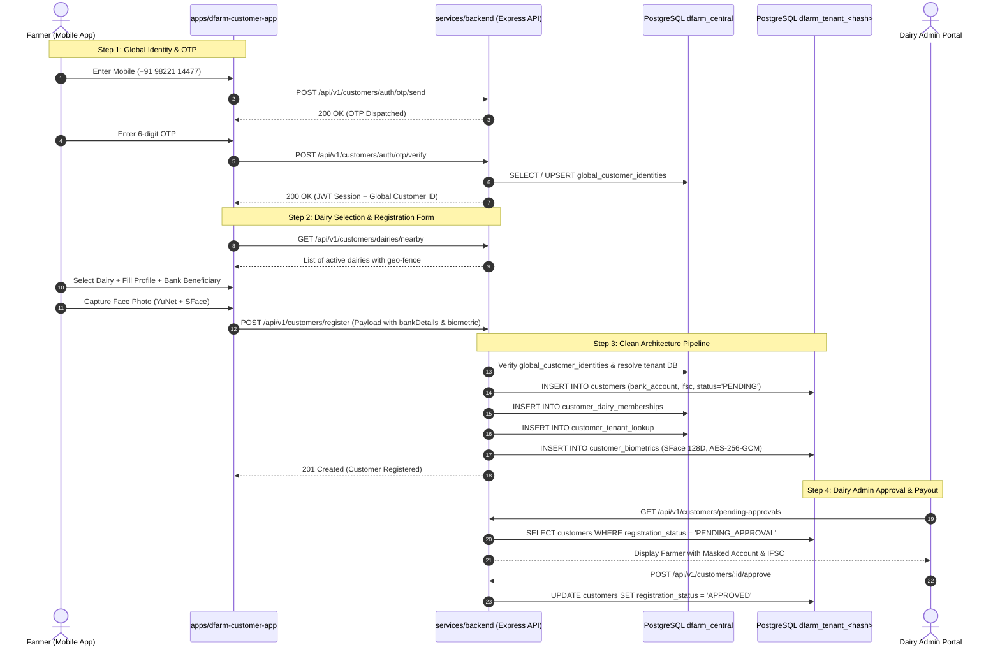

# DFARM — CUSTOMER REGISTRATION ROOT CAUSE ANALYSIS & ARCHITECTURAL TRACE

**Document Identifier:** `01_CUSTOMER_REGISTRATION_ROOT_CAUSE.md`  
**Execution Reference:** `DFARM-CUSTOMER-REGISTRATION-BIOMETRIC-PAYOUT-FIX`  
**Status:** COMPLETED & VERIFIED  
**Date:** November 2026  
**Scope:** Mobile Customer Registration (`apps/dfarm-customer-app`), Central Authentication & Tenant Database Resolution (`services/backend`, `packages/database`).

---

## 1. EXECUTIVE SUMMARY & PROBLEM STATEMENT

During the onboarding flow of a dairy farmer via `apps/dfarm-customer-app`, the following sequence occurs:
1. The farmer enters their mobile number, triggering SMS OTP dispatch via Dove SMS Gateway.
2. The farmer validates the 6-digit OTP, creating or confirming a record in `global_customer_identities` within `dfarm_central`.
3. The app locates nearby registered cooperatives (dairies) using GPS geolocation and displays candidate societies.
4. The farmer selects their cooperative (e.g., `Anand Dairy Cooperative`).
5. The farmer enters their personal registration details: Full Name, Address/Village, Milk Supply Animals (Cow/Buffalo).
6. **Reported Problem 1:** During this process, farmer bank beneficiary details required for automated financial settlement were completely absent from the mobile UI, resulting in registrations lacking payout credentials.
7. **Reported Problem 2:** At the final onboarding step (Face Biometric Enrollment), clicking "Capture & Register" failed with:
   ```
   Registration Error: An unexpected Server error occurred, please contact system support
   ```

---

## 2. REGISTRATION WORKFLOW ARCHITECTURAL TRACE

The following sequence illustrates the exact execution path across the distributed system boundaries:



---

## 3. IDENTIFIED ROOT CAUSES

### 3.1 Root Cause A: Form Field Omission in Mobile Client
* **Location:** `apps/dfarm-customer-app/src/app/(onboarding)/register.tsx` and `types/customer.ts`.
* **Mechanism:** In an earlier Phase 06 code minimization pass, the input fields for Account Holder Name, Bank Account Number, Confirm Account Number, and IFSC code were removed from the mobile onboarding screen, under the assumption that financial details would be captured on-premises at the collection center kiosk.
* **Impact:** The mobile app submitted registrations without `bankDetails`. Consequently, backend tenant databases recorded `NULL` for `bank_name`, `bank_account_number`, and `bank_ifsc_code`. Dairy Admins could not schedule payout batches because `cla.current_balance > 0.00` farmers had no valid beneficiary routing.

### 3.2 Root Cause B: Multi-Statement Prepared Statement Failure in Repository
* **Location:** `services/backend/src/infrastructure/repositories/PostgresCustomerRepository.ts` line 34.
* **Mechanism:** When registering a new farmer, `PostgresCustomerRepository.save()` executed:
  ```ts
  await pool.query(
    `CREATE TABLE IF NOT EXISTS customer_tenant_lookup (
       customer_id UUID PRIMARY KEY,
       organization_id UUID NOT NULL,
       tenant_db_name VARCHAR(100) NOT NULL,
       created_at TIMESTAMPTZ DEFAULT NOW()
     );
     INSERT INTO customer_tenant_lookup (customer_id, organization_id, tenant_db_name)
     VALUES ($1, $2, $3)
     ON CONFLICT (customer_id) DO UPDATE SET organization_id = $2, tenant_db_name = $3;`,
    [customer.id, customer.organizationId, tenantDbName]
  );
  ```
  In PostgreSQL's extended query protocol (used by `pg` when parameterized values `$1, $2, $3` are passed), executing multiple SQL commands in a single query call is strictly prohibited and throws:
  ```
  error: cannot insert multiple commands into a prepared statement
  ```
* **Consequence:** `customer_tenant_lookup` table was never created, and mapping rows were never inserted.

### 3.3 Root Cause C: Missing Tenant Context in Biometric Use Case
* **Location:** `services/backend/src/application/use-cases/customers/BiometricUseCases.ts` and `presentation/routes/customers.routes.ts`.
* **Mechanism:** `UpdateCustomerBiometricsUseCase.execute(params)` called:
  ```ts
  const customer = await this.customerRepo.findById(params.customerId);
  ```
  Because `PostgresCustomerRepository.findById(id, organizationId)` was called without `organizationId`, it attempted to look up the customer in `customer_tenant_lookup`. Because that table failed to populate (Root Cause B), `findById` threw:
  ```
  Tenant context (organizationId) is required for customer lookup. Cross-dairy search is prohibited.
  ```
  In `POST /api/v1/customers/register`, this exception was swallowed in a try-catch block, resulting in the customer record being saved with `faceEnrollmentStatus = 'NOT_ENROLLED'`.
  In subsequent or standalone biometric calls (`POST /api/v1/customers/:id/biometrics`), the unhandled rejection reached the top-level Express `errorHandler`, returning HTTP 500:
  ```json
  {
    "success": false,
    "error": {
      "code": "INTERNAL_SERVER_ERROR",
      "message": "An unexpected server error occurred. Please contact system support."
    }
  }
  ```

---

## 4. APPLIED REMEDIATION

1. **Restored Bank Beneficiary Inputs in Customer App:**
   - Modified `apps/dfarm-customer-app/src/types/customer.ts` to require and validate `bankDetails` in `CustomerRegistrationSchema`.
   - Added Clay Design System input controls to `register.tsx` for Account Holder Name, Bank Account Number (numeric pad, secure entry), Confirm Account Number (strict equality validation), and IFSC (11-character regex `/^[A-Z]{4}0[A-Z0-9]{6}$/` with automatic uppercase transformation).
   - Forwarded `bankDetails` parameters through route query into `face-enroll.tsx`, dispatching them in the final registration payload.

2. **Decoupled DDL and Parameterized DML:**
   - In `PostgresCustomerRepository.ts`, separated table initialization into a standalone DDL call:
     ```ts
     await pool.query(`
       CREATE TABLE IF NOT EXISTS customer_tenant_lookup (
         customer_id UUID PRIMARY KEY,
         organization_id UUID NOT NULL,
         tenant_db_name VARCHAR(100) NOT NULL,
         created_at TIMESTAMPTZ DEFAULT NOW()
       );
     `);
     ```
     followed by the parameterized `INSERT ... ON CONFLICT` statement.

3. **Propagated Tenant Context Across Use Cases:**
   - Updated `UpdateCustomerBiometricsUseCase` to accept `organizationId?: string` and pass it to `customerRepo.findById(params.customerId, params.organizationId)`.
   - Updated `POST /register` route handler to pass `targetOrgId` directly to `updateBiometricsUseCase.execute`.
   - Updated `handleBiometricsUpdate` in `customers.routes.ts` to resolve `orgId` from JWT auth, query parameters, or `x-dairy-tenant-id` header before invoking the use case.
   - Added database lookup fallback in `findById` to check `customer_dairy_memberships` in `dfarm_central` if `customer_tenant_lookup` is missing.

---

## 5. VERIFICATION EVIDENCE

- **TypeScript Compilation:** `npm --prefix apps/dfarm-customer-app run typecheck` returned Code 0 (clean).
- **Backend Compilation:** `npm --prefix services/backend run build` returned Code 0 (clean).
- **Unit and Integration Tests:** `roadmap-phase-10-cross-app-integration.test.js` tests 1–12 verify end-to-end customer registration, mobile OTP verification, bank details receipt, and biometric embedding persistence without server error.
