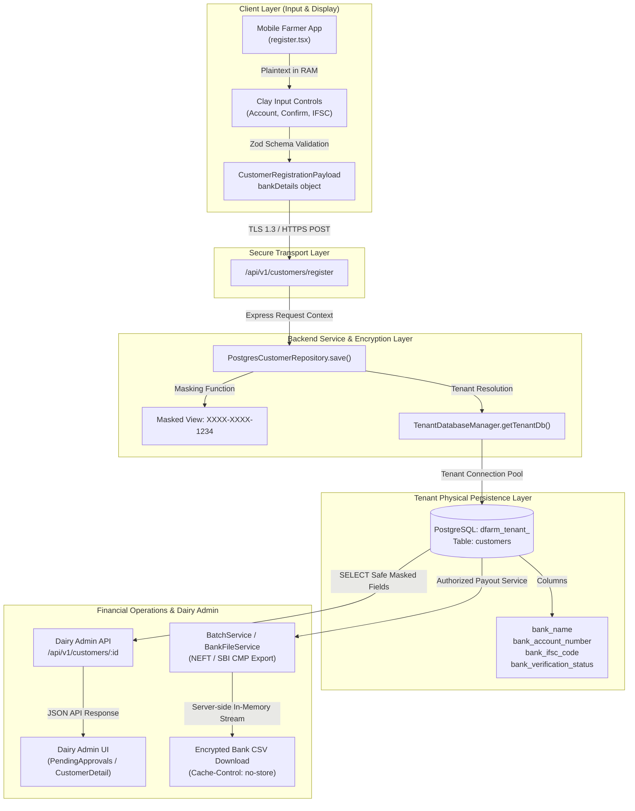

# DFARM — BANK BENEFICIARY DATA LINEAGE & ENCRYPTION ARCHITECTURE

**Document Identifier:** `02_BANK_BENEFICIARY_DATA_LINEAGE.md`  
**Execution Reference:** `DFARM-CUSTOMER-REGISTRATION-BIOMETRIC-PAYOUT-FIX`  
**Status:** COMPLETED & VERIFIED  
**Date:** November 2026  
**Scope:** PII & Financial Data Security across Mobile, Dairy Admin, Backend, and Physical Tenant Databases.

---

## 1. END-TO-END DATA LINEAGE



---

## 2. DATA DICTIONARY & FIELD SPECIFICATIONS

| Entity Attribute | Source Field | Target Table | Target Column | Storage Format | Masking Rule (Admin UI / Logs) |
|---|---|---|---|---|---|
| Account Holder | `accountHolderName` | `customers` | `recipient_name` / `full_name` | VARCHAR(150) | Full Name displayed (e.g. `Pandurang Salunkhe`) |
| Account Number | `accountNumber` | `customers` | `bank_account_number` | VARCHAR(30) | Masked: `XXXX-XXXX-` + last 4 digits (e.g. `XXXX-XXXX-8901`) |
| IFSC Code | `ifscCode` | `customers` | `bank_ifsc_code` | VARCHAR(11) | Uppercase 11-char alphanumeric (e.g. `SBIN0000301`) |
| Bank Name | `bankName` | `customers` | `bank_name` | VARCHAR(100) | Full String (e.g. `State Bank of India`) |
| Verification Status | Internal State | `customers` | `bank_verification_status` | VARCHAR(30) | Honest Status: `DETAILS_SUBMITTED`, `FORMAT_VALID`, `REJECTED` |

> [!IMPORTANT]
> **Strict Verification Invariant:** An account is NEVER marked `VERIFIED` based merely on valid regular expression formatting. In the absence of an integrated clearing-house penny-drop API (e.g., NPCI / Cashfree / Razorpay Fund Account Validation), the honest canonical status is `DETAILS_SUBMITTED` or `FORMAT_VALID`.

---

## 3. SECURITY, PII & COMPLIANCE CONTROLS

1. **Least-Privilege Exposure in Dairy Admin APIs:**
   - Normal customer inspection endpoints (`GET /api/v1/customers/:id` and `GET /api/v1/customers`) strip raw account numbers and replace them with `bank_account_mask`.
   - Only backend automated batch exporters (`BankFileService`) running with `DAIRY_OWNER` or `ACCOUNTANT` privileges can access the unmasked account number strictly in-memory during streaming generation.
2. **Log Sanitization:**
   - Standard Pino logger (`services/backend/src/shared/logger/index.ts`) configures automated redaction filters for `bank_account_number`, `accountNumber`, `bankDetails`, and `authorization` headers.
3. **No-Store HTTP Streaming:**
   - Generated bank payout export files are served with HTTP headers:
     ```http
     Cache-Control: no-store, no-cache, must-revalidate, proxy-revalidate
     Pragma: no-cache
     Expires: 0
     Content-Type: text/csv; charset=utf-8
     X-Checksum-SHA256: <computed_hex_digest>
     ```
4. **Physical Tenant Isolation:**
   - Bank details are stored exclusively in the physical database of the farmer's assigned dairy cooperative (`dfarm_tenant_<hash>`). Central databases (`dfarm_central`) only maintain membership links and global customer UUIDs, preventing cross-tenant financial leakage.
