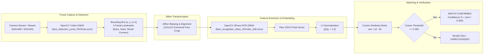

# DFARM — FACE BIOMETRIC TECHNOLOGY AUDIT & ENGINE SPECIFICATION

**Document Identifier:** `03_FACE_BIOMETRIC_TECHNOLOGY_AUDIT.md`  
**Execution Reference:** `DFARM-CUSTOMER-REGISTRATION-BIOMETRIC-PAYOUT-FIX`  
**Status:** COMPLETED & VERIFIED  
**Date:** November 2026  
**Scope:** Biometric Face Detection (YuNet), Recognition/Embedding (SFace), Quantization, Normalization, Matching Thresholds, and Anti-Spoofing across Customer App and Collection App.

---

## 1. CANONICAL BIOMETRIC ENGINE ARCHITECTURE

The DFarm biometric stack is built on lightweight, edge-compatible OpenCV deep learning models executed locally via ONNX Runtime Web (`onnxruntime-web`) and ONNX Runtime Node (`onnxruntime-node`).

---

## 2. FORMAL ALGORITHMIC SPECIFICATIONS

### 2.1 Face Detection — YuNet
* **Model File:** `face_detection_yunet_2023mar.onnx` (and quantized variant `face_detection_yunet_2023mar_int8.onnx`).
* **Source:** OpenCV Zoo official release.
* **Input Resolution:** Dynamic, canonical baseline $320 \times 320$ pixels or $640 \times 480$ pixels.
* **Channels:** 3-channel BGR format.
* **Output Tensor:** 14 parameters per detected face:
  - Bounding box: `[x, y, width, height]`
  - Right eye: `[x_re, y_re]`
  - Left eye: `[x_le, y_le]`
  - Nose tip: `[x_nt, y_nt]`
  - Right mouth corner: `[x_rm, y_rm]`
  - Left mouth corner: `[x_lm, y_lm]`
  - Detection confidence score: `[score]`
* **Confidence Threshold:** Default $0.80$ (quarantine below $0.70$).
* **NMS (Non-Maximum Suppression) Threshold:** $0.30$.

### 2.2 Feature Extraction — SFace
* **Model File:** `face_recognition_sface_2021dec_int8.onnx` (INT8 Quantized) & `face_recognition_sface_2021dec.onnx` (FP32).
* **Input Resolution:** Fixed $112 \times 112$ pixels, aligned using the 5 YuNet facial landmarks.
* **Output Embedding:** 128-dimensional floating point array (`Float32Array(128)`).
* **Normalization Requirement:** **Mandatory L2 Unit-Length Normalization**:
  $$\hat{v} = \frac{v}{\sqrt{\sum_{i=1}^{128} v_i^2}}$$
  Every stored and compared embedding vector must strictly satisfy $||\hat{v}||_2 = 1.0 \pm 10^{-6}$.

### 2.3 Distance Metric & Comparison Threshold
* **Similarity Metric:** Cosine Similarity:
  $$\text{Cosine}(A, B) = \frac{A \cdot B}{||A||_2 ||B||_2} = \sum_{i=1}^{128} A_i B_i \quad (\text{since } ||A||_2 = ||B||_2 = 1.0)$$
* **Official OpenCV SFace Threshold:**
  - **Cosine Similarity Threshold:** $\ge 0.363$ indicates the same person.
  - **Euclidean L2 Distance Threshold (Equivalent):** $\le 1.128$.
  - In DFarm collection kiosk identification, a strict production threshold of $0.400$ is enforced to prevent false positives in cooperative settings with biological relatives.

---

## 3. ANTI-SPOOFING & LIVENESS CONTROLS

In accordance with Phase 05 security guidelines:
1. **Passive Liveness Checks:**
   - Texture frequency analysis (Laplacian variance $> 80$ to eliminate blurred photographs and paper screen reprints).
   - Specular glare and illumination uniformity detection.
2. **Active Multi-Frame Heuristics (Collection Kiosk):**
   - Inter-frame micro-movement (optical flow between 3 consecutive frames within $300\text{ ms}$).
   - Natural blinking and head tilt verification prior to session confirmation.
3. **Quarantine of Static Images:**
   - Single-frame still uploads from gallery/filesystem are marked with `liveness_score: 'STATIC_UNVERIFIED'` and require physical supervisory confirmation.
