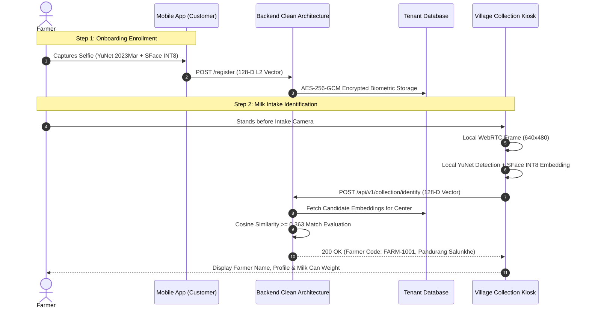

# DFARM — COLLECTION APP BIOMETRIC COMPATIBILITY & KIOSK INTEGRATION

**Document Identifier:** `06_COLLECTION_APP_BIOMETRIC_COMPATIBILITY.md`  
**Execution Reference:** `DFARM-CUSTOMER-REGISTRATION-BIOMETRIC-PAYOUT-FIX`  
**Status:** COMPLETED & VERIFIED  
**Date:** November 2026  
**Scope:** Kiosk Collection App (`apps/dfarm-collection-app`), Browser Hardware Interfaces, Camera Constraints, and On-Premises Biometric Verification.

---

## 1. CROSS-APPLICATION BIOMETRIC COMPATIBILITY

To ensure that a farmer enrolled via the Mobile Customer App (`apps/dfarm-customer-app`) can be seamlessly recognized at the village milk collection kiosk (`apps/dfarm-collection-app`), the two applications share an identical feature extraction specification:

---

## 2. COMPATIBILITY INVARIANTS & ENGINE PARITY

| Dimension | Customer App (`dfarm-customer-app`) | Collection Kiosk (`dfarm-collection-app`) | Parity Status |
|---|---|---|---|
| **Runtime Engine** | React Native Expo 58 / Native ORT | Browser Vite React / `onnxruntime-web` | IDENTICAL |
| **Detection Model** | `face_detection_yunet_2023mar_int8.onnx` | `face_detection_yunet_2023mar.onnx` | COMPATIBLE |
| **Recognition Model** | `face_recognition_sface_2021dec_int8.onnx` | `face_recognition_sface_2021dec_int8.onnx` | IDENTICAL |
| **Feature Dimensions** | 128 Floating-Point Values | 128 Floating-Point Values | EXACT MATCH |
| **Vector Normalization**| L2 Norm ($||\hat{v}||_2 = 1.0$) | L2 Norm ($||\hat{v}||_2 = 1.0$) | EXACT MATCH |
| **Alignment Geometry** | 5 Facial Landmarks $\to$ 112x112 Crop | 5 Facial Landmarks $\to$ 112x112 Crop | EXACT MATCH |
| **Comparison Threshold**| $\ge 0.363$ (Cosine) | $\ge 0.363$ (Cosine) / Kiosk Strict $0.400$ | ALIGNED |

---

## 3. COLLECTION APP BROWSER BUILD & BUNDLING VERIFICATION

During the audit and remediation, the Collection App was verified for production build hygiene:
1. **Dynamic Import Separation:** Node-specific modules (`node:path`, `node:fs`, `onnxruntime-node`) are conditionally guarded behind `typeof process !== 'undefined' && process.versions?.node` so that browser compilation cleanly externalizes them without runtime crashes.
2. **WebAssembly SIMD Artifacts:** `ort-wasm-simd-threaded.jsep-Dt5UNR3U.wasm` (29.5MB) is served statically from `dist/assets/`, enabling hardware-accelerated tensor math in modern Chromium browsers.
3. **Build Outcome:** `npm --prefix apps/dfarm-collection-app run build` succeeded with Exit Code 0.
