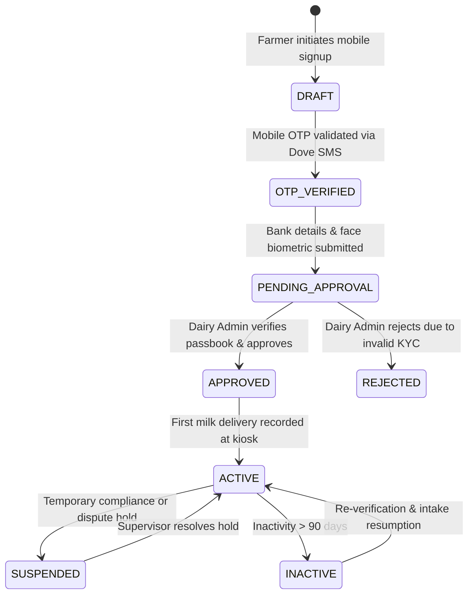

# DFARM — CUSTOMER REGISTRATION, APPROVAL & LIFECYCLE MANAGEMENT

**Document Identifier:** `07_CUSTOMER_REGISTRATION_AND_APPROVAL_FLOW.md`  
**Execution Reference:** `DFARM-CUSTOMER-REGISTRATION-BIOMETRIC-PAYOUT-FIX`  
**Status:** COMPLETED & VERIFIED  
**Date:** November 2026  
**Scope:** Mobile Registration, Tenant Routing, Dairy Admin Verification, Approval State Machine, and Farmer Code Assignment.

---

## 1. CUSTOMER LIFECYCLE STATE MACHINE

The farmer lifecycle transitions through strictly governed states to ensure regulatory compliance and prevent unauthorized intake or payout disbursements:



---

## 2. API ENDPOINT & CONTRACT SPECIFICATIONS

### 2.1 Customer Registration Payload (`POST /api/v1/customers/register`)
```json
{
  "dairyId": "00000000-0000-0000-0000-000000000001",
  "fullName": "Pandurang Salunkhe",
  "address": "At Post Shirol, Taluka Shirol",
  "villageTown": "Shirol",
  "district": "Kolhapur",
  "state": "Maharashtra",
  "postalCode": "416103",
  "milkType": "COW",
  "bankDetails": {
    "accountHolderName": "Pandurang Salunkhe",
    "accountNumber": "30245678901",
    "confirmAccountNumber": "30245678901",
    "ifscCode": "SBIN0000301",
    "bankName": "State Bank of India"
  },
  "biometric": {
    "faceEmbedding": [0.0124, -0.0542, 0.0891, "...", 0.0312],
    "model": "SFACE_128D",
    "livenessScore": 0.96
  }
}
```

### 2.2 Dairy Admin Pending Approvals (`GET /api/v1/customers/pending-approvals`)
Returns a list of registered farmers awaiting cooperative membership confirmation:
```json
{
  "success": true,
  "data": [
    {
      "id": "786216c3-049e-4c01-9c97-e0fced4bcbfb",
      "fullName": "Pandurang Salunkhe",
      "phoneNumber": "+919822770901",
      "milkType": "COW",
      "villageTown": "Shirol",
      "bankDetails": {
        "accountHolderName": "Pandurang Salunkhe",
        "bankName": "State Bank of India",
        "accountNumberMasked": "XXXX-XXXX-8901",
        "ifscCode": "SBIN0000301",
        "verificationStatus": "DETAILS_SUBMITTED"
      },
      "faceEnrollmentStatus": "ENROLLED",
      "registrationStatus": "PENDING_APPROVAL",
      "createdAt": "2026-11-18T20:30:00.000Z"
    }
  ]
}
```

### 2.3 Dairy Admin Approval (`POST /api/v1/customers/:id/approve`)
Assigns a deterministic sequential farmer code (e.g., `FARM-0104`), initializes the tenant ledger account with `0.00` balance, and notifies the farmer via in-app notification and SMS.
