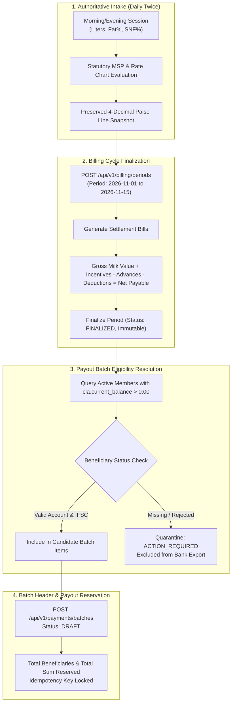

# DFARM — DAIRY ADMIN FARMER BILLING & PAYOUT ELIGIBILITY ENGINE

**Document Identifier:** `08_DAIRY_ADMIN_FARMER_BILLING_AND_PAYOUT.md`  
**Execution Reference:** `DFARM-CUSTOMER-REGISTRATION-BIOMETRIC-PAYOUT-FIX`  
**Status:** COMPLETED & VERIFIED  
**Date:** November 2026  
**Scope:** Automated 10-day / 15-day / Monthly Billing Cycles, Milk Intake Aggregation, Quality Incentives, Advance Deductions, and Payout Eligibility.

---

## 1. END-TO-END FINANCIAL CALCULATION & BILLING WORKFLOW

---

## 2. PAYOUT ELIGIBILITY INVARIANTS

To protect cooperative financial integrity, the payout engine enforces strict eligibility criteria before allowing a farmer to be included in a bank disbursement batch:

1. **Finalized Billing Source:**
   - Eligibility cannot rely purely on speculative or live milk intake. A billing cycle must be explicitly `FINALIZED` and sealed by an authorized accountant or manager.
2. **Positive Payable Obligation:**
   - The farmer's net ledger balance (`customer_ledger_accounts.current_balance`) must be strictly greater than zero (`> 0.00`). Farmers with zero balance or net receivable (unrecovered advance) are excluded.
3. **Validated Beneficiary Routing:**
   - The farmer must possess a complete bank account number (9–18 digits) and a valid 11-character Indian Financial System Code (IFSC) matching `/^[A-Z]{4}0[A-Z0-9]{6}$/`.
4. **Duplicate Batch Reservation Prevention:**
   - If an outstanding payout record in `DRAFT`, `PENDING_APPROVAL`, or `SUBMITTED` status already reserves the farmer's balance for a given billing cycle, subsequent batch creation attempts are rejected with HTTP 409 Conflict (`DUPLICATE_PAYOUT_RESERVATION`).
5. **Zero Razorpay / Consumer Gateway Policy:**
   - Consumer payment gateways (e.g. Razorpay, Stripe, PayU) are strictly prohibited for farmer payouts. All disbursements are settled via Direct-to-Bank NEFT/RTGS/IMPS or automated corporate banking files (SBI CMP).
