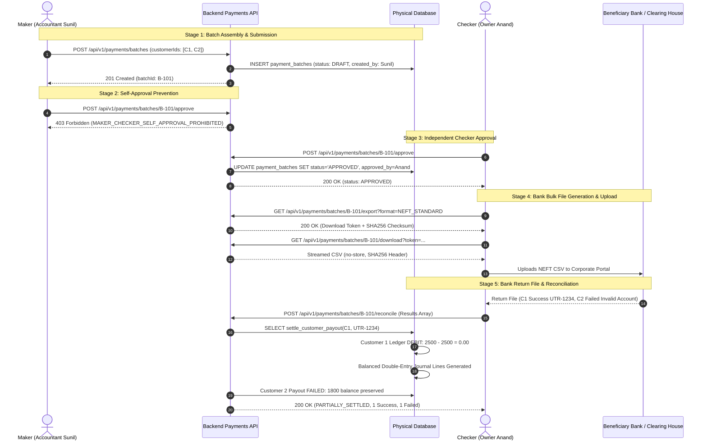

# DFARM — MAKER–CHECKER GOVERNANCE, BANK EXPORT & PAYMENT RECONCILIATION

**Document Identifier:** `09_MAKER_CHECKER_AND_BANK_RECONCILIATION.md`  
**Execution Reference:** `DFARM-CUSTOMER-REGISTRATION-BIOMETRIC-PAYOUT-FIX`  
**Status:** COMPLETED & VERIFIED  
**Date:** November 2026  
**Scope:** Segregation of Duties (SOD), Maker Batch Creation, Independent Checker Authorization, Bank File Formats (NEFT / SBI CMP), and UTR Settlement Reconciliation.

---

## 1. MAKER–CHECKER SEGREGATION OF DUTIES (SOD) WORKFLOW

---

## 2. BANK FILE EXPORT FORMAT SPECIFICATIONS

### 2.1 Standard NEFT CSV Format
* **Header Row:**
  `Transaction Type,Beneficiary Name,Beneficiary Account Number,Beneficiary IFSC,Amount,Sender Reference`
* **Security Controls:**
  - Export requires `DAIRY_OWNER` or `ACCOUNTANT` role.
  - Ephemeral download token valid for 5 minutes, single-use.
  - Streamed with `Cache-Control: no-store` and `X-Checksum-SHA256` header.
  - Export does NOT mutate or debit the customer ledger.

### 2.2 SBI CMP (Corporate Modern Payment) Specification
* Supported via dedicated bank template adapter. If the cooperative has not configured its corporate branch customer ID, attempts to export return explicit diagnostic: `SBI_CMP_UNCONFIGURED_SPECIFICATION_REQUIRED`.

---

## 3. IDEMPOTENT RECONCILIATION & DOUBLE-ENTRY LEDGER IMPACT

When bank responses are processed via `POST /api/v1/payments/batches/:id/reconcile`:
1. **Successful Beneficiary (SETTLED):**
   - Invokes PostgreSQL stored procedure `public.settle_customer_payout`.
   - Decreases the customer payable liability:
     $$\text{New Balance} = \text{Current Balance} - \text{Payout Amount}$$
   - Generates two append-only balanced double-entry lines in `ledger_entries`:
     - Line 1: `account_type = 'CUSTOMER_PAYABLE'`, `entry_type = 'DEBIT'`
     - Line 2: `account_type = 'CASH_BANK'`, `entry_type = 'CREDIT'`
2. **Failed Beneficiary (FAILED):**
   - Marks payout as `FAILED` with explicit `failure_reason` (e.g. `Account inactive or frozen by beneficiary bank`).
   - The farmer's payable ledger balance is preserved untouched, allowing immediate inclusion in subsequent payment cycles.
3. **Idempotency Guarantee:**
   - Re-posting the reconciliation results returns `isIdempotentReplay: true` without performing duplicate debits or inserting redundant journal lines.
