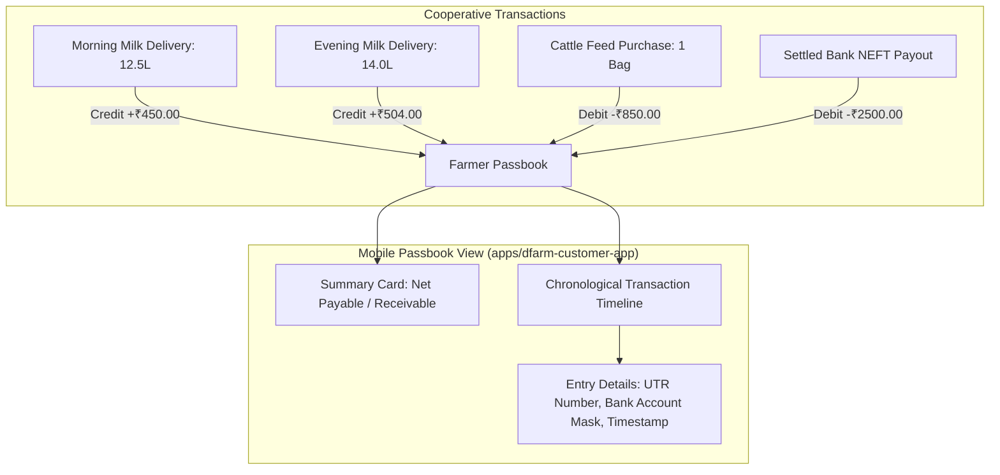

# DFARM — CUSTOMER PASSBOOK & REAL-TIME FINANCIAL REFLECTION

**Document Identifier:** `10_CUSTOMER_PASSBOOK_INTEGRATION.md`  
**Execution Reference:** `DFARM-CUSTOMER-REGISTRATION-BIOMETRIC-PAYOUT-FIX`  
**Status:** COMPLETED & VERIFIED  
**Date:** November 2026  
**Scope:** Mobile Farmer Passbook (`apps/dfarm-customer-app`), Ledger Sync, UTR Display, and Passbook Transaction Streams.

---

## 1. FARMER DIGITAL PASSBOOK WORKFLOW

The farmer's mobile application reflects all cooperative financial transactions in real time via an append-only digital passbook:



---

## 2. PASSBOOK ENTRY SPECIFICATION (`GET /api/v1/ledger/entries`)

When a payout is settled via NEFT/SBI CMP, the passbook records a dedicated debit entry:

```json
{
  "id": "c8b419b1-5e58-45a1-9a7e-cf97426e828e",
  "transactionType": "PAYMENT_PAYOUT_DEBIT",
  "direction": "DEBIT",
  "amount": 2500.00,
  "balanceAfter": 0.00,
  "description": "Settled Payout via BANK_TRANSFER Ref: UTR-NEFT-20261118-001234",
  "createdAt": "2026-11-18T20:44:15.000Z",
  "metadata": {
    "referenceEntity": "CUSTOMER_PAYMENT",
    "paymentMethod": "BANK_TRANSFER",
    "utr": "UTR-NEFT-20261118-001234"
  }
}
```

---

## 3. PASSBOOK REFLECTION GUARANTEES

1. **Paise Precision:** All amounts are parsed and rendered with 2 decimal places (Paise precision) using explicit string-to-numeric casting, eliminating JavaScript floating-point drift.
2. **Immediate Visibility:** As soon as the Dairy Admin reconciles the bank statement, the transaction is emitted via WebSocket sync and available on the farmer's next REST polling cycle.
3. **Transparency of Deductions:** When an advance or feed bill is deducted during cycle finalization, the breakdown is clearly itemized in the farmer's monthly bill summary.
