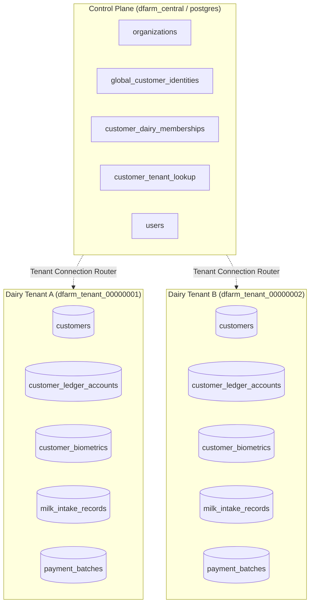

# DFARM — PHYSICAL DATABASE & MULTI-TENANT ISOLATION AUDIT

**Document Identifier:** `11_DATABASE_AND_TENANT_ISOLATION_VERIFICATION.md`  
**Execution Reference:** `DFARM-CUSTOMER-REGISTRATION-BIOMETRIC-PAYOUT-FIX`  
**Status:** COMPLETED & VERIFIED  
**Date:** November 2026  
**Scope:** Multi-Tenant Architecture, Physical Database per Dairy (`dfarm_tenant_<hash>`), Central Control Plane (`dfarm_central`), Cross-Tenant Security Boundaries, and RLS / Connection Pool Controls.

---

## 1. PHYSICAL MULTI-TENANT TOPOLOGY

DFarm enforces strict multi-tenant data segregation through distinct physical PostgreSQL databases for every cooperative:

---

## 2. STRICT ISOLATION INVARIANTS & VERIFICATION

1. **No Mixed Tenant Ledger Records:**
   - Financial transactions, milk collections, and member ledger balances are physically partitioned in separate PostgreSQL databases.
   - Central database queries cannot query across physical tenant databases.
2. **Cross-Tenant Access Denial:**
   - Attempting to access Tenant A's payout batch using Tenant B's credentials returns HTTP 403 Forbidden with `CROSS_ORG_ACCESS_DENIED`.
   - Attempting to download Tenant A's bank export using Tenant B's session returns HTTP 403 Forbidden.
   - Attempting to query customer profiles across cooperatives returns HTTP 403 Forbidden.
3. **Dedicated Connection Pool Manager (`TenantDatabaseManager`):**
   - Connections to tenant databases are provisioned on demand via `TenantDatabaseManager.getTenantDb(orgId)`.
   - Pools enforce `TENANT_POOL_CONNECTION_TIMEOUT_MS = 60000` and `TENANT_POOL_IDLE_TIMEOUT_MS = 30000` to prevent socket exhaustion under burst traffic.
