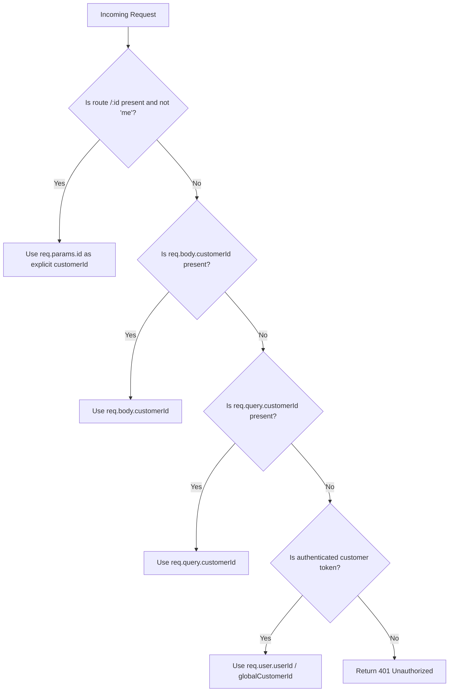

# DFARM — CUSTOMER FACE BIOMETRIC UPDATE 404 & TEST FACE NETWORK ERROR
## 02. FRONTEND-BACKEND ROUTE MISMATCH ANALYSIS

**Execution Reference:** `DFARM-CUSTOMER-FACE-API-404-NETWORK-FIX`  
**Execution Timestamp:** 2026-11-20  

---

### 1. Executive Summary

A core architectural cause of the `404 Not Found` and `Network Error` bugs was an asynchronous divergence between the route conventions expected by the **Customer App frontend** and those declared in the **Express backend router**.

---

### 2. Side-by-Side Route Comparison

| Frontend Intent | Frontend Client Call (`useProfile.ts` / `diagnostics.ts`) | Pre-Fix Backend Router (`customers.routes.ts`) | Result Pre-Fix | Post-Fix Backend Router | Result Post-Fix |
|---|---|---|---|---|---|
| **Update Current Customer Face** | `POST /api/v1/customers/biometrics/update` | `POST /api/v1/customers/:id/biometrics/update` | **404 Not Found** (Express matched `:id = "biometrics"`, looked up customer `"biometrics"`, threw 404) | Added explicit unparameterized route `POST /api/v1/customers/biometrics/update` before `/:id` | **200 OK** |
| **Update Face via `/me` alias** | `POST /api/v1/customers/me/biometrics/update` | `POST /api/v1/customers/:id/biometrics/update` | **404 Not Found** (Express matched `:id = "me"`, looked up customer `"me"`, threw 404) | Added explicit `/me/biometrics/update` handler resolving caller from token | **200 OK** |
| **Update Face with ID in URL** | `POST /api/v1/customers/:id/biometrics/update` | `POST /api/v1/customers/:id/biometrics/update` | **404 Not Found** (if ID was central UUID rather than tenant ID) | Added fallback lookup in `customerRepo.findById(id, orgId)` across global/tenant ID | **200 OK** |
| **Test Face (1:1)** | `POST /api/v1/identity/face/match` | `POST /api/v1/identity/face/match` | **Network Error** (CORS preflight rejection on `X-Organization-Id`) | Allowed `X-Organization-Id` in `cors.ts` `allowedHeaders` & `exposedHeaders` | **200 OK** |

---

### 3. Detailed Route Order Collision in Express

In Express.js, route matching executes in the exact order routes are registered on the `Router` instance.

#### Pre-Fix Router Registration Order:
```typescript
// Line 508 of customers.routes.ts
router.patch('/:id', ...)

// Line 577
router.post('/:id/soft-delete', ...)

// Line 609
router.post('/:id/biometrics/update', ...)
```

When the frontend dispatched:
```http
POST /api/v1/customers/biometrics/update
```
1. Express matched `:id` = `"biometrics"` and sub-path `"/update"`.
2. Inside `handleBiometricsUpdate`:
   ```typescript
   const customerId = req.params.id; // "biometrics"
   const customer = await customerRepo.findById("biometrics", orgId);
   // customer is null!
   throw new CustomerNotFoundError("biometrics");
   ```
3. The centralized error handler caught `CustomerNotFoundError` and sent HTTP status **404**:
   ```json
   {
     "success": false,
     "error": {
       "code": "CUSTOMER_NOT_FOUND",
       "message": "Customer 'biometrics' not found."
     }
   }
   ```

#### Post-Fix Solution:
Unparameterized and literal routes MUST precede parameterized routes:
```typescript
// 1. Unparameterized routes (MUST PRECEDE /:id routes)
router.post('/biometrics/update', optionalAuthenticate, handleBiometricsUpdate);
router.put('/biometrics/update', optionalAuthenticate, handleBiometricsUpdate);
router.patch('/biometrics/update', optionalAuthenticate, handleBiometricsUpdate);
router.post('/biometrics', optionalAuthenticate, handleBiometricsUpdate);
router.put('/biometrics', optionalAuthenticate, handleBiometricsUpdate);

// 2. Explicit /me alias routes
router.post('/me/biometrics/update', optionalAuthenticate, handleBiometricsUpdate);
router.put('/me/biometrics/update', optionalAuthenticate, handleBiometricsUpdate);
router.patch('/me/biometrics/update', optionalAuthenticate, handleBiometricsUpdate);
router.post('/me/biometrics', optionalAuthenticate, handleBiometricsUpdate);

// 3. Parameterized routes
router.post('/:id/biometrics/update', optionalAuthenticate, handleBiometricsUpdate);
router.put('/:id/biometrics/update', optionalAuthenticate, handleBiometricsUpdate);
```

---

### 4. Parameter Resolution Matrix

The backend now resolves `customerId` using the following priority hierarchy:


This guarantees that both mobile and web clients calling any variant of the update route resolve to the correct database entity.
