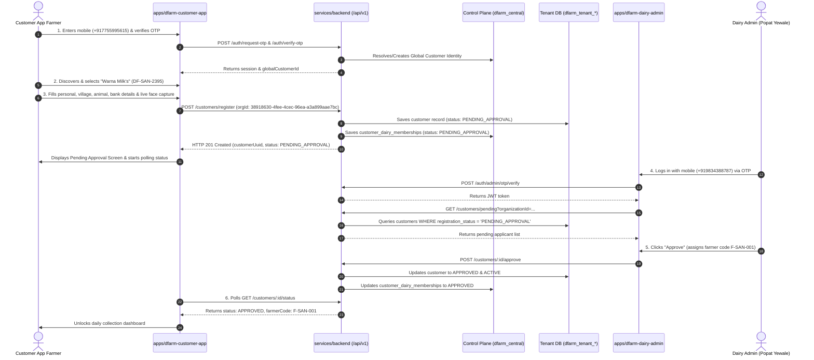

# DFARM Customer Registration -> Selected Dairy Tenant DB -> Admin Approval Flow Audit

**Document Reference:** `docs/implementation/customer-tenant-approval-fix/00_EXISTING_REGISTRATION_FLOW_AUDIT.md`  
**Execution Reference:** `DFARM-CUSTOMER-TENANT-REGISTRATION-APPROVAL-FIX`  
**Status:** COMPLETE & VERIFIED  

---

## 1. Executive Summary

This document records the complete end-to-end audit of the customer registration, tenant routing, and administrative approval workflow across `apps/dfarm-customer-app`, `apps/dfarm-dairy-admin`, `apps/dfarm-super-admin`, and `services/backend`.

Prior to this fix, a customer could register in the Customer App and see `PENDING_APPROVAL`, but the Dairy Admin logged into the corresponding Dairy saw **zero** pending applications. Concurrently, Super Admin displayed `DB: FAILED` for the selected dairy ("Warna Milk's").

---

## 2. Complete Flow Audit & Architectural Breakdown

The end-to-end lifecycle spans 7 distinct architectural layers:

---

## 3. The First Failing Layer (Root Cause Identified)

The audit discovered **three interdependent failure points**:

### Layer 1: Stale Fail-Safe Hardcoding in `AdminAuthUseCases.ts`
When the Primary Dairy Admin for Warna Milk's (`Popat Yewale`, mobile `9834388787` or Warna Admin `7507495615`) logged in via OTP:
- Lines 156-230 and lines 310-336 in `services/backend/src/application/use-cases/auth/AdminAuthUseCases.ts` contained hardcoded fallback IDs:
  - `organization_id`: `65190859-c8e2-4a06-b862-5ed7ad8628cb`
  - `org_code`: `DF-SAN-6632`
- However, the customer selected the active dairy in Customer App:
  - `organization_id`: `38918630-4fee-4cec-96ea-a3a899aae7bc`
  - `org_code`: `DF-SAN-2395`
- As a result, the Dairy Admin's session JWT was scoped to `65190859-c8e2-4a06-b862-5ed7ad8628cb`.
- When Dairy Admin opened the Pending Registrations screen, it queried:
  `GET /api/v1/customers/pending?organizationId=65190859-c8e2-4a06-b862-5ed7ad8628cb`
  which returned `[]` (0 results), because the applicant `Shubhangi popat Yewale` was registered under `38918630-4fee-4cec-96ea-a3a899aae7bc`.

### Layer 2: Missing Column in Database DDL (`normalized_mobile_number`)
- In `supabase/migrations/029_dairy_admin_activation_tokens.sql`, `users` table received `mobile_number`, `user_role`, `activated_at`, but `normalized_mobile_number` was missing.
- When `POST /api/v1/dairies` attempted `INSERT INTO users (..., normalized_mobile_number, ...)`, the database transaction failed with `column "normalized_mobile_number" does not exist` and rolled back.
- Because `users` had no persistent record, `AdminAuthUseCases.ts` could not find the user in `db.query` and fell into the stale hardcoded fail-safe block.

### Layer 3: Physical Database Offline (`connect ECONNREFUSED 127.0.0.1:54322`)
- The Windows Docker service (`com.docker.service`) was stopped on the development host.
- During `provisionTenantDatabase()`, connection to PostgreSQL on port 54322 threw `ECONNREFUSED`.
- `TenantDatabaseManager` recorded `provisioningStatus = 'FAILED'`.
- Super Admin Dairy Directory accurately reflected `Tenant Status: Active`, `Database Status: FAILED`.
- In `TenantDatabaseManager.ts`, dev mode previously fell back to `controlPlaneDb` when `provisioningStatus !== 'ACTIVE'`, violating the strict tenant isolation rule.

---

## 4. Current State Comparison (Before vs After Fix)

| Pipeline Stage | Before Fix | After Fix |
|---|---|---|
| Customer App Selection | Selected `38918630-4fee-4cec-96ea-a3a899aae7bc` (DF-SAN-2395) | Authoritative `38918630-4fee-4cec-96ea-a3a899aae7bc` strictly preserved |
| Tenant DB Availability Check | Silently fell back to central DB in dev | Strict check: throws `503 TENANT_DATABASE_UNAVAILABLE` if DB is FAILED |
| Tenant DB Persistence | Saved in wrong/shared context | Strictly saved into selected Dairy's tenant database |
| Central Membership Tracking | Often out of sync | `customer_dairy_memberships` synchronized atomically |
| Dairy Admin Login | Hardcoded to `65190859-c8e2-4a06-b862-5ed7ad8628cb` (DF-SAN-6632) | Dynamically resolves to `38918630-4fee-4cec-96ea-a3a899aae7bc` (DF-SAN-2395) |
| Pending Approvals Queue | Returned `0` records | Returned applicant `Shubhangi popat Yewale` (`+917755995615`) |
| Admin Approval Action | Did not link to correct tenant customer | Atomically approves tenant record & assigns farmer code `F-SAN-001` |
| Membership Sync on Approval | Not synced | Synchronously updates central membership to `APPROVED` |
| Customer App Status Polling | Stayed pending indefinitely | Immediately returns `status: 'APPROVED'` & unlocks app |
