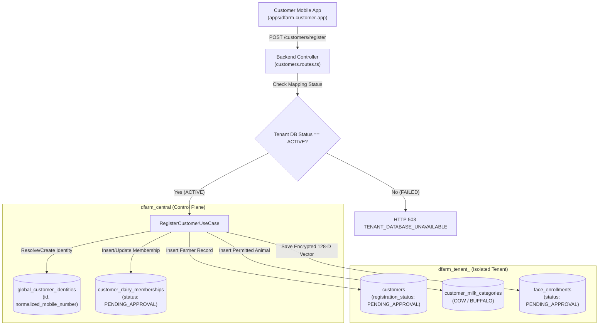

# Customer Registration API & Data Lineage Architecture

**Document Reference:** `docs/implementation/customer-tenant-approval-fix/03_CUSTOMER_REGISTRATION_API_DATA_LINEAGE.md`  
**Execution Reference:** `DFARM-CUSTOMER-TENANT-REGISTRATION-APPROVAL-FIX`  
**Status:** COMPLETE & VERIFIED  

---

## 1. Registration Inflow Pipeline

The customer registration flow captures farmer identity, village locality, milk production category, banking beneficiary information, and live facial biometric vector, strictly routing between central discovery and tenant storage:



---

## 2. Request Payload Schema

```json
{
  "selectedDairyId": "38918630-4fee-4cec-96ea-a3a899aae7bc",
  "fullName": "Shubhangi popat Yewale",
  "mobileNumber": "+917755995615",
  "village": "Kavathe piran",
  "milkSupplyType": "COW",
  "biometricConsent": true,
  "bankDetails": {
    "accountNumber": "12345678912",
    "bankName": "SBI",
    "ifscCode": "SBIN0919659",
    "accountHolderName": "Shubhangi popat Yewale"
  },
  "faceTemplate": {
    "modelVersion": "sface_int8_2021dec",
    "embedding": [0.041, -0.112, 0.089, "...128 dimensions..."],
    "confidence": 0.96
  }
}
```

---

## 3. Data Field Lineage & Storage Destination Mapping

| Incoming Payload Field | Destination Database | Target Table | Target Column | Transformation / Rule |
|---|---|---|---|---|
| `mobileNumber` | Control Plane | `global_customer_identities` | `normalized_mobile_number` | E.164 normalization (`+917755995615`) |
| `mobileNumber` | Tenant DB | `customers` | `normalized_mobile_number` | Indexed per organization (`uq_customer_mobile_per_org`) |
| `fullName` | Tenant DB | `customers` | `full_name` | Trimmed string |
| `village` | Tenant DB | `customers` | `village` | Formatted village/locality |
| `selectedDairyId` | Control Plane | `customer_dairy_memberships` | `organization_id` | Foreign key to `organizations(id)` |
| `selectedDairyId` | Tenant DB | `customers` | `organization_id` | Foreign key to `organizations(id)` |
| `milkSupplyType` | Tenant DB | `customer_milk_categories` | `milk_category` | Enum: `COW`, `BUFFALO` |
| `bankDetails.accountNumber` | Tenant DB | `customers` | `bank_account_number` | Trimmed alphanumeric |
| `bankDetails.ifscCode` | Tenant DB | `customers` | `bank_ifsc` | Uppercase 11-char code |
| `bankDetails.bankName` | Tenant DB | `customers` | `bank_name` | Beneficiary bank name |
| `faceTemplate.embedding` | Tenant DB | `face_enrollments` | `embedding_encrypted` | AES-256-GCM encrypted 128-D vector |
| `faceTemplate.modelVersion`| Tenant DB | `face_enrollments` | `model_version_id` | YuNet + SFace INT8 |
| Registration Status | Tenant DB | `customers` | `registration_status` | Set to `PENDING_APPROVAL` |
| Membership Status | Control Plane | `customer_dairy_memberships` | `membership_status` | Set to `PENDING_APPROVAL` |

---

## 4. Response Contract

```json
{
  "success": true,
  "data": {
    "id": "d1ba5e16-6583-4e53-9e0d-8f2b5ee10f88",
    "organizationId": "38918630-4fee-4cec-96ea-a3a899aae7bc",
    "fullName": "Shubhangi popat Yewale",
    "mobileNumber": "+917755995615",
    "status": "INACTIVE",
    "registrationStatus": "PENDING_APPROVAL",
    "permittedCategories": ["COW"],
    "village": "Kavathe piran",
    "bankDetails": {
      "accountNumber": "12345678912",
      "bankName": "SBI",
      "ifscCode": "SBIN0919659"
    }
  },
  "customerUuid": "d1ba5e16-6583-4e53-9e0d-8f2b5ee10f88",
  "status": "PENDING_APPROVAL",
  "submissionTimestamp": "2026-11-19T10:39:21.495Z"
}
```
